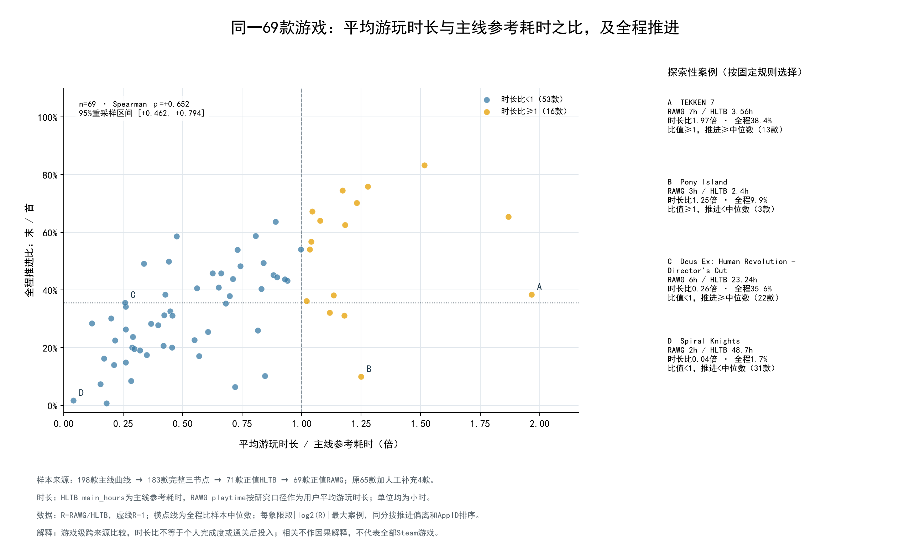
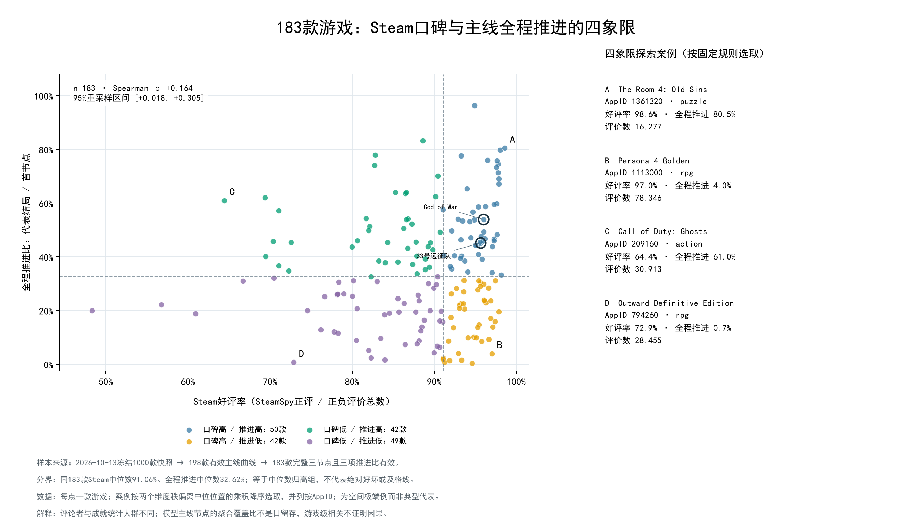
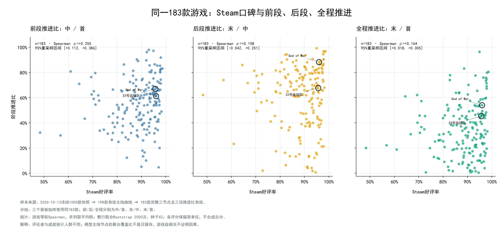

# 基于 Steam 成就的主线推进与玩家投入分析

课程项目分析报告 · 初稿供审核  
作者：刘宇翔（LYX）  
整理日期：2026-10-17  
分析数据版本：`wwh5-2026-10-13T10:26:09.722887+00:00`

任务4统计更新：2026-10-20（69款）；其余专题保持原冻结结果。

## 摘要

本项目围绕“玩家更愿意持续推进什么样的游戏”展开分析。由于现有数据以游戏级成就解锁率为主，无法直接观察同一名玩家何时进入、何时退出或是否再次游玩，本报告把研究对象具体化为**主线节点覆盖、阶段推进比例及其与游戏属性的关联**，以此描述用户粘性的一个可观测侧面。

研究以小组已完成分类的热门游戏快照为基础：冻结范围为 1,000 款游戏，其中 198 款满足既定主线曲线条件，183 款能够形成完整的首、中、末三个节点。基于这一共同底表，依次完成主线指标构建、类型比较、全流程曲线分析、游玩时长分析、口碑分析和相对同类参照分析。其中，时长专题使用 69 款同时具备合规主线指标、HLTB 参考耗时与正值 RAWG 平均游玩时长的游戏；三种评分的公平比较使用 142 款共同样本。

结果表明：第一，完整三节点样本的前段、后段、全程推进比中位数分别为 **56.95%、67.12%、32.62%**，前段与后段需要分开观察。第二，主类型之间存在明显的描述性差异，但多标签口径会改变成员构成和差异幅度，不能把类型排名直接解释为稳定的设计优劣。第三，两款游戏可以具有几乎相同的全程推进比，却在完全不同的位置出现主要落差，因此单一终点比值不足以解释过程。第四，在 69 款时长样本内，平均游玩时长与主线参考耗时之比，与全程推进比呈中等正向秩关联（Spearman ρ＝0.652），相关点估计高于绝对游玩小时数的 0.289；但尚不足以证明因果关系或指标优越性。第五，好评率与主线推进表现并不等价；在相近玩法的参照下，也能观察到同一游戏绝对表现和相对表现的差别。

本报告的贡献是形成一套可追溯、可解释的分析框架，将“是否推进”“在哪一段出现落差”“投入是否与内容长度相匹配”“口碑是否对应推进”“相对同类表现如何”分开回答，而不将这些不同问题强行合并为一个用户粘性总分。

## 一、研究目标与任务关系

### 1.1 从“用户粘性”转向可观察的问题

“粘性”通常包含持续游玩、重复进入、投入时长和完成内容等不同含义。当前数据库没有逐玩家的连续游玩日志，也没有按进入日期划分的玩家队列，因此本项目不能计算真实的次日、七日留存或玩家流失率。现有条件下，较可靠的切入点是观察：能够解锁某个早期主线节点的玩家群体，相对于后续节点的覆盖，呈现怎样的聚合差异。

研究拆分为以下六项任务。任务 1 建立共同指标；任务 2—5 分别提供类型、过程、时长和口碑解释；任务 6 把单款游戏放回可比的玩法环境中观察。它们构成相互补充的证据，而不是六次相互独立的验证。

| 任务 | 研究问题 | 主要处理 | 主要产出 |
|---|---|---|---|
| 1. 主线指标 | 到达早期节点后，后续覆盖相对保留多少？ | 按剧情数组顺序选首、中、末节点，计算三个覆盖率和三个推进比 | 198 款指标底表、183 款完整三节点样本 |
| 2. 类型比较 | 不同玩法的推进形态有何差异？ | 主类型互斥分组，多标签重叠分组，增加样本口径对照 | 类型覆盖、推进、分布及标签对照图 |
| 3. 全流程 | 同样的全程推进，是否经历不同的节点落差？ | 保留所有有效主线节点，计算相邻落差、相对位置及案例配对 | 完整曲线、相邻节点表与对比案例 |
| 4. 时长与投入 | 绝对游玩时长和相对内容长度，哪个更贴近推进表现？ | 联结 RAWG 与 HLTB，比较绝对时间和三种耗时比值 | 69 款共同样本、相关表及参考耗时比较图 |
| 5. 口碑 | 玩家好评和媒体评分是否对应更高的主线推进？ | 四象限、三阶段相关、共同样本评分比较、多标签探索 | 183 款 Steam 分析、142 款三评分比较及案例 |
| 6. 同类参照 | 某款游戏相对于相似玩法，表现如何？ | 多标签 Jaccard 筛选参照，比较阶段差和参照分布 | 181 款有效主参照结果、完整参照名单及条件对照 |

分析实现分布于 `analysis/T1Core` 和 `analysis/T2Sum`。`T0Pre` 负责复现小组已有分类分析、冻结共同基础，不应重复计为本报告新增的独立分类工作。现有结果已整合为 [WEB交互简报](../WEB/index.html)，支持1—5款游戏联动、完整过程分组及各专题口径切换；它是本报告的本地展示入口，不新增研究样本、统计实验或数据库写入，尚未公网部署。打开/构建见 [WEB说明](../WEB/README.md)，分析命令和页面交接分别见 [INSTRUCT.md](INSTRUCT.md) 与 [DEPLOY.md](DEPLOY.md)。

### 1.2 人工审核与本报告的采用范围

**重点案例主线节点的人工审核已由 WWH 完成**，本报告依据项目负责人刘宇翔在 2026-10-17 本轮讨论中的确认采用该状态。当前可读材料尚未附逐项审核清单或审核后修订版本，因此这一确认不扩大为“全部 198 款或 183 款均已逐项人工核验”，也不据此推定冻结数据库的数值已经发生修改。旧结果表中的 `not_individually_reviewed` 等字段属于生成当时的记录，不能用来否定本轮确认。

人工确认能够支撑对重点案例节点含义的采用，但不同游戏的“结局”仍可能代表普通结局、特定路线、对局胜利或更高完成要求。报告保留这些语义差别；审核完成并不意味着所有末节点都天然等价。

## 二、数据基础、样本范围与来源

### 2.1 使用了哪些数据库和表

当前分析采用借入的 WWH 冻结数据库为主体，LYX 原数据库只提供时长补充。两个数据库均按只读方式使用。

| 数据文件与数据表 | 本报告实际使用的内容 | 对应作用 |
|---|---|---|
| `NewDB/wwh5.sqlite3`：`games` | `appid`、名称、原始 `payload` 中的 SteamSpy 正负评价数、RAWG 时长及评分、源时间 | 游戏身份、好评率、游玩时长与评分 |
| 同库：`achievements` | `local_id`、`display_name`、`description`、`percent` | 定位成就原文和解锁覆盖 |
| 同库：`achievement_labels` | 成就分类、范围等已处理标签 | 复现基础分析，验证节点与原始记录的对应 |
| 同库：`story_labels` | `payload.checkpoints` 数组、阶段、路线、置信度、前置关系标记 | 主线顺序和节点筛选 |
| 同库：`game_labels` | `payload.gameplay` 的首标签与完整标签集合 | 主类型、多标签和相似玩法参照 |
| 同库：`model_calls`、`metadata` | 成功调用关联、数据版本、输入指纹 | 来源一致性与可追溯校验 |
| `database/achievements.sqlite`：`games`、`games_time` | `appid`、名称及 `main_hours`、`extra_hours`、`completionist_hours`，并核对 RAWG 时长副本 | 按 AppID 联结 HLTB 主线、主线＋支线、全收集参考耗时 |

本轮分析**没有使用**旧库的 `achievement_types`、旧主线排序、价格、`guide_difficulty` 或旧 `games_rate` 作为解释变量。特别是本报告的 Steam 好评率来自 WWH 快照中的 SteamSpy 正负评价数，而不是旧库的 `review_percent`。数据库结构和来源分别详见 [DATABASE_WWH.md](DATABASE_WWH.md) 与 [DATABASE_LYX.md](DATABASE_LYX.md)。

### 2.2 样本如何从 1,000 款收缩到各专题

冻结的 1,000 款为 2026 年以前发售、类型为游戏的热门样本，按 SteamSpy 正负评价数之和降序、AppID 升序确定范围。它不是 Steam 全体游戏的随机样本，也不能与 LYX 早期按其他来源评价数生成的 1,000 款清单视为同一个集合。

| 层次 | 游戏数量 | 含义及使用位置 |
|---|---:|---|
| 冻结候选范围 | 1,000 | WWH 原始分析范围；库中包含 72,616 条原始成就 |
| 已有成就分类覆盖的游戏 | 982 | 基础分类分析可用范围；库中 `achievement_labels` 为 69,834 条记录 |
| 有效主线曲线 | 198 | 通过既定主线节点、路线、置信度及顺序/覆盖率质量规则 |
| 首、中、末完整 | 183 | 主要的阶段、类型、口碑及同类参照分析范围 |
| 只有两个节点 | 15 | 可计算首末比；不虚构中位节点，不进入完整三阶段比较 |
| 完整三节点且 HLTB 主线耗时为正（含人工补充） | 71 | 长度补充、时长匹配的候选范围 |
| 上述 71 款中 RAWG 时长也为正 | 69 | 时长专题三个参考耗时比值的共同范围 |
| 完整三节点且三种评分同时有效 | 142 | Steam、Metacritic、RAWG 评分的公平比较范围 |
| 完整三节点且有效同类参照不少于 5 款 | 181 | 同类主参照可报告统计的范围 |

来源：[基础复现结果][S0]、[主线指标底表][S1]、[时长资格表][S4E]、[评分覆盖表][S5C]、[同类覆盖表][S6C]。

198 款中包含 120 款统一结局口径和 78 款多结局代理口径；完整三节点的 183 款分别为 107 款与 76 款。后者还有 170 款满足“唯一且位于首位的显式 start 节点”条件，作为口径对照使用，没有据此替换主要样本。

从 1,000 到 198 的缩减主要反映曲线是否适合当前计算，并不等于其余游戏“没有主线”或“玩家没有粘性”。同时，曲线筛选本身排除了不满足既定单调性条件的情形，因此不能把入选后整体单调下降再当作一项独立发现。

时长缺失同样不能直接解释成外部网站没有数据。198 款中只有 161 款能在旧 LYX 游戏库中对应，另外 37 款不在该旧库范围内；联结覆盖、导入范围和源数据缺失都会影响最终的 69 款样本。

### 2.3 数据版本与统计原则

本报告使用已经生成并核验的冻结分析产物，不将“报告整理日期”解释为源数据采集日期。SteamSpy、RAWG 等各源的原始时间保留在对应表内，跨平台信息也并非同一时刻、同一批用户的同步观测。

分析以游戏为单位、各游戏等权。类型汇总先在每款游戏内计算指标，再取组内中位数，不按评价数、玩家数或成就数量加权。类型与相关分析采用 2,000 次游戏级 Bootstrap、固定随机种子 42；类型组不少于 5 款才进入主图，不少于 10 款才报告区间。区间表示当前游戏集合重采样的波动，不能消除非随机抽样的偏差。

相关分析使用 Spearman 秩相关，衡量变量在游戏间的单调关联，允许重复值；它既不是解释方差比例，也不证明一个变量导致另一个变量。探索中涉及多个分组和多组相关，未统一进行多重检验校正，本报告据此控制结论强度。

## 三、任务 1：把主线推进拆成可解释指标

### 3.1 节点选择：顺序来自剧情数组

分析沿用 `story_labels.payload.checkpoints` 的原始数组位置，不按成就 API 名、成就编号或解锁率重排剧情。筛选合规的共同路线节点后，保留非结局节点；若存在多个合规结局，取解锁率最高的一个作为代表结局，若相同则保留原数组最先出现者。替代结局不能简单相加，因为同一玩家可能取得多个结局。

设合并代表结局后的序列有 n 个节点：首节点为第一个有效节点，末节点为代表结局；n≥3 时，中节点取数组的中位位置，零起始索引为 `(n-1)//2`，偶数长度取靠前的那个中位节点。n＝2 时不设中节点。

这里的“中”是**选中节点序列的位置中点**，不是模型标为 middle 的节点，也不是剧情或游玩时间走到一半。它实现了跨游戏的一致选点规则，但不同游戏的成就设置密度仍会影响其内容含义。实现依据：[prepare_metrics.py](../analysis/T1Core/prepare_metrics.py)。

### 3.2 六个核心指标及解释

先把原始百分数转换为 0—1 的覆盖率，记首、中、末节点分别为 p_s、p_m、p_f。

| 指标 | 计算 | 主要回答什么 | 阅读限制 |
|---|---|---|---|
| 首节点覆盖率 | p_s | 原始成就统计口径下，覆盖到选定首节点的比例 | 不等于安装率、启动率或已开始游玩的精确人数占比 |
| 中节点覆盖率 | p_m | 覆盖到数组中位节点的比例 | 不等于完成一半游戏 |
| 末节点覆盖率 | p_f | 覆盖到代表末节点的比例 | 是否等于普通通关取决于该节点要求 |
| 前段推进比 | p_m / p_s | 中节点覆盖相对首节点覆盖保留多少 | 是聚合覆盖比，不是按时间跟踪玩家的留存 |
| 后段推进比 | p_f / p_m | 末节点覆盖相对中节点覆盖保留多少 | 受中节点与结局要求共同影响 |
| 全程推进比 | p_f / p_s | 代表末节点相对首节点的覆盖比例 | 归一化起点不同于直接比较 p_f |

分母缺失或不大于 0 时，结果为空；分子为 0 是合法值，不按缺失处理。完整三节点游戏满足“前段推进比 × 后段推进比＝全程推进比”。**这一等式仅在同一游戏内部成立**：组内各列分别计算的中位数不能相乘或互除。

只有在同一统计总体、节点具有包含关系等条件成立时，覆盖比才具有相应的条件完成比例含义。本项目没有直接观测逐玩家节点链，因此正式行文使用“推进比”，不把它改称真实留存率或流失率。

### 3.3 总体表现：前后段呈现不同的覆盖保留

为避免混用样本，下表六项都在同一批 183 款完整三节点游戏中计算。

| 指标 | 游戏级中位数 |
|---|---:|
| 首节点覆盖率 | 81.60% |
| 中节点覆盖率 | 41.80% |
| 代表末节点覆盖率 | 22.70% |
| 前段推进比 | 56.95% |
| 后段推进比 | 67.12% |
| 全程推进比 | 32.62% |

来源：[game_metrics.csv][S1]，筛选 `metric_status=complete_three_point`，分别取六个字段中位数。作为补充，全部 198 款首末可用游戏的全程推进比中位数为 33.98%，不能将其与上表的前后段拼成一条“共同样本曲线”。

结果说明，在当前选定节点体系中，后段的相对覆盖保留通常高于前段。若先逐游戏计算“后段－前段”，再对 183 个差取中位数，结果为 **+11.70 个百分点**；它与两个组中位数相减得到的差不是同一个统计量。这与“到达较后节点的群体已具有更强推进意愿”相容，但也可能受到首节点门槛、节点间跨度及路线定义影响，不能由此断言玩家真实流失集中发生在前半段。

以 God of War（AppID 1593500）为例，选中节点为 The Journey Begins、Hello, Old Friend、Last Wish，覆盖率分别为 87.0%、53.2%、46.9%，对应前段 61.15%、后段 88.16%、全程 53.91%。该例清楚地区分了“末节点覆盖 46.9%”和“相对首节点的全程推进 53.91%”两个问题。节点名称与原数组索引可在 [checkpoints.csv][S1N] 逐项追溯。

基础分类还提供一个背景观察：T0 复现中，先取每款游戏各类成就的解锁率中位数，再跨游戏取均值，主线、支线、收集、挑战分别为 29.33%、19.36%、12.74%、10.96%，对应有效游戏数为 914、789、816、870。主线覆盖较广、额外目标覆盖较窄，与内容要求层次不同相容；但四组游戏不完全相同，成就数量与要求也不同，**不能把它解释为同一批玩家从主线转向支线、收集和挑战的转化率**。[来源：T0 `metrics.categories` 相关统计，见基础复现结果][S0]。

## 四、任务 2：玩法类型与阶段推进的关联

### 4.1 为什么同时保留主类型和多标签

游戏通常同时具有动作、冒险、角色扮演等多种玩法。主分析取已有 `gameplay[0]` 为主类型，使分组互斥、便于概括；补充分析使用完整玩法标签，同一游戏可以进入多个组。两者回答不同问题：前者描述“主要归为这一类型的游戏”，后者描述“具有这一玩法特征的游戏”。重叠标签组人数不能相加，也不是相互独立的样本。

### 4.2 主类型结果：差异不只在最终比例，也在阶段形态

| 主类型 | n | 首覆盖 | 中覆盖 | 末覆盖 | 前段推进 | 后段推进 | 全程推进 |
|---|---:|---:|---:|---:|---:|---:|---:|
| 动作 | 90 | 81.8% | 39.8% | 24.1% | 55.1% | 70.2% | 35.4% |
| 角色扮演 | 22 | 80.3% | 35.1% | 18.6% | 60.0% | 61.4% | 25.1% |
| 冒险 | 21 | 81.9% | 58.0% | 46.5% | 69.3% | 86.5% | 58.8% |
| 模拟 | 16 | 78.6% | 37.4% | 8.4% | 48.9% | 32.7% | 12.6% |
| 平台跳跃 | 13 | 79.9% | 38.6% | 22.6% | 56.6% | 63.1% | 31.1% |
| 策略 | 9 | 81.6% | 39.4% | 25.4% | 61.8% | 64.5% | 30.6% |
| 解谜 | 7 | 90.9% | 72.6% | 66.2% | 82.2% | 90.3% | 73.3% |

表内均为游戏级中位数。来源：[group_summary.csv][S2]，完整三节点、主类型分组。生存、竞速、节奏、体育组分别只有 2、1、1、1 款，保留在结果表内，不进入主要类型结论。

**第一项发现是当前主类型样本中的量级差异。** 解谜组全程推进中位数为 73.3%，冒险为 58.8%，模拟为 12.6%。不过解谜只有 7 款，策略只有 9 款，不能以其点值排名替代稳定性判断。在满足区间报告条件的组中，冒险全程推进中位数的 95% Bootstrap 区间约为 46.6%—70.1%，模拟约为 6.7%—20.8%；区间描述的是当前集合重采样波动，不是已经控制其他游戏属性的类型效应。

**第二项发现是类型间的阶段形态不同。** 动作、冒险组的后段中位数高于前段，而模拟组后段为 32.7%，低于前段 48.9%。这提示同样的低全程结果可以由不同阶段共同形成，分析应进一步定位节点跨度和末节点要求。它尚不能解释为模拟游戏玩家更不喜欢游戏，或者某种玩法必然带来后期退出。

### 4.3 多标签对照：类型定义本身会改变结论幅度

| 玩法标签 | 主类型 n | 主类型全程中位数 | 完整标签 n | 完整标签全程中位数 |
|---|---:|---:|---:|---:|
| 动作 | 90 | 35.4% | 130 | 34.3% |
| 冒险 | 21 | 58.8% | 146 | 35.9% |
| 解谜 | 7 | 73.3% | 38 | 46.7% |
| 角色扮演 | 22 | 25.1% | 88 | 30.3% |
| 模拟 | 16 | 12.6% | 56 | 22.4% |

来源：[类型口径对照表][S2S]及[成员表][S2M]；完整三节点、全程推进指标。

冒险标签从主类型的 21 款扩大到 146 款后，中位数下降约 22.9 个百分点；解谜从 7 款扩大到 38 款后下降约 26.6 个百分点。动作组变化仅约 −1.1 个百分点。这个差别说明，部分“类型差异”与主类型所代表的游戏组合有关，不能把一项混合玩法标签当作单一、纯净的处理条件。

因此，本专题可以形成“类型与推进有关联，且值得进一步分层”的结论；不支持“选择某类玩法就能提高多少推进率”的设计因果结论。网页和报告应同时展示 n、主类型/多标签口径及组内分布，避免只呈现一张排名图。

## 五、任务 3：从三个代表节点展开到完整推进过程

### 5.1 方法与指标

任务 1 适合概括，但可能遗漏中间的集中落差。本专题保留 198 款游戏合并代表结局后的完整序列，共 1,741 个节点、1,543 对相邻节点；其中 172 款至少有 4 个节点，133 款至少有 6 个节点。[来源：完整过程表][S3]、[相邻节点表][S3E]。

为了把节点数不同的游戏放在一张图中，横轴采用 `(节点位置-1)/(节点数-1)`，表示相对节点位置；纵轴可表示相对首节点的覆盖。横轴 0.5 不代表游玩时长或剧情完成 50%，折线插值也不表示真实连续轨迹。

对于相邻节点 a、b，分别计算：

- 相邻推进比＝b 的覆盖率 / a 的覆盖率；
- 相对落差＝1－相邻推进比，描述相对前一节点覆盖的减少比例；
- 绝对覆盖落差＝100×（a 的覆盖率－b 的覆盖率），单位为百分点。

相对落差大与绝对落差大不是同一件事。节点设置疏密也会影响“最大落差出现在何处”，因此这些指标主要用于过程定位和案例解释，不直接作为跨游戏的优劣榜。

### 5.2 关键案例：近乎相同的全程推进，呈现不同的过程

自动配对限定：至少 6 个节点、相同主类型与结局口径、节点数相差不超过 2、全程推进相差不超过 3 个百分点，再依据过程形态挑选不重复案例。当前保存 63 对候选，选出 3 对。以下一对最能说明为什么不能只看终点。

| 项目 | Tom Clancy’s Splinter Cell Blacklist | Dead Cells |
|---|---:|---:|
| AppID | 235600 | 588650 |
| 节点数 | 11 | 11 |
| 首节点覆盖 | 9.6% | 92.0% |
| 末节点覆盖 | 4.2% | 40.3% |
| 前段推进比 | 54.17% | 66.52% |
| 后段推进比 | 80.77% | 65.85% |
| 全程推进比 | 43.75% | 43.80% |
| 最大相邻相对落差位置 | 第 1→2 节点 | 第 10→11 节点 |
| 该处相对落差 | 19.79% | 15.87% |
| 该处绝对覆盖落差 | 1.9 个百分点 | 7.6 个百分点 |

来源：[game_profiles.csv][S3]（AppID 235600、588650）、[adjacent_nodes.csv][S3E]及[候选配对表][S3C]。全程差约 0.05 个百分点。

两款游戏终点比值几乎相同，但前者的最大相邻相对落差位于最前一对节点，后者位于最后一对节点。前者后段比前段保留更多覆盖，后者两个阶段则较为接近。**全程推进比相近，只说明归一化后的终点接近，并不说明玩家经历了同样的过程。**

同时，两款游戏首节点覆盖率相差很大；这提醒读者，归一化会弱化起点覆盖差异，不能因此把两条曲线理解成同样一批、同等规模的已进入玩家。最大相对落差较大的游戏，在对应节点上的绝对百分点差反而更小，也说明两种落差应一并呈现。

案例能够定位“值得解释的节点”，但仅凭覆盖差无法断定具体原因是难度、剧情质量还是内容设计。那些机制需要额外信息。选中案例亦不代表当前样本中这种形态的出现频率。

## 六、任务 4：游玩时长与内容长度是否匹配

### 6.1 共同样本与三个参考耗时

本专题限定 69 款共同游戏，RAWG `playtime` 按项目约定作为游戏级平均游玩时长纳入分析；HLTB 分别提供主线、主线＋支线、全收集参考耗时。这些是不同平台和统计群体的汇总，不能当作 Steam 同一批玩家的精确时间记录。

对每款游戏计算三个无量纲比值：

`R主线＝playtime/main_hours`  
`R主支线＝playtime/extra_hours`  
`R全收集＝playtime/completionist_hours`

它们表达平均投入相对于不同内容目标参考耗时的量级，**不是个人游戏完成百分比**。R≥1 不能证明普通用户已经通关，也不能把超出部分直接解释为通关后投入。

69 款游戏的 RAWG 时长中位数为 6.00 小时，主线参考耗时中位数为 12.65 小时，逐游戏计算后的 R主线中位数为 0.651。这里不能直接用两个时长中位数相除来替代“比值的中位数”。RAWG 时长在该集合中只有 22 个不同的整数值，相关分析保留了这些并列值。[来源：时长汇总][S4S]。

### 6.2 相关结果：相对投入比绝对小时数更值得关注

下表每行均为同一批 69 款，括号为游戏级 Bootstrap 的 95% 区间。

| 时间变量 | 与前段推进的 ρ | 与后段推进的 ρ | 与全程推进的 ρ |
|---|---:|---:|---:|
| 主线参考耗时 | -0.421［-0.617，-0.196］ | -0.299［-0.538，-0.029］ | -0.364［-0.587，-0.101］ |
| RAWG 平均游玩时长 | +0.117［-0.127，+0.353］ | +0.268［+0.016，+0.503］ | +0.289［+0.041，+0.511］ |
| 平均时长 / 主线参考耗时 | +0.606［+0.403，+0.755］ | +0.590［+0.385，+0.757］ | +0.652［+0.462，+0.794］ |

来源：[time_correlations.csv][S4C]。更新后RAWG时长与全程比的95%区间约为[+0.041,+0.511]，相关仍较弱，不能将其描述为强关系。

在当前样本中，绝对游玩时长较长并不一定对应较高推进，因为内容本身也可能更长。主线参考耗时与全程推进呈负向关联，平均时长与参考耗时之比则呈正向关联。由此可以提出一个较具体的解释：**把投入放在内容需求的尺度上观察，比孤立地看“玩了多少小时”更贴近本项目的问题。**

但这仍是描述性比较。R 的分母本身已与推进负相关，除法会把长度信息带入指标；本专题没有完成相关系数差的专门检验、独立样本预测或混杂控制，因此不能证明归一化变量具有更好的预测能力，更不能得出“缩短游戏就一定提高粘性”。

### 6.3 换用主线＋支线、全收集参考，关系是否仍存在

| 参考口径 | n | 比值小于 1 的游戏 | 比值至少为 1 的游戏 | 与全程推进的 ρ［95% 区间］ |
|---|---:|---:|---:|---:|
| 平均时长 / 主线耗时 | 69 | 53 | 16 | +0.652［+0.462，+0.794］ |
| 平均时长 / 主线＋支线耗时 | 69 | 64 | 5 | +0.652［+0.457，+0.805］ |
| 平均时长 / 全收集耗时 | 69 | 67 | 2 | +0.630［+0.442，+0.779］ |

来源：[主线时长共同表][S4]与[补充参考相关表][S4R]。三个分母均在同一批 69 款上比较，不因数据缺失换样本。

三个参考下关联方向一致，说明观察并非仅存在于单一参考口径；但这些比值共享 RAWG 分子，参考耗时彼此也有关联，不能将其当作三个独立研究。比值小于 1 的游戏随目标扩大而增多，说明按这些聚合量比较时，平均时长往往没有达到对应目标的参考耗时；这不等于“多少比例的玩家没有完成该目标”。

以 Hollow Knight（AppID 367520）为例，RAWG 为 7 小时，HLTB 主线 26.94 小时、主线＋支线 41.37 小时、全收集 62.37 小时，三个比值约为 0.260、0.169、0.112，全程推进为 34.22%。同样的投入放到不同完成目标中有不同含义，不能只凭“7 小时”判断投入高低。原始联结见 [duration_cohort.csv][S4]及[reference_cohort.csv][S4RC]；补充图见 [14 号图](../analysis/T1Core/figures/14_extra_time_ratio.png)、[15 号图](../analysis/T1Core/figures/15_completionist_time_ratio.png)。

## 七、任务 5：口碑是否等于主线推进

### 7.1 数据覆盖与公平比较

Steam 好评率按 `positive/(positive+negative)` 计算。183 款均有效；Metacritic 有效 142 款；RAWG 评分有效 174 款，另外 4 款缺失、5 款为 0，后者不按有效评分参与相关。三种评分共同有效范围为 142 款。不同评分有不同人群与量表，比较时不能把数值尺度直接混同。

Steam 的总体分析使用 183 款；判断“哪种评分与推进关系更密切”时统一到 142 款，避免把样本变化当成评分来源差异。[来源：覆盖表][S5C]、[评分资格表][S5E]。

2026-10-20叠加本人手动搜索确认值：33号远征队Metacritic 92、RAWG 4.42；战神Metacritic 94、RAWG 4.54、RAWG评分人数5310。原140款保留，补齐这两款后共同样本为142款；33号远征队旧RAWG 4.44仍留原值字段。补充输入及逐字段来源见[评分补充CSV](../analysis/T2Sum/inputs/manual_rating_supplements.csv)，数据库未修改；未提供具体平台版本页面URL和源查询时间，不将新增评分视为2026-10-13统一快照。两款原已在Steam183款中，故Steam183统计不变，本轮仅增加图面案例标注。

### 7.2 四象限：好评与推进具有不同信息

以 183 款的 Steam 好评率中位数 91.06%、全程推进中位数 32.62% 为分界，达到分界值归为高组：

| 象限 | 游戏数 | 主要含义 |
|---|---:|---|
| 高好评、高推进 | 50 | 评价较好且相对主线覆盖保留较多 |
| 高好评、低推进 | 42 | 好评较高，但所选主线终点相对覆盖较低 |
| 低好评、高推进 | 42 | 好评低于本样本中位数，但推进并不低 |
| 低好评、低推进 | 49 | 两项均低于本样本中位数 |

“高”“低”只相对于本样本中位数，不代表固定质量标准。两个方向不一致的象限共 84 款，占 45.90%；这说明用好评率代替推进表现会遗漏相当一部分差别。该比例依赖分界选择，不是一个普遍的“口碑失效概率”。来源：[四象限统计][S5Q]，比例为本报告按 `(42+42)/183` 推导。

进一步查看完整玩法多标签，各象限的构成具有不同特征：

| 组别 | n | 含动作标签 | 含解谜标签 | 含角色扮演标签 | 含模拟标签 |
|---|---:|---:|---:|---:|---:|
| 全部样本 | 183 | 71.0% | 20.8% | 48.1% | 30.6% |
| 高好评、高推进 | 50 | 64.0% | 48.0% | 42.0% | 18.0% |
| 高好评、低推进 | 42 | 59.5% | 14.3% | 45.2% | 47.6% |
| 低好评、高推进 | 42 | 88.1% | 7.1% | 45.2% | 16.7% |
| 低好评、低推进 | 49 | 73.5% | 10.2% | 59.2% | 40.8% |

来源：[exploration_multilabel.csv][S5M]，按组别及对应玩法标签读取；同一游戏可以同时计入多列，所以行内比例不求和为 100%。

高好评、高推进组的解谜标签占比为 48.0%，相对全部样本 20.8% 更集中；高好评、低推进组的模拟占比为 47.6%，也高于背景 30.6%；低好评、高推进组则包含更多动作标签。这说明不同象限不仅反映“评价好不好”，还混合着不同玩法组合。它为类型分层提供了依据，但没有证明标签本身造成了推进差异。

### 7.3 后段面板右上角：解谜标签集中，但不能据此作因果归因

将原先从图上观察到的“右上角”明确为 Steam 好评率≥90%、后段推进比≥80%，得到 28 款游戏，其中 19 款含解谜标签，占 **67.86%**。这约为全体解谜占比的 3.27 倍；即使只和好评率≥90%的 102 款比较，后者解谜占比为 31.37%，右上角仍更集中。[来源：多标签表][S5M]、[区域分界表][S5B]。

把好评门槛在 85%、90%、95%，后段门槛在 70%、80%、90% 之间组合，九种边界中的解谜占比约为 40.68%—83.33%，均高于 20.8% 的背景；但区域样本量从 59 款缩小到 6 款。可据此说“解谜标签富集并非只出现在一个边界”，不能把这九次重叠划分视为九次独立验证，也不能把少数极高门槛结果写成普遍规律。

这一部分是看图后形成的探索，主要价值在于提出更具体的解释方向：高好评、后段推进较高的区域具有特定玩法构成，而不是只有评价数值这一种共同点。当前未进行正式交互效应检验，也没有证明短流程、谜题节奏等具体机制。

### 7.4 三种评分：正向关联总体有限，来源差异需要同样本检验

| 分析范围与评分 | n | 前段 ρ | 后段 ρ | 全程 ρ［95% 区间］ |
|---|---:|---:|---:|---:|
| 全部 Steam 有效样本 | 183 | +0.255 | +0.108 | +0.164［+0.018，+0.305］ |
| 共同样本：Steam 好评率 | 142 | +0.227 | +0.089 | +0.140［−0.030，+0.303］ |
| 共同样本：Metacritic | 142 | +0.235 | +0.188 | +0.239［+0.070，+0.392］ |
| 共同样本：RAWG 评分 | 142 | +0.276 | +0.237 | +0.295［+0.141，+0.444］ |

来源：[reputation_correlations.csv][S5R]，区分 `steam183` 与 `common142`。

Steam 好评率与推进的点估计总体为正，但关联较弱，尤其后段；183 款的后段相关区间为 −0.042—+0.251，跨越 0。也就是说，好评较高不能替代“后段覆盖保留较多”的判断。共同样本中 RAWG 评分的全程相关数值较高，但不能仅凭几个点估计的排序宣布平台优劣。

现有程序还在同一批 142 款上，对相关系数之差进行联合重采样。Steam−RAWG 的全程相关差为 −0.155，95% 区间为［−0.286，−0.033］；后段差为 −0.147，区间为［−0.275，−0.017］。这为“在此共同样本中，RAWG 评分与这两项推进指标的关联更强”提供了重采样支持。Steam−Metacritic 的全程差以及 Metacritic−RAWG 的全程差区间均跨越 0，不能作同样强度的判断。[来源：相关差表][S5D]。

这些比较仍属于多项探索，不能上升为“RAWG 更准确”或“某类评分解释了玩家行为”。评分人群选择、玩法构成、发售时间和成就要求都可能参与观察到的关系。

### 7.5 案例与辅助排序：用于解释反例，不取代指标体系

在相同主类型和结局口径、HLTB 主线耗时相近的案例中，Battlefield 1（AppID 1238840）与 POSTAL 2（223470）的参考耗时分别为 6.74、7.03 小时；后者好评率约 96.86%，高于前者的 86.49%，但前者全程推进约 63.67%，明显高于后者的 17.14%。这是一个具体反例：**好评较高与相对主线推进较高可以分离**。配对只约束有限属性，并未形成因果控制。[来源：matched_cases.csv][S5P]。

现有探索还保存了好评率与全程推进的等权秩位置分，用于筛选两方面都突出的案例。等权下前五为 The Room 4: Old Sins、Balatro、The Room、The Room Two、Firework，其中同一系列占三款；按现有并列处理规则选出的后五为 Outward Definitive Edition、Sniper Elite 3、Atomic Heart、Pathfinder: Kingmaker — Enhanced Plus Edition、Arma Reforger。后三款中的 Pathfinder、Arma 与边界外的 Dragon's Dogma 2 同分，因此“后五”不具有唯一性。完整分数、并列情况以[秩位置表][S5J]为准，节点原文另见[案例节点表](../analysis/T2Sum/output/reputation/exploration_case_checkpoints.csv)。

这个辅助排序不作为本报告的用户粘性评分或游戏质量榜。将两项权重改为 25/75 或 75/25 时，前五与等权结果均重合 4 款，但后五分别只重合 3 款、2 款，说明尾部排序对权重较敏感。末节点可能包含额外路线、模式或更高完成要求，也进一步限制了“最好、最差”的字面解释。[来源：权重对照表][S5W]。

## 八、任务 6：把单款游戏放入同类玩法中比较

### 8.1 为什么需要同类参照

类型统计回答组间差异，单游戏曲线回答过程形态，但“全程推进 35% 到底高不高”仍需要上下文。本专题基于完整三节点的 183 款，为每款目标游戏建立其他相似游戏的参照集合，不再用全体游戏统一的一个中位数评价所有对象。

参照使用完整玩法标签集合，忽略 `other`、`uncertain`，按 Jaccard＝交集数量/并集数量计算相似度。主条件要求相似度≥0.5、结局口径相同并排除自身；不根据推进结果挑参照，不按相似度给结果加权。至少 5 款参照才报告中位数、四分位数、差值和参照内百分位；不足时保留实际值和 n，相关统计留空，不自动放宽条件。

各阶段计算“目标实际推进－参照游戏同阶段中位数”。差值乘 100 后以百分点显示。百分位按“低于目标的款数＋0.5×同值款数”除以参照数计算；它只描述该目标在自己的参照集合内的位置，不是全部游戏排名。箱体的 Q1—Q3 是参照游戏间分布，不是估计误差区间。

### 8.2 覆盖与条件变化

| 参照条件 | 目标候选 | 有效参照≥5 | 参照≥10 | 参照数中位数 |
|---|---:|---:|---:|---:|
| 主条件：相似度≥0.5 | 183 | 181 | 160 | 33 |
| 相似度≥0.4 | 183 | 182 | 175 | 48 |
| 相似度≥0.6 | 183 | 157 | 120 | 14 |
| 主条件＋好评差≤10 个百分点 | 183 | 165 | 138 | 19 |
| 主条件＋主线参考耗时比≤2 | 68 | 46 | 33 | 9 |

来源：[peer_coverage.csv][S6C]。最后一行另有 115 款因缺少有效 HLTB 时长不具备目标资格，不把它们与“有时长但参照不足”的 22 款混合。

主条件下 181 款可计算，其中 91 款高于各自参照的全程中位数，90 款低于。Clustertruck（397950）只有 4 款参照，Session: Skate Sim（861650）为 0，均保留不足原因，不补零差值。

图中对角线上方表示目标高于自己的参照中位数，不意味着其末节点覆盖一定高于所有其他游戏。相似度放宽到 0.4 或收紧到 0.6 时，在共同有效目标上，差值方向分别有 170/181、150/157 保持一致，差值变动绝对值中位数分别为 1.14、1.49 个百分点；附加好评接近条件后为 161/165，变动中位数 1.14 个百分点。附加长度条件只有 46 款共同有效，42 款方向一致，变动中位数 4.80 个百分点。[来源：共同样本条件对照][S6S]。

这些结果说明，当前多数目标的相对方向在所测玩法阈值下较稳定；但长度条件改变更明显且覆盖较小。方向一致不等于统计显著，参照集合相互重叠，也不能把这些目标当作独立的重复实验。任务 5 的严格成对耗时条件为 1.25 倍，本专题为建立参照集合使用 2 倍，两者用途不同。

### 8.3 具体解读：绝对推进与相对表现是两个问题

| 游戏 | AppID | 实际全程 | 参照 n | 参照全程中位数 | 实际－参照 |
|---|---:|---:|---:|---:|---:|
| Hollow Knight | 367520 | 34.22% | 34 | 42.95% | −8.72 个百分点 |
| ELDEN RING | 1245620 | 54.00% | 46 | 38.79% | +15.21 个百分点 |
| Emily is Away | 417860 | 83.19% | 16 | 39.02% | +44.17 个百分点 |
| Sanfu（三伏） | 1880330 | 74.01% | 16 | 36.09% | +37.92 个百分点 |

来源：[peer_benchmark.csv][S6]，`config=main`，按 AppID 定位；参照成员逐款列于 [peer_membership.csv][S6M]。

Hollow Knight 的全程推进略高于 183 款总体中位数 32.62%，但低于其相似玩法参照中位数。这并不矛盾，而是比较对象改变。ELDEN RING 则在当前参照条件下具有正向差值。Emily is Away、三伏展示了更明显的正向偏离，但差值只表示选定节点和参照条件下的相对位置，并不自动归因于剧情质量或设计能力。

已有自动案例还包括 The Walking Dead: The Final Season、Pony Island 和 STEINS;GATE。对于章节覆盖、全部秘密或特定路线等原始节点要求，本报告保留原文解释，不把所有末节点统一改称普通通关。重点案例审核状态采用本报告第一节的人工作业确认；原结果表中的生成时提示仍作为追溯记录保存。

本专题属于留一同类描述基准，不是预测模型，没有回归、SHAP 或完整混杂控制。它的实际价值是让“高或低”具备可查阅的比较对象，并支持继续查看差距主要在前段还是后段。

## 九、综合讨论：当前证据能够支持什么

### 9.1 可以形成的主要结论

**结论一：主线推进应由覆盖水平、阶段比例和完整过程共同描述。** 末节点覆盖回答“覆盖到哪里”，首末比回答“相对选定起点保留多少”，前后段和完整曲线回答“差异出现在哪个位置”。三者互补，不能由单一通关百分比替代。完整样本中前段中位数低于后段，以及全程几乎相同但落差位置不同的配对案例，都支持分阶段观察的必要性。

**结论二：玩法与推进存在描述性联系，但标签定义是结论的一部分。** 主类型中冒险、解谜与模拟的推进差异较大，而完整多标签会明显改变差异幅度。因此合理的表述是“当前样本中，具有某种分类口径的游戏呈现怎样的推进分布”，而不是“某种标签天然让玩家更粘”。这也是同类参照必须使用明确标签集合与阈值的原因。

**结论三：相对内容长度的投入值得纳入解释。** 69 款共同样本中，绝对 RAWG 时长与推进的关联有限，而三个参考耗时比值与全程推进均呈正向关联。它提示在分析投入时，应同时关心游戏需要多少参考时间。但由于分母参与关系、平台群体不同和样本覆盖限制，尚不能把比值当作真实个人完成率或已验证的通用粘性评分。

**结论四：口碑与推进应并列展示。** 四象限中的不一致案例、Steam 后段关联较弱以及相近耗时的反例，都说明好评率包含不同于主线推进的信息。玩家可能对一种体验给出好评，而其所选终点覆盖仍然较低；反向情形同样存在。现有数据支持这两项指标分开衡量，不足以单独确定背后的心理或设计原因。

**结论五：相对同类位置比脱离环境的总排名更有解释价值。** 181 款能够建立有效主参照；同一游戏与总体比、与相似玩法比可能得到不同判断。公开参照名单、数量和筛选条件，比直接给予一个高低分更便于审查和解释。

### 9.2 当前尚不能下的结论

本报告不将聚合成就覆盖解释为逐玩家留存，不将节点间差直接称为真实流失人数，也不宣称类型、时长或好评率造成了推进变化。受欢迎样本的筛选、节点可比性、各源不同人群、源时间差异以及子样本缺失，都限制了向全部 Steam 游戏和全部玩家的推广。

主线并不是所有游戏唯一的内容目标。联机、重复对局、自由探索和收集等投入可能并不表现为末节点覆盖，因此较低主线推进不能直接等同于游戏没有吸引力。基础成就分类的意义在于区分这些内容要求；当前主报告重点研究主线，其余参与方式尚未形成与主线同等深度的逐游戏联合分析。

现有 `hard_ratio` 与同一套成就完成数据具有来源关联，不作为本报告独立的难度解释变量；价格方向已按项目决定移除。报告亦未建立统一用户粘性评分。保留不同指标的含义，能够避免权重任意选择和相关指标重复计分。

### 9.3 对项目展示与后续分析的意义

展示上宜形成“共同背景—单款定位—过程解释”的顺序：先呈现类型、时长、口碑的固定总体背景，再允许选择 1—5 款游戏，查看其六项指标、完整曲线及同类参照差。选择游戏只影响高亮和案例面板，不重新定义总体样本或参照范围；数据不足时明确显示原因。

后续值得补充的是把已完成重点案例人工审核的明细及版本与当前结果绑定，便于报告读者追溯；如需回答更强的问题，再考虑扩展 HLTB 覆盖、区分不同末节点目标或获取真正的玩家级时间数据。这些是证据深化方向，不影响本报告对现有冻结结果的描述，也不把已完成人工审核重新列为待办。

任务4新增的10个值由刘宇翔手动查询后在项目对话确认，详见[人工输入](../analysis/T1Core/inputs/manual_duration_supplements.csv)。未提供来源页面URL或查询时间，因此保留人工来源标记；两份SQLite指纹不变。此补充不扩展任务5共同评分样本或任务6长度条件。

## 十、复现与证据索引

以下原核验叙述为2026-10-17至19的历史记录；任务4在2026-10-20已按69款重跑主分析、补充耗时及独立数值验收，原两库未变，历史日期与统计不追改。

### 10.1 来源指纹与复现状态

| 对象 | 版本或 SHA-256 |
|---|---|
| WWH 数据版本 | `wwh5-2026-10-13T10:26:09.722887+00:00` |
| WWH 输入指纹 | `17a0c8e213e73d38ebf20939d5a26413dd49b858d3b315b4c6afa12722d0ebb0` |
| `NewDB/wwh5.sqlite3` 文件 | `4c6ad6553b408efbecdd209c669f7ef9250da0f38c4f60e0e631660aaa35fae9` |
| `database/achievements.sqlite` 文件 | `9690c8ca6bf9e727760992a99f57fca595d3561e15f5ff5e7f4abd846bfe2585` |

指纹及参数见各专题 `manifest.json` 和 [交付审计说明](../analysis/delivery/AUDIT.md)。T0 采用已冻结的 `CURVE_BASELINE=highest` 复现基础范围，T1 的正式全程指标按首节点计算；不随其他目录后来变更的默认参数静默换样本，也不把 T0 的旧基准完成比混作本报告的首末比。

最近已有真实运行核验记录位于 [运行核验报告](../analysis/delivery/runtime/run_check_20261017T043521Z/REPORT.md)：10 项命令通过、49 份 CSV 重跑内容一致，30 份 PNG 及对应 SVG 有效，1—5 款查询接口通过核查。本报告整理不重新抓取、不调用分类模型，不修改数据库与已有数值或图片。运行可复现证明处理链路一致，不等于已证明所有来源字段和每款节点的实质含义完全正确。

本轮另作只读数值复核：219 项已登记产物指纹匹配，并从冻结来源复算核心指标、类型汇总、完整节点过程、65 款时长数据及其相关区间、评分相关和同类参照。复核同时发现一项现存的来源元数据不同步：时长补充程序严格比较父级 `manifest_sha256`，当前父级指标清单指纹已与时长专题生成时不同，因此原完整审计入口在该保护检查处停止。逐字段检查显示该来源对象仅此指纹字段不同；本轮以只读联结独立重算补充耗时及相关结果，与既有 CSV 一致。故本文采用已核实的数值，但不将当前完整审计入口写为全部通过。本次只写报告，未改动程序或清单；后续维护应核对父级清单变化后再同步来源记录。

2026-10-19展示层补记：WEB按26张CSV和7份manifest构建，消费结果表自身哈希及样本/数值关系通过检查，并将6条历史父manifest指纹漂移显式保留。其28项浏览器检查和桌面/手机布局核验见 [网页验收记录](../WEB/ACCEPTANCE.md)，来源清单见 [source_manifest.json](../WEB/source_manifest.json)。这证明当前展示与已存结果一致，不替代上文原分析链的完整审计或逐游戏语义核验。

### 10.2 主要结论对应的来源表

所有路径均相对 `result/LYX`。表中提供最小定位条件，完整成员、缺失原因、参数和源指纹保存在同目录产物中。本文标为“本报告推导”的比例或中位数，均由这些已存结果表进行确定性计算，不是新采集数据。

| 内容 | 主要来源 | 定位与处理方式 |
|---|---|---|
| 1,000/982/198 基础范围、分类参与背景 | `analysis/T0Pre/metrics.json` | 顶层 `metrics` 对象；分类统计先游戏内中位数、再跨游戏汇总 |
| 六指标、183/15 划分与总体中位数 | `analysis/T1Core/output/game_metrics.csv` | `metric_status`；按字段逐列取中位数，不对组汇总率互除 |
| 首中末节点身份、原数组索引 | `analysis/T1Core/output/checkpoints.csv` | AppID、节点 ID、原数组索引及是否进入选中序列 |
| 主类型和多标签结果 | `analysis/T1Core/output/type_analysis/` | `group_summary.csv`、`game_membership.csv`、`sensitivity_summary.csv`；区分样本范围与分组口径 |
| 完整序列、落差和相近全程配对 | `analysis/T1Core/output/trajectory_analysis/` | `game_profiles.csv`、`adjacent_nodes.csv`、`case_candidates.csv`；案例按 AppID 定位 |
| 时长覆盖、相关、三个参考比值 | `analysis/T1Core/output/duration_analysis/`、`duration_references/` | 资格表审查联结缺失；`time_correlations.csv` 与 `reference_correlations.csv` 定位 x/y 字段 |
| 评分覆盖、相关与相关差 | `analysis/T2Sum/output/reputation/` | `score_coverage.csv`、`reputation_correlations.csv`、`correlation_differences.csv`；区分 `steam183`/`common142` |
| 四象限、标签共性和右上角探索 | 同上 | `reputation_quadrants.csv`、`exploration_multilabel.csv`、`exploration_group_summary.csv`、`exploration_region_boundaries.csv` |
| 口碑配对与辅助排序 | 同上 | `matched_cases.csv`、`exploration_joint_rankings.csv`、`exploration_rank_weights.csv`；保留并列和权重条件 |
| 单款同类位置与全部参照 | `analysis/T2Sum/output/benchmark/` | `peer_benchmark.csv`、`peer_conditions.csv`、`peer_membership.csv`；主口径 `config=main` |
| 同类覆盖和条件变化 | 同上 | `peer_coverage.csv`、`matched_sensitivity.csv`；只比较共同有效目标 |

数据交接目录与汇总表映射见 [delivery/README.md](../analysis/delivery/README.md)。T1/T2正式output的CSV、JSON、manifest和报告现已纳入Git；SQLite、T0本地基线、runtime和delivery/package仍按既有规则单独保留或交接，完整复算须提供匹配快照。只演示当前交互可提供`WEB/index.html`；完整报告、原图及来源链接需保留LYX目录结构，不能用单页HTML替代全部复算输入。本报告是对现有任务的证据收束稿，审阅时应优先核对节点含义、样本口径和解释强度，再调整表达与篇幅。

[S0]: ../analysis/T0Pre/metrics.json
[S1]: ../analysis/T1Core/output/game_metrics.csv
[S1N]: ../analysis/T1Core/output/checkpoints.csv
[S2]: ../analysis/T1Core/output/type_analysis/group_summary.csv
[S2S]: ../analysis/T1Core/output/type_analysis/sensitivity_summary.csv
[S2M]: ../analysis/T1Core/output/type_analysis/game_membership.csv
[S3]: ../analysis/T1Core/output/trajectory_analysis/game_profiles.csv
[S3E]: ../analysis/T1Core/output/trajectory_analysis/adjacent_nodes.csv
[S3C]: ../analysis/T1Core/output/trajectory_analysis/case_candidates.csv
[S4]: ../analysis/T1Core/output/duration_analysis/duration_cohort.csv
[S4E]: ../analysis/T1Core/output/duration_analysis/duration_eligibility.csv
[S4S]: ../analysis/T1Core/output/duration_analysis/duration_summary.csv
[S4C]: ../analysis/T1Core/output/duration_analysis/time_correlations.csv
[S4R]: ../analysis/T1Core/output/duration_references/reference_correlations.csv
[S4RC]: ../analysis/T1Core/output/duration_references/reference_cohort.csv
[S5C]: ../analysis/T2Sum/output/reputation/score_coverage.csv
[S5E]: ../analysis/T2Sum/output/reputation/reputation_eligibility.csv
[S5Q]: ../analysis/T2Sum/output/reputation/reputation_quadrants.csv
[S5M]: ../analysis/T2Sum/output/reputation/exploration_multilabel.csv
[S5B]: ../analysis/T2Sum/output/reputation/exploration_region_boundaries.csv
[S5R]: ../analysis/T2Sum/output/reputation/reputation_correlations.csv
[S5D]: ../analysis/T2Sum/output/reputation/correlation_differences.csv
[S5P]: ../analysis/T2Sum/output/reputation/matched_cases.csv
[S5J]: ../analysis/T2Sum/output/reputation/exploration_joint_rankings.csv
[S5W]: ../analysis/T2Sum/output/reputation/exploration_rank_weights.csv
[S6]: ../analysis/T2Sum/output/benchmark/peer_benchmark.csv
[S6M]: ../analysis/T2Sum/output/benchmark/peer_membership.csv
[S6C]: ../analysis/T2Sum/output/benchmark/peer_coverage.csv
[S6S]: ../analysis/T2Sum/output/benchmark/matched_sensitivity.csv
