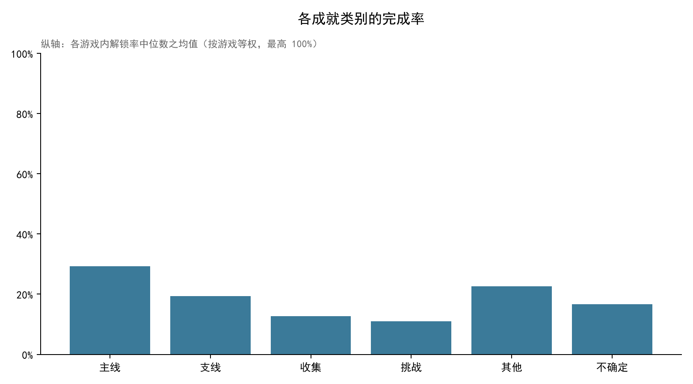
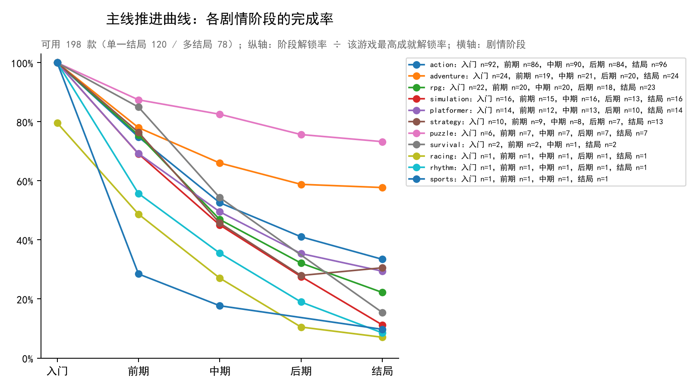
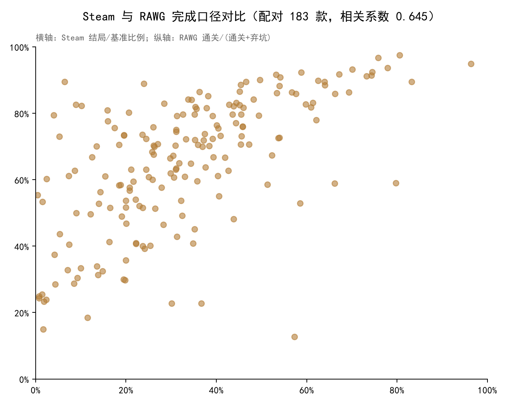

# LYX：WWH任务5三图复现

数据版本：`wwh5-2026-10-13T10:26:09.722887+00:00`；输入 SHA256：`17a0c8e213e73d38ebf20939d5a26413dd49b858d3b315b4c6afa12722d0ebb0`。
模型配置：`{"batch_size":40,"model":"deepseek-flash","prompt_version":"wwh5-ds-v3"}`。分类、阶段、顺序与游戏类型直接读取WWH借用快照。
分析参数：`{"ALLOW_MULTI_ENDING":true,"BOOTSTRAP_SAMPLES":2000,"CURVE_BASELINE":"highest","MIN_COMMON_CHECKPOINTS":2,"RANDOM_STATE":42,"RAWG_FOUR_STATUS":true,"RAWG_MIN_DENOMINATOR":20,"RAWG_THRESHOLDS":[10,20,50],"REQUIRE_START_CHAIN":false,"STORY_CONF_MIN":0.6}`。数据库只读，运行结果保存在本目录文件中。

## 覆盖与当前状态

固定排名样本 1000 款；分类完整 982；剧情标注完成 982；
映射/展示名阻塞 1；尚待完整标注 17（其中有失败记录 17）。
可用主线曲线 198；RAWG 已匹配 985；有效状态样本 902；有效配对 183。

游戏按 SteamSpy 好评数＋差评数排序（并列按 appid），仅游戏且 2026 年以前发售。排名后才检查缺口，不用后续游戏替换缺失项。
所有游戏维度、成就分类、剧情节点均由 DeepSeek 给出，属于模型判断，未经人工核实。
模型输入只有名称、标签、成就展示名与描述，不含完成率、评价数或 RAWG 状态。

## 分类完成率

每款游戏先计算每类成就的完成率中位数，再对游戏等权汇总；不把成就多的游戏赋予更高权重。
主线、支线、收集、挑战、其他、不确定分类均保留；DLC、联机、低置信度为独立属性。分类汇总含低置信度条目，剧情曲线另有严格筛选。

| 类别 | 游戏数 | 游戏中位数的均值 |
| --- | ---: | ---: |
| main | 914 | 0.2933 |
| side | 789 | 0.1936 |
| collection | 816 | 0.1274 |
| challenge | 870 | 0.1096 |
| other | 177 | 0.2258 |
| uncertain | 475 | 0.1670 |

## 主线曲线

只使用映射无未解决问题、有展示名、置信度至少 0.6 的共同路线本体主线节点（非 DLC、非联机）。
**归一化基准：该游戏最高成就解锁率**。这是成就解锁率的比值，最高解锁率成就不等于启动过游戏的玩家。
**多结局处理**：模型判定没有唯一结局时，取完成率最高的那个结局作分子，得到「**至少**走到某个结局」的候选结局覆盖的下界；绝不相加。unified只表示模型判定的统一结局，不是人工验证或精确通关率。
节点按模型给出的全局剧情顺序排列；出现反向完成率跳跃则排除整条曲线，**不按完成率重排数据**。

曲线类型：`{"multi":78,"unified":120}`（unified = 模型标注的统一结局；multi = 多结局取最高者）。
排除原因：`{"at least 2 common checkpoints required":184,"checkpoint not high-confidence base main story":77,"end more common than the node before it":31,"invalid narrative stage order":11,"low story confidence":348,"no end-stage checkpoint":35,"no pre-end checkpoint":2,"reverse completion jump; curve excluded without sorting":96,"source mapping/display-name quality failed":1,"story labeling pending":17}`。

该比例是聚合观测指标，**不代表弃坑率、留存率或全成就玩家比例**；剧情顺序与节点前置关系属于模型判断，仍需独立验证。

每款游戏使用模型首个玩法标签作为主类型，分组不会因多标签重复计入。图中各阶段先在游戏内取中位数，再对同类游戏取中位数；图例逐阶段给出有效游戏数。缺少某阶段的游戏不插值补齐，因此阶段构成可能不同。

| 主玩法 | 有效游戏数 | 结局/基准均值 | 游戏层 Bootstrap 95% 区间 |
| --- | ---: | ---: | --- |
| action | 96 | 0.3329 | [0.30217923558092347, 0.3617878922106618] |
| adventure | 24 | 0.5633 | [0.4802374676146588, 0.6418076439705219] |
| platformer | 14 | 0.2804 | [0.2364922538790186, 0.3194498884772223] |
| puzzle | 7 | 0.6449 | [0.45016613171554465, 0.7589279876277644] |
| racing | 1 | 0.0704 | 不可用 |
| rhythm | 1 | 0.0852 | 不可用 |
| rpg | 23 | 0.2404 | [0.18195145356987838, 0.2981625878405343] |
| simulation | 16 | 0.1451 | [0.09143186681193832, 0.20203141425596774] |
| sports | 1 | 0.0972 | 不可用 |
| strategy | 13 | 0.3613 | [0.2464561795416359, 0.49124723296247247] |
| survival | 2 | 0.1898 | 不可用 |

补充维度采用重叠多标签分组，同一游戏可进入多个组，不代表独立样本。

| 模型维度标签 | 游戏数 | 结局/基准均值 | 95% 区间 |
| --- | ---: | ---: | --- |
| gameplay:action | 139 | 0.3321 | [0.3049599086627494, 0.359571961405733] |
| gameplay:adventure | 156 | 0.3644 | [0.33491559029597323, 0.39635362996388457] |
| gameplay:casual | 33 | 0.4019 | [0.2999803096132523, 0.5061158255156669] |
| gameplay:other | 44 | 0.3804 | [0.32127330453625935, 0.44261152947270277] |
| gameplay:platformer | 28 | 0.3153 | [0.27181882442203176, 0.3633393199483374] |
| gameplay:puzzle | 42 | 0.4755 | [0.4070878481918375, 0.5442412768826493] |
| gameplay:racing | 6 | 0.2822 | [0.161394255847788, 0.41389583023412435] |
| gameplay:rhythm | 2 | 0.1750 | 不可用 |
| gameplay:rpg | 95 | 0.3059 | [0.27523578649730024, 0.3385953824331427] |
| gameplay:simulation | 59 | 0.2562 | [0.20774383511279124, 0.3088174082800582] |
| gameplay:sports | 2 | 0.1527 | 不可用 |
| gameplay:strategy | 47 | 0.2406 | [0.19144846962164128, 0.29405939038242407] |
| gameplay:survival | 30 | 0.2882 | [0.22557751284493294, 0.34905742911391063] |
| player_mode:4 Player Local | 2 | 0.2868 | 不可用 |
| player_mode:Co-op | 60 | 0.2943 | [0.253412605345941, 0.3365719618564175] |
| player_mode:Cross-Platform Multiplayer | 2 | 0.2129 | 不可用 |
| player_mode:Local Co-Op | 19 | 0.2871 | [0.22687622733553495, 0.34230356176324184] |
| player_mode:Local Multiplayer | 9 | 0.2845 | [0.22375996893064576, 0.34705298925313466] |
| player_mode:MMORPG | 2 | 0.1589 | 不可用 |
| player_mode:Massively Multiplayer | 6 | 0.2551 | [0.11441161212089801, 0.39847844518419634] |
| player_mode:Multiplayer | 91 | 0.3036 | [0.2648174745066529, 0.34375127709715286] |
| player_mode:Online Co-Op | 36 | 0.2951 | [0.2405752737239943, 0.3501606159351007] |
| player_mode:Online Party | 1 | 0.1957 | 不可用 |
| player_mode:Online PvP | 4 | 0.3945 | [0.23514252807371147, 0.53158940397351] |
| player_mode:Online multiplayer | 11 | 0.2481 | [0.17081135914951884, 0.31926431161749735] |
| player_mode:PvE | 8 | 0.2913 | [0.1860971293909691, 0.41388586489947565] |
| player_mode:PvP | 10 | 0.3499 | [0.23949327411205168, 0.447260767744554] |
| player_mode:Remote Play Together | 1 | 0.5232 | 不可用 |
| player_mode:Shared/Split Screen Co-op | 1 | 0.4963 | 不可用 |
| player_mode:Shared/Split Screen PvP | 1 | 0.5232 | 不可用 |
| player_mode:Singleplayer | 197 | 0.3388 | [0.31101762550592815, 0.36476715230284856] |
| player_mode:Solo | 1 | 0.1844 | 不可用 |
| player_mode:Split Screen | 16 | 0.2879 | [0.218576724224189, 0.35492915894266147] |
| player_mode:Team-Based | 1 | 0.3666 | 不可用 |
| player_mode:cooperative | 5 | 0.1958 | [0.07382325932600027, 0.3178454654442966] |
| presentation:1990's | 1 | 0.1391 | 不可用 |
| presentation:2.5D | 4 | 0.3005 | [0.16574358646006743, 0.37767689344108246] |
| presentation:2D | 47 | 0.3613 | [0.306386556240684, 0.42266707764337696] |
| presentation:2D Fighter | 1 | 0.5232 | 不可用 |
| presentation:3D | 22 | 0.3247 | [0.24725031912935705, 0.40899894008611626] |
| presentation:3D Fighter | 1 | 0.5232 | 不可用 |
| presentation:3D Platformer | 2 | 0.2717 | 不可用 |
| presentation:3D Vision | 8 | 0.3256 | [0.235940038317674, 0.4283946575769389] |
| presentation:3rd-Person Perspective | 1 | 0.3374 | 不可用 |
| presentation:Aliens | 2 | 0.1710 | 不可用 |
| presentation:Anime | 27 | 0.3557 | [0.2867214551936206, 0.4225206604624206] |
| presentation:Arcade | 1 | 0.2217 | 不可用 |
| presentation:Atmospheric | 108 | 0.3696 | [0.33311147412156134, 0.40689158817577253] |
| presentation:Beautiful | 9 | 0.3666 | [0.22840523091215073, 0.5163185881091369] |
| presentation:Benchmark | 1 | 0.3738 | 不可用 |
| presentation:Blood | 3 | 0.4932 | [0.4192229038854805, 0.6248671625929861] |
| presentation:Bullet Time | 1 | 0.3535 | 不可用 |
| presentation:Captions available | 2 | 0.3213 | 不可用 |
| presentation:Cartoon | 3 | 0.3655 | [0.22976501305483035, 0.5231788079470199] |
| presentation:Cartoony | 6 | 0.3159 | [0.10638887919825199, 0.5723461737637535] |
| presentation:Cinematic | 15 | 0.3955 | [0.30446599805685914, 0.49480575560743684] |
| presentation:Classic | 2 | 0.4011 | 不可用 |
| presentation:Colorful | 20 | 0.3036 | [0.21593238494569683, 0.39529557604936244] |
| presentation:Comedy | 8 | 0.3001 | [0.21363582640457188, 0.40641813731665793] |
| presentation:Comic Book | 9 | 0.6296 | [0.523460422251865, 0.7412519691091276] |
| presentation:Commentary available | 1 | 0.3124 | 不可用 |
| presentation:Controller | 2 | 0.5055 | 不可用 |
| presentation:Cozy | 1 | 0.1148 | 不可用 |
| presentation:Crime | 1 | 0.5411 | 不可用 |
| presentation:Cute | 10 | 0.2808 | [0.1594347334856252, 0.41734650924354844] |
| presentation:Cyberpunk | 3 | 0.3005 | [0.05211726384364821, 0.4935672514619884] |
| presentation:Dark | 20 | 0.4195 | [0.3418235241007366, 0.5010688058391514] |
| presentation:Dark Fantasy | 9 | 0.3244 | [0.2615982337054397, 0.38515557821941143] |
| presentation:Dark Humor | 3 | 0.2963 | [0.16503800217155268, 0.4192229038854805] |
| presentation:Demons | 1 | 0.2648 | 不可用 |
| presentation:Destruction | 2 | 0.2878 | 不可用 |
| presentation:Difficult | 1 | 0.1998 | 不可用 |
| presentation:Dragons | 1 | 0.4009 | 不可用 |
| presentation:Dynamic Narration | 2 | 0.2690 | 不可用 |
| presentation:Dystopian | 2 | 0.3972 | 不可用 |
| presentation:Epic | 1 | 0.2610 | 不可用 |
| presentation:Episodic | 9 | 0.6210 | [0.48457219486857595, 0.7538568465332008] |
| presentation:FPS | 21 | 0.3208 | [0.25152655131327595, 0.38518120063294264] |
| presentation:Family Friendly | 3 | 0.2738 | [0.11480865224625625, 0.4088607594936708] |
| presentation:Fantasy | 14 | 0.3439 | [0.2798155611595943, 0.40402950838609397] |
| presentation:Fast-Paced | 2 | 0.3132 | 不可用 |
| presentation:Female Protagonist | 2 | 0.1540 | 不可用 |
| presentation:First-Person | 52 | 0.3286 | [0.2716849713112156, 0.3879772568494826] |
| presentation:Full controller support | 10 | 0.3113 | [0.22887646096905817, 0.40058728869958327] |
| presentation:Funny | 15 | 0.2879 | [0.205603920386671, 0.37678431233283916] |
| presentation:Futuristic | 6 | 0.2339 | [0.14937534362825156, 0.30298928703991374] |
| presentation:Gore | 25 | 0.3497 | [0.28717625952415654, 0.4123676727133368] |
| presentation:Gothic | 2 | 0.3376 | 不可用 |
| presentation:Great Soundtrack | 95 | 0.3441 | [0.30984794885881084, 0.3824383552938792] |
| presentation:HDR available | 1 | 0.1884 | 不可用 |
| presentation:Hand-drawn | 10 | 0.4675 | [0.3350676423246537, 0.6055469212334564] |
| presentation:Historical | 9 | 0.3398 | [0.2449049349963013, 0.4333680997700894] |
| presentation:Horror | 10 | 0.3058 | [0.22070097525947624, 0.4010503719394689] |
| presentation:Immersive | 2 | 0.3972 | 不可用 |
| presentation:Immersive Sim | 1 | 0.3559 | 不可用 |
| presentation:Includes level editor | 1 | 0.1346 | 不可用 |
| presentation:Isometric | 10 | 0.3080 | [0.18617563933016334, 0.4282994219886509] |
| presentation:LEGO | 2 | 0.3532 | 不可用 |
| presentation:Level Editor | 1 | 0.1998 | 不可用 |
| presentation:Linear | 6 | 0.4321 | [0.3282282897547259, 0.5374581256715335] |
| presentation:Lore-Rich | 3 | 0.3946 | [0.3787234042553192, 0.40406320541760726] |
| presentation:Magic | 2 | 0.4025 | 不可用 |
| presentation:Mature | 5 | 0.3807 | [0.27985001668662524, 0.4741536966080047] |
| presentation:Medieval | 6 | 0.2687 | [0.18303751696856926, 0.35675446127092947] |
| presentation:Memes | 1 | 0.1998 | 不可用 |
| presentation:Military | 3 | 0.3259 | [0.2535545023696682, 0.3757115749525617] |
| presentation:Minimalist | 2 | 0.0228 | 不可用 |
| presentation:Moddable | 2 | 0.1136 | 不可用 |
| presentation:Mouse only | 1 | 0.1541 | 不可用 |
| presentation:Music | 5 | 0.3115 | [0.17545681470646307, 0.44754431149319274] |
| presentation:Mythology | 1 | 0.1633 | 不可用 |
| presentation:Narration | 5 | 0.3802 | [0.23715293662937365, 0.548605484774709] |
| presentation:Narrative | 1 | 0.4963 | 不可用 |
| presentation:Noir | 5 | 0.5693 | [0.5056503497725853, 0.6329751082251083] |
| presentation:Nudity | 9 | 0.3157 | [0.22468358416979245, 0.3988239255009305] |
| presentation:Old School | 2 | 0.7155 | 不可用 |
| presentation:Open World | 8 | 0.2714 | [0.1918067816158333, 0.3389864434512937] |
| presentation:Parkour | 1 | 0.1998 | 不可用 |
| presentation:Partial Controller Support | 5 | 0.3897 | [0.28240801222979445, 0.4760119539613522] |
| presentation:Physics | 5 | 0.2234 | [0.13216716753204322, 0.31521885199200445] |
| presentation:Pixel Graphics | 22 | 0.3396 | [0.2480921299886937, 0.4452868015321003] |
| presentation:Point & Click | 3 | 0.6965 | [0.5670731707317074, 0.7793633369923162] |
| presentation:Post-apocalyptic | 2 | 0.1927 | 不可用 |
| presentation:Quick-Time Events | 2 | 0.4704 | 不可用 |
| presentation:Real-Time with Pause | 2 | 0.0699 | 不可用 |
| presentation:Realistic | 14 | 0.1977 | [0.09920317757875706, 0.30083709983768003] |
| presentation:Remake | 3 | 0.4187 | [0.261049723756906, 0.5411255411255411] |
| presentation:Remote Play on Tablet | 1 | 0.6932 | 不可用 |
| presentation:Retro | 12 | 0.3786 | [0.2402673686417185, 0.522726720812254] |
| presentation:Retrofuturism | 1 | 0.0521 | 不可用 |
| presentation:Sci-fi | 12 | 0.2492 | [0.14482874146141547, 0.3637081615978053] |
| presentation:Sexual Content | 3 | 0.5023 | [0.3928980526918671, 0.572928821470245] |
| presentation:Shooter | 1 | 0.3099 | 不可用 |
| presentation:Side Scroller | 9 | 0.3500 | [0.3032668629714591, 0.39704894400961066] |
| presentation:Sniper | 1 | 0.3099 | 不可用 |
| presentation:Soundtrack | 2 | 0.3148 | 不可用 |
| presentation:Space | 3 | 0.2500 | [0.19962335216572502, 0.3056558363417569] |
| presentation:Stealth | 1 | 0.3217 | 不可用 |
| presentation:Steam Achievements | 4 | 0.1974 | [0.13873626373626374, 0.2700292665081398] |
| presentation:Steam Cloud | 3 | 0.1966 | [0.13461538461538464, 0.3124199743918054] |
| presentation:Steam Leaderboards | 1 | 0.1998 | 不可用 |
| presentation:Steam Workshop | 2 | 0.1672 | 不可用 |
| presentation:Steampunk | 7 | 0.4843 | [0.34473551325292023, 0.6295119885770166] |
| presentation:Stereo Sound | 1 | 0.3090 | 不可用 |
| presentation:Story | 1 | 0.3757 | 不可用 |
| presentation:Story Rich | 22 | 0.3644 | [0.30124462353477294, 0.42162339497566614] |
| presentation:Stylized | 7 | 0.3483 | [0.2020153314967542, 0.5060723248820576] |
| presentation:Superhero | 2 | 0.3153 | 不可用 |
| presentation:Surreal | 3 | 0.5373 | [0.1391304347826087, 0.7401069518716578] |
| presentation:Surround Sound | 1 | 0.3090 | 不可用 |
| presentation:Survival Horror | 2 | 0.1271 | 不可用 |
| presentation:Tactical | 1 | 0.3217 | 不可用 |
| presentation:Tanks | 2 | 0.3146 | 不可用 |
| presentation:Text-Based | 2 | 0.6941 | 不可用 |
| presentation:Third Person | 71 | 0.3162 | [0.2794158542879687, 0.35187193688668966] |
| presentation:Third-Person Shooter | 17 | 0.3428 | [0.27517151225714187, 0.4080509614334493] |
| presentation:Top-Down | 7 | 0.1862 | [0.07341632470561048, 0.3264834954796652] |
| presentation:Touch-Friendly | 2 | 0.6716 | 不可用 |
| presentation:Turn-Based | 1 | 0.1213 | 不可用 |
| presentation:Underwater | 5 | 0.2841 | [0.12979817297798074, 0.42748539175484235] |
| presentation:VR | 5 | 0.3932 | [0.14374843799054585, 0.6535197880372459] |
| presentation:Vikings | 1 | 0.1633 | 不可用 |
| presentation:Violent | 16 | 0.3968 | [0.325854944491459, 0.46168047041902943] |
| presentation:Visual Novel | 12 | 0.4510 | [0.30807330875118616, 0.5965895524228279] |
| presentation:Walking Simulator | 3 | 0.6594 | [0.5340632603406326, 0.7429718875502008] |
| presentation:War | 3 | 0.3259 | [0.2535545023696682, 0.3757115749525617] |
| presentation:Well-Written | 2 | 0.5119 | 不可用 |
| presentation:World War I | 1 | 0.3757 | 不可用 |
| presentation:World War II | 1 | 0.2536 | 不可用 |
| presentation:Zombies | 1 | 0.6249 | 不可用 |
| presentation:artistic | 1 | 0.2632 | 不可用 |
| presentation:battle | 1 | 0.3757 | 不可用 |
| presentation:controller support | 1 | 0.1998 | 不可用 |
| presentation:first person mod | 2 | 0.4011 | 不可用 |
| presentation:history | 1 | 0.3757 | 不可用 |
| presentation:interactive movie | 1 | 0.7013 | 不可用 |
| presentation:stats | 1 | 0.1998 | 不可用 |
| presentation:tank | 1 | 0.3757 | 不可用 |
| presentation:ww1 | 1 | 0.3757 | 不可用 |
| theme:1980s | 2 | 0.2705 | 不可用 |
| theme:1990's | 2 | 0.3137 | 不可用 |
| theme:4X | 2 | 0.0909 | 不可用 |
| theme:Action | 4 | 0.2937 | [0.1364644749174106, 0.4510132446114172] |
| theme:Action RPG | 4 | 0.3863 | [0.21819282945736435, 0.5243774671665136] |
| theme:Action Roguelike | 1 | 0.1981 | 不可用 |
| theme:Adventure | 6 | 0.4060 | [0.26156287667006967, 0.5663292317840158] |
| theme:Aliens | 5 | 0.2237 | [0.12474649322909681, 0.3460099974826482] |
| theme:Alternate History | 5 | 0.3838 | [0.20829889017254252, 0.5526138732724761] |
| theme:America | 1 | 0.5319 | 不可用 |
| theme:Anime | 3 | 0.4063 | [0.33256880733944955, 0.4596354166666667] |
| theme:Arcade | 4 | 0.3695 | [0.14075422509888527, 0.6627301108398698] |
| theme:Artificial Intelligence | 1 | 0.1884 | 不可用 |
| theme:Assassin | 7 | 0.3417 | [0.2747320255722138, 0.40649826186079474] |
| theme:Atmospheric | 10 | 0.3582 | [0.2632826353716946, 0.45327311123391384] |
| theme:Automobile Sim | 2 | 0.1351 | 不可用 |
| theme:Base Building | 2 | 0.0989 | 不可用 |
| theme:Base-Building | 4 | 0.0780 | [0.016858393817764966, 0.13905172496705875] |
| theme:Based On A Novel | 3 | 0.2732 | [0.06370192307692307, 0.40406320541760726] |
| theme:Batman | 1 | 0.2398 | 不可用 |
| theme:Beat 'em up | 1 | 0.3519 | 不可用 |
| theme:Blood | 4 | 0.4010 | [0.35811685988263914, 0.4619286313717677] |
| theme:Board Game | 1 | 0.6622 | 不可用 |
| theme:Boxing | 1 | 0.2081 | 不可用 |
| theme:Building | 8 | 0.0373 | [0.012251592181157895, 0.07495327474997035] |
| theme:Bullet Hell | 2 | 0.1889 | 不可用 |
| theme:Capitalism | 1 | 0.1358 | 不可用 |
| theme:Card Battler | 1 | 0.1541 | 不可用 |
| theme:Card Game | 1 | 0.7976 | 不可用 |
| theme:Casual | 1 | 0.2372 | 不可用 |
| theme:Cats | 2 | 0.5286 | 不可用 |
| theme:Character | 1 | 0.3559 | 不可用 |
| theme:Character Customization | 10 | 0.2269 | [0.15204796476916704, 0.3142078137931737] |
| theme:Choices Matter | 26 | 0.4443 | [0.3517906601800752, 0.5405429495936704] |
| theme:Choose Your Own Adventure | 10 | 0.6789 | [0.5822983133688044, 0.7741208289126832] |
| theme:City Builder | 8 | 0.0737 | [0.015975801370668674, 0.1480482397404046] |
| theme:Classic | 8 | 0.4007 | [0.30189716389627513, 0.47981883307067347] |
| theme:Cold War | 1 | 0.0855 | 不可用 |
| theme:Collectathon | 2 | 0.2292 | 不可用 |
| theme:Colony Sim | 4 | 0.1230 | [0.011428924021993993, 0.23447531701480911] |
| theme:Combat | 1 | 0.3559 | 不可用 |
| theme:Comedy | 20 | 0.3593 | [0.275279492923349, 0.4458675357644349] |
| theme:Comic Book | 2 | 0.3243 | 不可用 |
| theme:Competitive | 4 | 0.2973 | [0.24000364220262202, 0.3546023965141612] |
| theme:Conspiracy | 1 | 0.3559 | 不可用 |
| theme:Cozy | 1 | 0.2372 | 不可用 |
| theme:Crafting | 4 | 0.1759 | [0.06422926628297482, 0.3003858365309518] |
| theme:Crime | 8 | 0.4504 | [0.34931568959424447, 0.5543294931293515] |
| theme:Cult Classic | 2 | 0.3541 | 不可用 |
| theme:Cute | 5 | 0.2550 | [0.1480625752575688, 0.3598219204456662] |
| theme:Cyberpunk | 7 | 0.3281 | [0.2763602362849249, 0.38290254206548674] |
| theme:Dark | 10 | 0.3755 | [0.25259098248988776, 0.49906773764348794] |
| theme:Dark Comedy | 1 | 0.5877 | 不可用 |
| theme:Dark Fantasy | 18 | 0.3384 | [0.2727870760406732, 0.4025350717667552] |
| theme:Dark Humor | 8 | 0.3148 | [0.1844228276418991, 0.45311553019026857] |
| theme:Dating Sim | 6 | 0.3487 | [0.16798047620601028, 0.5639136882495409] |
| theme:Deckbuilding | 2 | 0.4758 | 不可用 |
| theme:Demons | 5 | 0.3439 | [0.1964724073109147, 0.4680507439580287] |
| theme:Destruction | 2 | 0.1066 | 不可用 |
| theme:Detective | 10 | 0.4418 | [0.30549240732144056, 0.573387447866001] |
| theme:Difficult | 20 | 0.3090 | [0.23462087537781723, 0.3906305623422328] |
| theme:Dog | 1 | 0.4545 | 不可用 |
| theme:Dragons | 6 | 0.3163 | [0.2048852193773029, 0.435003345951442] |
| theme:Drama | 18 | 0.5883 | [0.5143824681929983, 0.665009239342085] |
| theme:Driving | 1 | 0.2610 | 不可用 |
| theme:Dungeon Crawler | 7 | 0.1517 | [0.09221963915068193, 0.21600785118421983] |
| theme:Dungeons & Dragons | 1 | 0.1213 | 不可用 |
| theme:Dwarf | 1 | 0.2414 | 不可用 |
| theme:Dystopian | 8 | 0.3402 | [0.2852577795581625, 0.39332738621499663] |
| theme:Early Access | 2 | 0.0846 | 不可用 |
| theme:Economy | 8 | 0.0949 | [0.04013630037119477, 0.16187417482604294] |
| theme:Education | 2 | 0.3834 | 不可用 |
| theme:Emotional | 10 | 0.4909 | [0.361789949216381, 0.6062656012191195] |
| theme:Epic | 1 | 0.5400 | 不可用 |
| theme:Episodic | 1 | 0.6719 | 不可用 |
| theme:Escape Room | 3 | 0.5541 | [0.15859766277128548, 0.7585071350164654] |
| theme:Experimental | 2 | 0.4108 | 不可用 |
| theme:Exploration | 14 | 0.2997 | [0.18971853677321818, 0.4233280896630395] |
| theme:Faith | 1 | 0.3045 | 不可用 |
| theme:Family Friendly | 12 | 0.2152 | [0.12203554824759359, 0.3137529290058007] |
| theme:Fantasy | 48 | 0.3015 | [0.2567612574504388, 0.34975036557841654] |
| theme:Farming Sim | 1 | 0.1358 | 不可用 |
| theme:Fast-Paced | 2 | 0.2340 | 不可用 |
| theme:Feel Good | 1 | 0.2372 | 不可用 |
| theme:Female Protagonist | 29 | 0.4293 | [0.35903599391207724, 0.5072074466753657] |
| theme:Fighting | 2 | 0.2800 | 不可用 |
| theme:Fishing | 1 | 0.3010 | 不可用 |
| theme:Flight | 2 | 0.1239 | 不可用 |
| theme:Foreign | 1 | 0.5232 | 不可用 |
| theme:Free to Play | 1 | 0.0167 | 不可用 |
| theme:Funny | 26 | 0.3176 | [0.23049648703204223, 0.4086020324097126] |
| theme:Futuristic | 7 | 0.3674 | [0.24185611581017372, 0.48491057582291675] |
| theme:Games Workshop | 1 | 0.2414 | 不可用 |
| theme:God Game | 1 | 0.0072 | 不可用 |
| theme:Gore | 26 | 0.3791 | [0.29324004444841123, 0.47169585455592744] |
| theme:Gothic | 3 | 0.3077 | [0.22108345534407028, 0.3844515441959531] |
| theme:Grand Strategy | 1 | 0.0186 | 不可用 |
| theme:Great Soundtrack | 1 | 0.5857 | 不可用 |
| theme:Hack and Slash | 7 | 0.3104 | [0.16733848829873124, 0.44274983892938213] |
| theme:Hacking | 5 | 0.2727 | [0.17665728877401293, 0.34299691915807135] |
| theme:Heist | 6 | 0.2518 | [0.17178572358655173, 0.3184003386093461] |
| theme:Historical | 15 | 0.3925 | [0.3262242921608241, 0.4594727163557033] |
| theme:Horror | 41 | 0.4427 | [0.3718121284166353, 0.5148453380211201] |
| theme:Horses | 3 | 0.0661 | [0.023397761953204477, 0.08879023307436183] |
| theme:Hunting | 3 | 0.4043 | [0.337402885682575, 0.5131729667812142] |
| theme:Idler | 1 | 0.1148 | 不可用 |
| theme:Illuminati | 4 | 0.5668 | [0.3462335216572504, 0.7874216162897203] |
| theme:Immersive Sim | 1 | 0.4826 | 不可用 |
| theme:Indie | 8 | 0.3753 | [0.20778848061724656, 0.5515475371482037] |
| theme:Interactive Fiction | 5 | 0.7070 | [0.6308228095612818, 0.780706656861715] |
| theme:Inventory Management | 1 | 0.3010 | 不可用 |
| theme:Investigation | 4 | 0.4336 | [0.2301077578243358, 0.6414438502673797] |
| theme:JRPG | 2 | 0.2714 | 不可用 |
| theme:Job Simulator | 1 | 0.1148 | 不可用 |
| theme:LEGO | 1 | 0.4089 | 不可用 |
| theme:LGBTQ+ | 7 | 0.4785 | [0.29068547322560584, 0.6964866406450919] |
| theme:Life Sim | 1 | 0.1358 | 不可用 |
| theme:Linear | 2 | 0.5100 | 不可用 |
| theme:Loot | 3 | 0.2841 | [0.14810426540284358, 0.40330788804071255] |
| theme:Lore-Rich | 6 | 0.3532 | [0.24772718274018432, 0.46121282716813533] |
| theme:Lovecraftian | 5 | 0.6373 | [0.4948896349275536, 0.7745346389097204] |
| theme:MMORPG | 1 | 0.5729 | 不可用 |
| theme:Mafia | 2 | 0.4975 | 不可用 |
| theme:Magic | 9 | 0.1973 | [0.1308134795961884, 0.2826042014764481] |
| theme:Management | 11 | 0.1069 | [0.05363553662009378, 0.16697890698339035] |
| theme:Martial Arts | 4 | 0.3188 | [0.2093187262792388, 0.4282947977392768] |
| theme:Mature | 17 | 0.5156 | [0.41497328524269167, 0.6126499158757642] |
| theme:Mechs | 2 | 0.5779 | 不可用 |
| theme:Medical Sim | 1 | 0.0138 | 不可用 |
| theme:Medieval | 13 | 0.2407 | [0.15455654226083854, 0.3385588056887542] |
| theme:Memes | 7 | 0.4118 | [0.25195657604027144, 0.5770891417657328] |
| theme:Mental Health | 1 | 0.2372 | 不可用 |
| theme:Metroidvania | 3 | 0.3462 | [0.28285356695869834, 0.43804347826086953] |
| theme:Military | 8 | 0.3658 | [0.24303773224253813, 0.4984051305531991] |
| theme:Moddable | 3 | 0.0562 | [0.0072840790842872, 0.14285714285714285] |
| theme:Multiple Endings | 13 | 0.3660 | [0.2777838200733602, 0.4590778359396104] |
| theme:Music | 2 | 0.2429 | 不可用 |
| theme:Mystery | 23 | 0.4789 | [0.3743320318314452, 0.5804193819307897] |
| theme:Mythology | 4 | 0.3899 | [0.23638478379857691, 0.5345954828333683] |
| theme:NSFW | 1 | 0.2766 | 不可用 |
| theme:Narration | 2 | 0.4204 | 不可用 |
| theme:Narrative | 1 | 0.3326 | 不可用 |
| theme:Nature | 4 | 0.2412 | [0.08333779514911388, 0.4261392256287988] |
| theme:Naval | 2 | 0.2172 | 不可用 |
| theme:Ninja | 2 | 0.5034 | 不可用 |
| theme:Nonlinear | 1 | 0.3519 | 不可用 |
| theme:Nudity | 13 | 0.4509 | [0.3817368785870103, 0.5203609347365482] |
| theme:Old School | 3 | 0.3118 | [0.12482468443197758, 0.4192229038854805] |
| theme:Open World | 36 | 0.2496 | [0.19862801210556771, 0.3007366843075517] |
| theme:Open World Survival Craft | 1 | 0.0151 | 不可用 |
| theme:Parkour | 6 | 0.2933 | [0.22243191010085495, 0.36438740250614915] |
| theme:Parody | 2 | 0.5743 | 不可用 |
| theme:Party | 1 | 0.2217 | 不可用 |
| theme:Party-Based RPG | 1 | 0.1213 | 不可用 |
| theme:Perma Death | 7 | 0.3961 | [0.28591185468784824, 0.5041826797255067] |
| theme:Philosophical | 2 | 0.4484 | 不可用 |
| theme:Physics | 2 | 0.1656 | 不可用 |
| theme:Pirates | 2 | 0.3196 | 不可用 |
| theme:Political | 1 | 0.0898 | 不可用 |
| theme:Politics | 2 | 0.2454 | 不可用 |
| theme:Post-apocalyptic | 19 | 0.4251 | [0.32781474714811154, 0.530966340560422] |
| theme:Procedural Generation | 8 | 0.3904 | [0.22281162957714082, 0.5829221932219069] |
| theme:Programming | 1 | 0.3123 | 不可用 |
| theme:Psychological | 1 | 0.6630 | 不可用 |
| theme:Psychological Horror | 16 | 0.4045 | [0.29967258829958204, 0.5194440297502018] |
| theme:Quick-Time Events | 1 | 0.4963 | 不可用 |
| theme:RPG | 1 | 0.3787 | 不可用 |
| theme:Real-Time with Pause | 1 | 0.5857 | 不可用 |
| theme:Relaxing | 6 | 0.2009 | [0.03252354677422235, 0.44474945460185183] |
| theme:Remake | 3 | 0.3666 | [0.3436893203883495, 0.3915151515151514] |
| theme:Replay Value | 7 | 0.4443 | [0.24776662797161786, 0.6172840532471408] |
| theme:Resource Management | 8 | 0.1027 | [0.0427179307880199, 0.1721684085636606] |
| theme:Robots | 4 | 0.3228 | [0.1499683465538325, 0.4508969613246232] |
| theme:Rogue-like | 4 | 0.3023 | [0.1651137394459563, 0.5453019291161957] |
| theme:Rogue-lite | 4 | 0.3023 | [0.1651137394459563, 0.5453019291161957] |
| theme:Roguelike | 7 | 0.4447 | [0.278390589631359, 0.6139133538337068] |
| theme:Roguelike Deckbuilder | 1 | 0.1541 | 不可用 |
| theme:Roguelite | 5 | 0.4505 | [0.2625824931234235, 0.6409282712261228] |
| theme:Romance | 12 | 0.3949 | [0.2868960873855824, 0.5229755581473609] |
| theme:Rome | 1 | 0.3738 | 不可用 |
| theme:Sandbox | 16 | 0.1464 | [0.08977264489063431, 0.21038000225378273] |
| theme:Satire | 1 | 0.1346 | 不可用 |
| theme:Sci-fi | 34 | 0.3395 | [0.28629570732590925, 0.3946421027864105] |
| theme:Science | 1 | 0.1595 | 不可用 |
| theme:Score Attack | 1 | 0.0043 | 不可用 |
| theme:Secrets | 1 | 0.3559 | 不可用 |
| theme:Sexual Content | 14 | 0.3259 | [0.23706078676075623, 0.40866002066745916] |
| theme:Shark | 1 | 0.1650 | 不可用 |
| theme:Shoot 'Em Up | 2 | 0.1889 | 不可用 |
| theme:Shooter | 2 | 0.3448 | 不可用 |
| theme:Shop Keeper | 1 | 0.1148 | 不可用 |
| theme:Short | 2 | 0.7823 | 不可用 |
| theme:Skateboarding | 1 | 0.0972 | 不可用 |
| theme:Sniper | 2 | 0.2147 | 不可用 |
| theme:Souls-like | 9 | 0.3674 | [0.2572193660196415, 0.4631823468826783] |
| theme:Soviet Union | 1 | 0.0521 | 不可用 |
| theme:Space | 7 | 0.3094 | [0.21756940006940245, 0.4204280876923618] |
| theme:Space Sim | 1 | 0.5857 | 不可用 |
| theme:Sports | 1 | 0.2583 | 不可用 |
| theme:Stealth | 19 | 0.3139 | [0.25497900561613135, 0.36847018246351015] |
| theme:Steampunk | 4 | 0.3764 | [0.3117655427514583, 0.4410590429562278] |
| theme:Story | 3 | 0.4353 | [0.3558863328822733, 0.5231788079470199] |
| theme:Story Rich | 85 | 0.4126 | [0.36882633996642505, 0.4540761493190868] |
| theme:Superhero | 4 | 0.3776 | [0.2307521933226468, 0.5399397590361446] |
| theme:Supernatural | 2 | 0.5085 | 不可用 |
| theme:Surreal | 2 | 0.5532 | 不可用 |
| theme:Survival | 14 | 0.3300 | [0.17740824659708176, 0.4851047906427186] |
| theme:Survival Horror | 12 | 0.3271 | [0.2571755606467221, 0.39658305237094144] |
| theme:Swordplay | 2 | 0.3410 | 不可用 |
| theme:Tactical | 12 | 0.3194 | [0.21175355367951687, 0.428287370733212] |
| theme:Third-Person Shooter | 1 | 0.0862 | 不可用 |
| theme:Thriller | 6 | 0.4472 | [0.286941494200688, 0.6011057819235825] |
| theme:Time Manipulation | 1 | 0.3451 | 不可用 |
| theme:Time Travel | 4 | 0.3794 | [0.20587135901916626, 0.6247029641055571] |
| theme:Tower Defense | 1 | 0.0433 | 不可用 |
| theme:Trading | 2 | 0.1253 | 不可用 |
| theme:Trains | 2 | 0.0359 | 不可用 |
| theme:Transhumanism | 2 | 0.3333 | 不可用 |
| theme:Transportation | 1 | 0.0531 | 不可用 |
| theme:Turn-Based | 1 | 0.6622 | 不可用 |
| theme:Turn-Based Combat | 1 | 0.6622 | 不可用 |
| theme:Turn-Based Strategy | 1 | 0.6622 | 不可用 |
| theme:Turn-Based Tactics | 1 | 0.6622 | 不可用 |
| theme:Twin Stick Shooter | 1 | 0.1481 | 不可用 |
| theme:USSR | 1 | 0.0521 | 不可用 |
| theme:Underground | 1 | 0.0972 | 不可用 |
| theme:Underwater | 2 | 0.3755 | 不可用 |
| theme:Urban | 1 | 0.0972 | 不可用 |
| theme:Vehicular Combat | 1 | 0.0704 | 不可用 |
| theme:Villain Protagonist | 1 | 0.1650 | 不可用 |
| theme:Violent | 21 | 0.3945 | [0.3002615359493987, 0.4967019778334395] |
| theme:Visual Novel | 2 | 0.5363 | 不可用 |
| theme:War | 18 | 0.3554 | [0.2670176418369126, 0.44206892707233336] |
| theme:Warhammer 40K | 3 | 0.2706 | [0.20058997050147495, 0.36663233779608656] |
| theme:Weapons | 1 | 0.3559 | 不可用 |
| theme:Western | 1 | 0.3535 | 不可用 |
| theme:Wholesome | 1 | 0.2372 | 不可用 |
| theme:World War I | 2 | 0.4151 | 不可用 |
| theme:World War II | 6 | 0.3539 | [0.18027076713026524, 0.5251178908691635] |
| theme:Zombies | 15 | 0.4810 | [0.3644783346840824, 0.5975376907906498] |
| theme:artgame | 1 | 0.6630 | 不可用 |
| theme:battle | 1 | 0.3757 | 不可用 |
| theme:cats | 2 | 0.3432 | 不可用 |
| theme:combat | 1 | 0.1391 | 不可用 |
| theme:e-sports | 1 | 0.2583 | 不可用 |
| theme:history | 1 | 0.3757 | 不可用 |
| theme:japan | 1 | 0.2365 | 不可用 |
| theme:meditation | 1 | 0.2372 | 不可用 |
| theme:plague | 1 | 0.5341 | 不可用 |
| theme:strange | 1 | 0.3451 | 不可用 |
| theme:student | 1 | 0.3451 | 不可用 |
| theme:summer | 1 | 0.2365 | 不可用 |
| theme:transportation | 1 | 0.0186 | 不可用 |
| theme:weird | 1 | 0.2444 | 不可用 |
| theme:ww1 | 1 | 0.3757 | 不可用 |

## RAWG 对比

主指标 beaten/(beaten+dropped)：两字段均须已观测且非负，分母至少 20；缺失保持缺失，不补零。另报告阈值 10、50。
四状态敏感性分析分母为 beaten+dropped+playing+owned，四字段都须观测；owned 不能证明已游玩。

| 最低分母 | 配对游戏数 | Spearman | Bootstrap 95% 区间 |
| --- | ---: | ---: | --- |
| 10 | 186 | 0.6506 | [0.5372470687102056, 0.7509715649022959] |
| 20 | 183 | 0.6449 | [0.5261740253868413, 0.7459042891516999] |
| 50 | 178 | 0.6259 | [0.5039902267522037, 0.7307683647462424] |

四状态口径：`{"bootstrap_ci95":[0.4924177080036463,0.6941834572912742],"paired_games":188,"spearman":0.6036561772093876}`。

Spearman 在配对游戏层面计算；少于 3 款或变量恒定时不可用。Bootstrap 按游戏重抽样 2000 次、随机种子 42；不能覆盖模型标注误差。

Steam 与 RAWG 用户群及状态口径不同，只比较描述趋势与排序，不能据此判断哪个平台更准确，也不能解释为因果效应。
RAWG 数据来源：[RAWG](https://rawg.io/)。

模型返回用量累计（含取得响应但解析失败的请求）：`{"completion_tokens":6676472,"prompt_cache_hit_tokens":921211,"prompt_cache_miss_tokens":3492037,"prompt_tokens":4413248,"total_tokens":11089720}`。
HTTP 次数上限含重试；成功响应按模型、提示版本、输入 hash 续跑。服务商收费后、SQLite 提交前终止属于外部结果未知，恢复可能重复付费。
