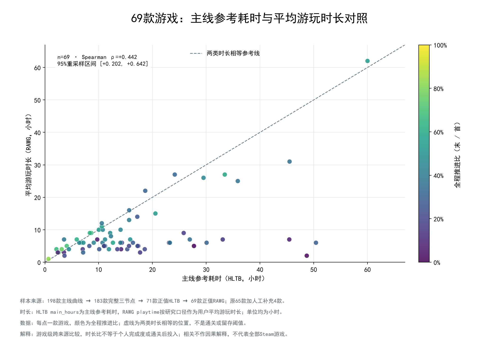
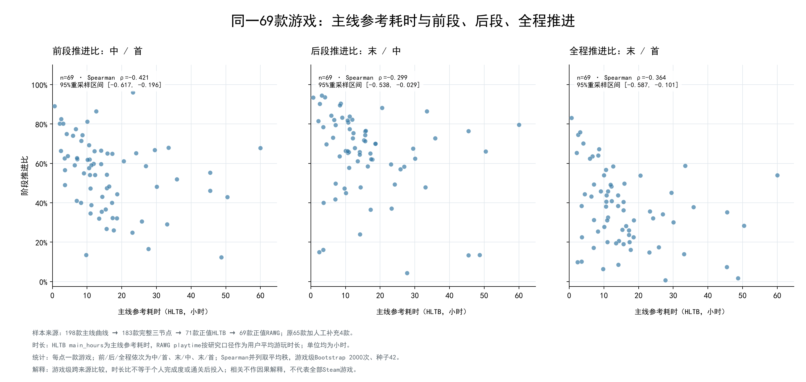
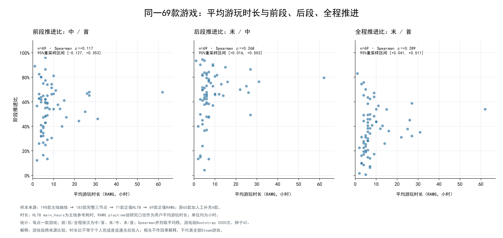
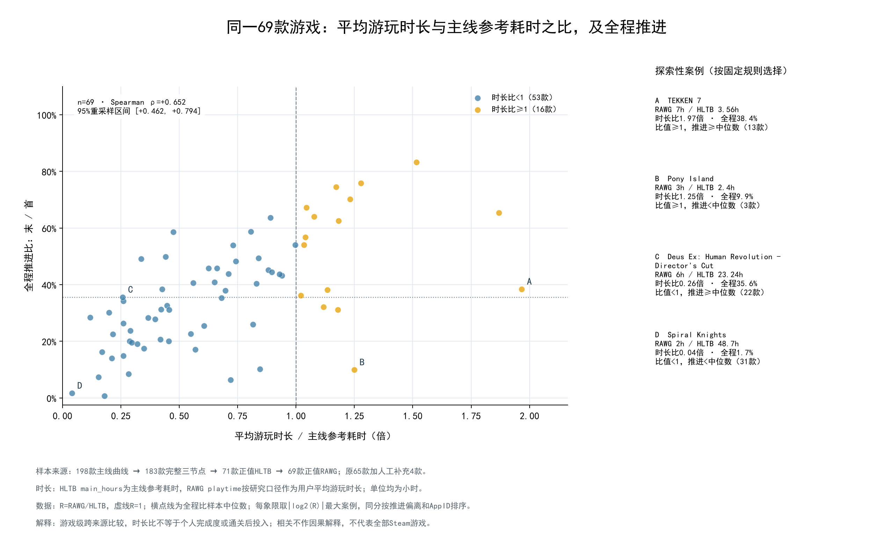

# 专题4：内容长度、平均游玩时长与主线推进

更新：2026-10-20。原65款加人工补充4款，原SQLite不变。
主线快照版本：wwh5-2026-10-13T10:26:09.722887+00:00。共同样本69款，AppID顺序指纹：48d3f0600fbbb2cbaff4e1ffe3df9d330af35ab6ec70e384906a9161ff82e4a9。

## 固定样本与来源

采用用户确认口径：RAWG playtime为用户平均游玩时长（小时），HLTB main_hours为主线参考耗时（小时）。二者独立保留；空值仅用已确认的同来源人工查询补充，不互相替代；主线指标仍使用既有数组位置中位节点和代表结局。
不开展类型对照、类型分组、类型着色或按类型拟合。全部主图使用同一69款，不把不同有效集合混为一条阶段过程。
| 筛选步骤 | 游戏数 |
|---|---:|
| 固定有效主线范围 | 198 |
| 完整三节点 | 183 |
| 其中正值HLTB主线时长 | 71 |
| 再与正值RAWG时长取交集 | 69 |

全部198款中，补充后HLTB主线正值78款；状态分布{'positive': 78, 'null': 82, 'not_in_local_table': 37, 'zero': 1}。本地未匹配不代表HLTB网站没有该游戏。
补充前基线65款不变。新增Assassin's Creed® Odyssey、Clair Obscur: Expedition 33、ELDEN RING的三类HLTB耗时及God of War的RAWG 15小时，形成69款。补充后完整三节点且HLTB正值71款，另2款仍缺RAWG。
人工补充由刘宇翔于2026-10-20在项目对话确认，提供10个字段；未提供页面URL或查询时间。逐字段来源、原快照空值和人工字段写入CSV及manifest，不写回SQLite。

## 输入分布与时长比

| 变量 | n | 最小 | 中位数 | 最大 |
|---|---:|---:|---:|---:|
| 主线参考耗时（HLTB，小时） | 69 | 0.66 | 12.65 | 60.00 |
| 平均游玩时长（RAWG，小时） | 69 | 1.00 | 6.00 | 62.00 |
| 平均游玩时长 / 主线参考耗时 | 69 | 0.04 | 0.65 | 1.97 |

时长比R=playtime/main_hours；R<1有53款，R>=1有16款。
R=0.6只表示RAWG平均值为HLTB参考值的60%，不是个人完成了60%主线；R>1也不能据此认定通关后继续游玩。

## 关联分析

每款游戏同等权重，Spearman并列值取平均秩。以整行游戏联合重采样2000次、随机种子42，报告2.5/97.5百分位区间；常量重采样不可计算时剔除并记录有效次数。未用p值挑选结论，也未拟合复杂趋势或搜索时间门槛。
| 时长变量 | 对照指标 | n | Spearman ρ | 95%游戏重采样区间 |
|---|---|---:|---:|---|
| 主线参考耗时（HLTB，小时） | 前段推进比：中 / 首 | 69 | -0.421 | [-0.617, -0.196] |
| 主线参考耗时（HLTB，小时） | 后段推进比：末 / 中 | 69 | -0.299 | [-0.538, -0.029] |
| 主线参考耗时（HLTB，小时） | 全程推进比：末 / 首 | 69 | -0.364 | [-0.587, -0.101] |
| 平均游玩时长（RAWG，小时） | 前段推进比：中 / 首 | 69 | +0.117 | [-0.127, +0.353] |
| 平均游玩时长（RAWG，小时） | 后段推进比：末 / 中 | 69 | +0.268 | [+0.016, +0.503] |
| 平均游玩时长（RAWG，小时） | 全程推进比：末 / 首 | 69 | +0.289 | [+0.041, +0.511] |
| 平均游玩时长 / 主线参考耗时 | 前段推进比：中 / 首 | 69 | +0.606 | [+0.403, +0.755] |
| 平均游玩时长 / 主线参考耗时 | 后段推进比：末 / 中 | 69 | +0.590 | [+0.385, +0.757] |
| 平均游玩时长 / 主线参考耗时 | 全程推进比：末 / 首 | 69 | +0.652 | [+0.462, +0.794] |
| 主线参考耗时（HLTB，小时） | 平均游玩时长（RAWG，小时） | 69 | +0.442 | [+0.202, +0.642] |

区间表示当前69款游戏的重采样波动，不是Steam玩家级误差或总体随机抽样保证。相关方向与大小分别说明，不凭区间重叠认定两种相关系数不同。

## HLTB主线长度分组（仍为相同69款）

| 参考耗时 | n | 前段中位数 | 后段中位数 | 全程中位数 |
|---|---:|---:|---:|---:|
| ≤5小时 | 10 | 70.7% | 80.0% | 54.9% |
| >5～15小时 | 30 | 59.4% | 67.1% | 42.1% |
| >15～30小时 | 20 | 45.9% | 63.6% | 27.3% |
| >30小时 | 9 | 48.2% | 66.1% | 30.1% |

组内先计算每款游戏指标再取中位数；四分位使用线性插值。n>=10才提供中位数Bootstrap区间，各组按更新后的样本数决定是否报告区间；分组不是根据结果寻找的最优切点。

## 观察与可复查案例

- 主线参考耗时（HLTB，小时）与全程推进比：ρ=-0.364，重采样区间[-0.587, -0.101]。这是一项游戏级关联，不作因果归因。
- 平均游玩时长（RAWG，小时）与全程推进比：ρ=+0.289，重采样区间[+0.041, +0.511]。这是一项游戏级关联，不作因果归因。
- 平均游玩时长 / 主线参考耗时与全程推进比：ρ=+0.652，重采样区间[+0.462, +0.794]。这是一项游戏级关联，不作因果归因。

案例以R=1和69款全程比中位数划分四象限；每象限按|log2(R)|降序、全程比偏离中位数距离降序、AppID升序取一款。属于刻意选择的探索性极端案例，不能代表各象限的典型游戏；无样本时不调整阈值补齐。

- A TEKKEN 7：HLTB 3.56h，RAWG 7h，R=1.97，全程38.4%；比值≥1，推进≥中位数。
- B Pony Island：HLTB 2.4h，RAWG 3h，R=1.25，全程9.9%；比值≥1，推进<中位数。
- C Deus Ex: Human Revolution - Director's Cut：HLTB 23.24h，RAWG 6h，R=0.26，全程35.6%；比值<1，推进≥中位数。
- D Spiral Knights：HLTB 48.7h，RAWG 2h，R=0.04，全程1.7%；比值<1，推进<中位数。

平均玩得更久与主线推进更深是不同观测维度。重复游玩、支线或其他活动只能作为后续待核验解释，不能凭时长比值直接确认。比值含HLTB分母，始终同时展示两种原始时长的关联，避免仅依据派生比值作结论。

## 四张图

## 明细与边界

[69款底表](duration_cohort.csv)、[198款筛选记录](duration_eligibility.csv)、[变量分布](duration_summary.csv)、[相关与区间](time_correlations.csv)、[时长分组](duration_groups.csv)、[案例](duration_cases.csv)、[来源与保护核验](manifest.json)。
这69款来自既有冻结游戏的有效交集，样本覆盖不完整；两类时长和成就统计的来源口径不同，不宣称是同一批玩家的时长与轨迹。RAWG是整数小时，保留并列值，不抖动数据用于统计。
阶段推进是聚合节点覆盖之比，不是日留存、流失率或个人完成度；节点跨度、首节点和代表结局含义仍有差异。本轮未控制其他游戏属性，不把时长关联解释为内容长度造成了流失。
两份数据库、T0Pre、旧底表与01～09图保持只读/不变；采用用户提供人工补充值，无程序联网采集、模型调用或数据库写入。RAWG来源：[RAWG](https://rawg.io/)。
