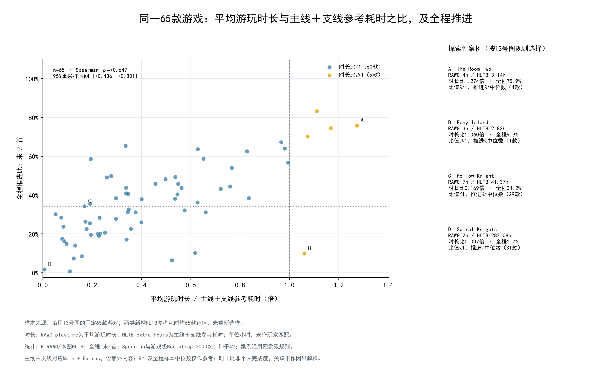
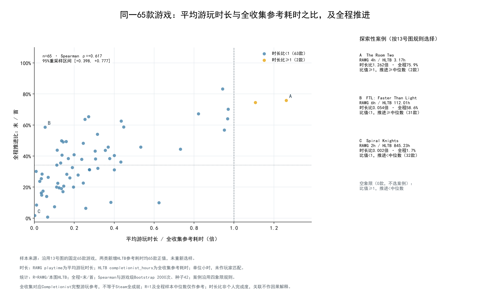

# 专题4补充：主线＋支线与全收集参考耗时

日期：2026-10-16。
沿用13号图的固定65款与全程推进比，两个参考耗时均65款正值；不更换样本、不开展类型对照。
RAWG playtime按已授权口径作为平均游玩时长；extra_hours是HLTB Main + Extras（主线＋额外内容），completionist_hours是Completionist完整游玩参考，不等于Steam全成就耗时。单位均为小时。

| HLTB参考口径 | n | R<1 | R>=1 | Spearman ρ | 95%游戏重采样区间 |
|---|---:|---:|---:|---:|---|
| 主线＋支线 | 65 | 60 | 5 | +0.647 | [+0.436, +0.801] |
| 全收集 | 65 | 63 | 2 | +0.617 | [+0.398, +0.777] |

## 图与规则

两图横轴分别为playtime/extra_hours、playtime/completionist_hours，纵轴均为原全程推进比p_f/p_s；三图13～15的游戏顺序、推进值、参考横线相同。每款等权，平均秩处理并列；整行游戏Bootstrap 2000次、种子42，95%百分位区间，不按p值筛选。
案例沿用13号图：R=1与全程比中位数划四象限，各取|log2(R)|最大者，再按推进偏离和AppID排序；空象限不补齐，不改变阈值。案例是探索性极端值，不能代表典型游戏。

## 来源与边界

数据分别来自借用快照的RAWG playtime与旧本地库games_time的两个HLTB字段，均只读按AppID关联；沿用原时长分析的快照指纹并校验01～13图及原分析产物未变。
主线≤主线＋支线≤全收集的顺序异常：0款；异常只标记，不截断或改值。
R是跨来源游戏级对照，不代表个人完成比例、支线参与率或全收集率；纵轴仍为主线推进，不是支线/全收集完成率。R>=1不能确认完成了相应内容。不同分母改变相关强度，不能直接说明哪类内容造成粘性变化。
[65款底表](reference_cohort.csv)、[相关与区间](reference_correlations.csv)、[案例与选样](reference_cases.csv)、[来源与保护核验](manifest.json)。原01～13图、两份数据库、其他分析结果和依赖文件不变；无采集或模型调用。RAWG来源：[RAWG](https://rawg.io/)。
