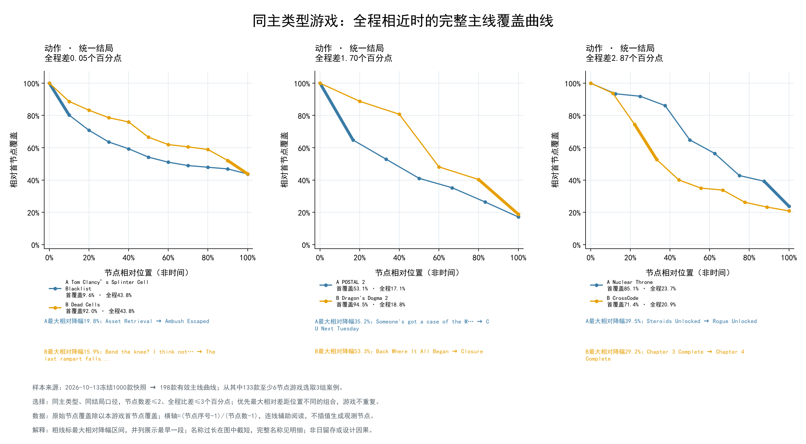
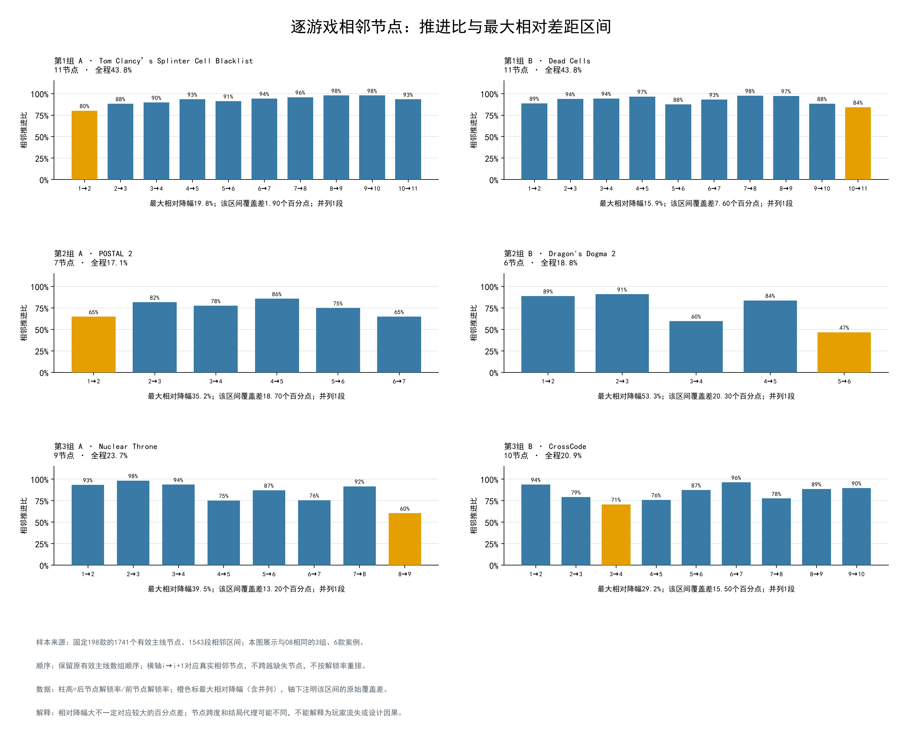

# 专题3：全程相近游戏的完整主线推进过程

实施日期：2026-10-16。数据版本：wwh5-2026-10-13T10:26:09.722887+00:00。

## 范围与计算

固定198款，1741个有效序列节点、1543段真实相邻区间；不改原指标、节点、数组顺序或代表结局。
183款至少3节点、172款至少4节点、133款至少6节点；15款仅有首末节点仍保留，不能用一个区间判断内部差距位置。
相邻推进比=p后/p前；相对降幅=1-相邻推进比；原始覆盖差=100×(p前-p后)个百分点；相对首节点覆盖=p节点/p首。
横轴相对位置=(序号-1)/(节点数-1)，不是游玩时间或真实剧情百分比。分母非正时留空，不补零或跨过缺失段；反向上升保留原值与标记，不截断或重排。
最大值并列均在明细标记，摘要与曲线标注原数组中最早一段；相邻比值全有效时检查乘积等于既有全程比。
max_gap_share=最大百分点差/(首末总百分点差)，仅在非反向且首末有正差时计算；首末相同留空。该比例受节点数量影响，不跨节点密度直接排名。

## 案例选择

至少6节点、同主类型、同结局口径、节点数差≤2、全程比差≤3个百分点，共63对候选；按最大相对降幅区间中点位置差降序、覆盖差集中度差降序、全程差升序、节点数差升序、AppID升序排序，贪心取最多3组不重复游戏。
该规则仅用于探索性展示，不是相同玩家、相同章节长度或因果控制；全部候选和是否选中均保存。节点不足不改变198款计算范围。

| 组 | 主类型 / 结局口径 | 游戏A（节点） | 游戏B（节点） | A全程 | B全程 | 全程差 |
|---|---|---|---|---:|---:|---:|
| 1 | 动作 / unified | Tom Clancy’s Splinter Cell Blacklist（11） | Dead Cells（11） | 43.75% | 43.80% | 0.05个百分点 |
| 2 | 动作 / unified | POSTAL 2（7） | Dragon's Dogma 2（6） | 17.14% | 18.84% | 1.70个百分点 |
| 3 | 动作 / unified | Nuclear Throne（9） | CrossCode（10） | 23.74% | 20.87% | 2.87个百分点 |

### 第1组：具体差距节点

- Tom Clancy’s Splinter Cell Blacklist：相对降幅最大区间为“Asset Retrieval” → “Ambush Escaped”，第1→2节点，阶段start→early；相对降幅19.79%，原始覆盖差1.90个百分点，并列1段。
- Dead Cells：相对降幅最大区间为“Bend the knee? I think not…” → “The last rampart falls...”，第10→11节点，阶段late→end；相对降幅15.87%，原始覆盖差7.60个百分点，并列1段。
原始首节点覆盖分别为9.60%与92.00%；图08将各自首节点归一为100%，因此曲线是在不同原始覆盖基准上的形态对照，不是相同玩家人群或相同入门门槛。

### 第2组：具体差距节点

- POSTAL 2：相对降幅最大区间为“Someone's got a case of the Mondays!” → “C U Next Tuesday”，第1→2节点，阶段start→early；相对降幅35.22%，原始覆盖差18.70个百分点，并列1段。
- Dragon's Dogma 2：相对降幅最大区间为“Back Where It All Began” → “Closure”，第5→6节点，阶段late→end；相对降幅53.28%，原始覆盖差20.30个百分点，并列1段。
原始首节点覆盖分别为53.10%与94.50%；图08将各自首节点归一为100%，因此曲线是在不同原始覆盖基准上的形态对照，不是相同玩家人群或相同入门门槛。

### 第3组：具体差距节点

- Nuclear Throne：相对降幅最大区间为“Steroids Unlocked” → “Rogue Unlocked”，第8→9节点，阶段late→end；相对降幅39.52%，原始覆盖差13.20个百分点，并列1段。
- CrossCode：相对降幅最大区间为“Chapter 3 Complete” → “Chapter 4 Complete”，第3→4节点，阶段early→middle；相对降幅29.19%，原始覆盖差15.50个百分点，并列1段。
原始首节点覆盖分别为85.10%与71.40%；图08将各自首节点归一为100%，因此曲线是在不同原始覆盖基准上的形态对照，不是相同玩家人群或相同入门门槛。

## 图与审计表

[相邻区间明细](adjacent_nodes.csv)、[全部游戏过程摘要](game_profiles.csv)、[全部案例候选及选中标记](case_candidates.csv)、[版本与保护核验](manifest.json)。

## 可解释结论与限制

图中可观察的是标注节点之间的聚合覆盖差距；全程相近并不意味着覆盖差距发生在同一个位置。这里按既定规则挑选差异较大的案例，不能据此估计此类模式在所有游戏中的普遍程度。
当前三组均为动作主类型、统一结局口径，是筛选和排序后的案例构成，不代表已检验所有类型；原始首节点覆盖差异同时展示，不因归一化而隐藏。
正文保留成就完整展示名；只在图中截短过长名称，不展示内部ID。后续可以结合成就描述核查节点语义和章节跨度；当前没有额外人工事实或设计原因证据，不把差距归因为Boss、剧情或操作难度。
模型公共主线和先后顺序继续复用，未证实玩家解锁集合的包含关系；相邻推进比不是条件玩家比例、流失率或日留存。不同节点密度、首节点与多结局代理均影响可比性。
数据库、T0Pre、既有底表和01～07图保持不变，无新采集、模型调用或数据库写入。
