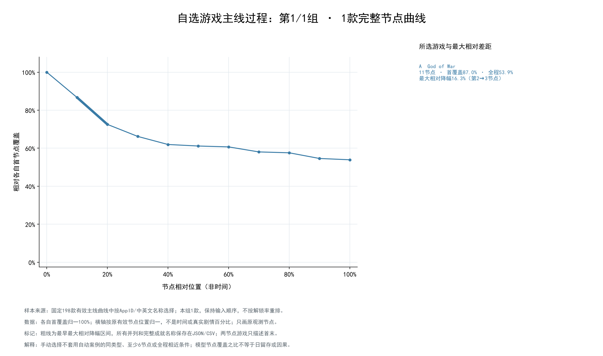
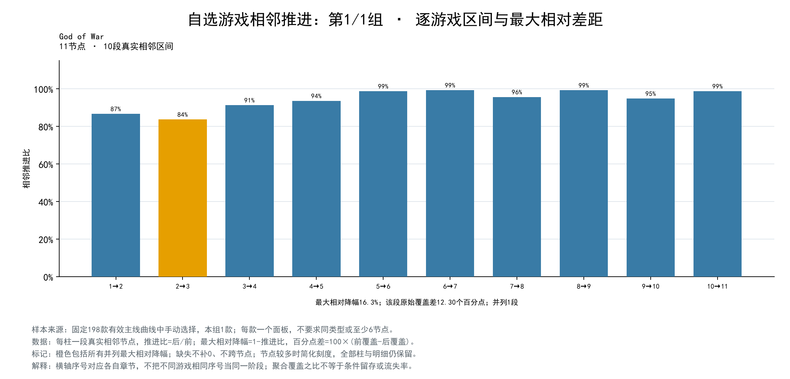

# 自选游戏主线过程对比

日期：2026-10-16。输入1款，实际1组，每组款数：[1]。
按输入顺序分组；默认每组2款，显式每组款数优先且尾组保留余数，仅指定组数时尽量均分。两参数同时传入必须一致。

手动选择不套用自动案例的同类型、至少6节点或全程相近条件。数组顺序、代表结局及全部指标沿用既有底表，缺失不补0；归一节点位置不是时间，主线推进比不是日留存。

## 第1组

God of War

[前端可读取的结构化数据](data.json)、[节点](selected_nodes.csv)、[过程摘要](selected_profiles.csv)、[相邻区间](selected_adjacent.csv)、[来源与保护](manifest.json)。
