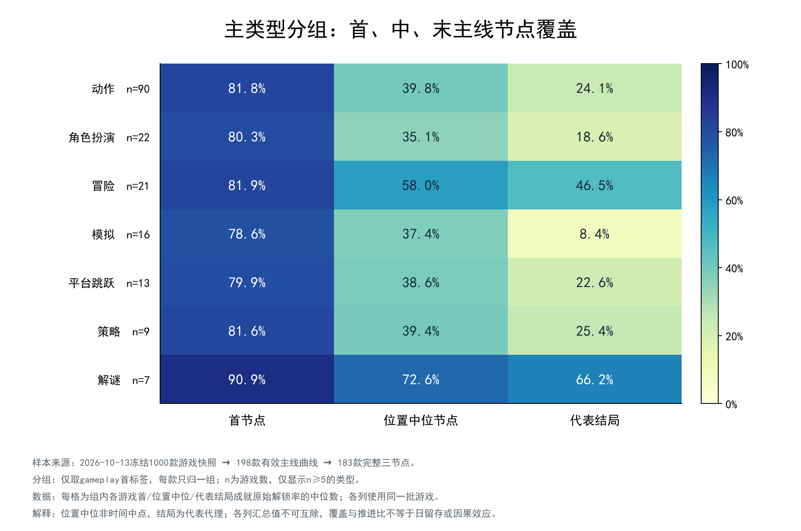
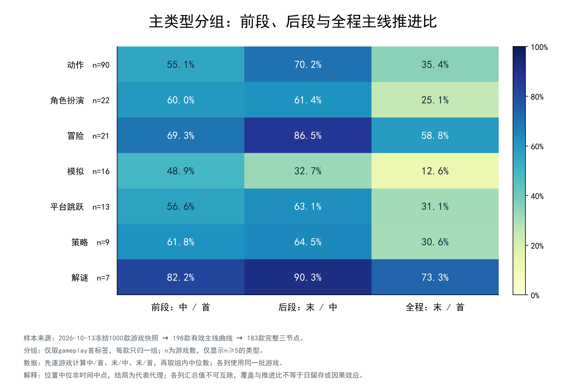
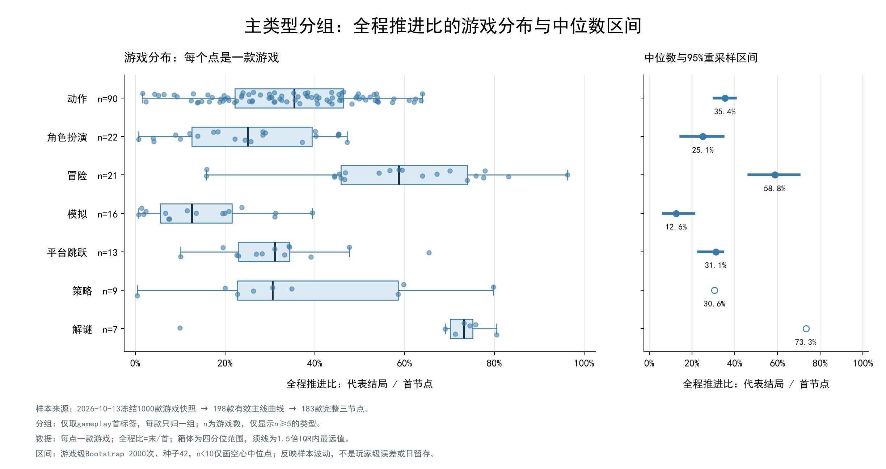
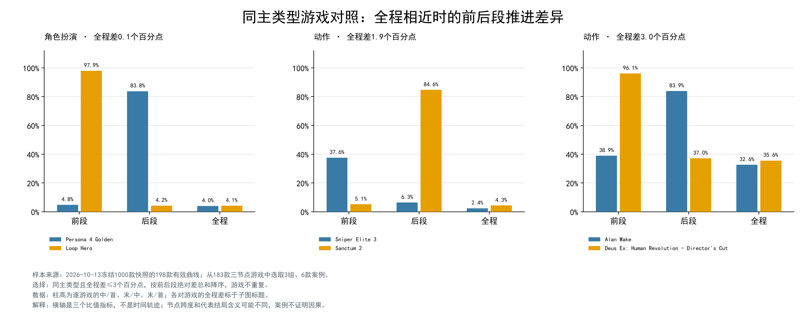

# 专题2：玩法类型与主线阶段推进

实施日期：2026-10-16。数据版本：wwh5-2026-10-13T10:26:09.722887+00:00。
固定WWH有效198款，主分析三节点齐全183款；其余15款保留在全范围补充，不补中位节点或零值。

## 口径与可比性

主类型取WWH gameplay[0]，互斥分组；完整gameplay为有重叠的补充。沿用数组位置中位、代表结局和每款游戏的已有比值，不重算选点、不写数据库。
每格先计算游戏级指标再取组内中位数。有效n>=5进入主图，n>=10报告95%游戏级百分位Bootstrap区间，2000次、种子42；四分位数使用线性插值。
六指标联合重采样整行游戏；不按评论数、玩家数或成就条数加权，不用汇总覆盖率互除。区间描述当前游戏集合重采样波动，不是总体随机抽样保证或玩家级误差。
不同列中位数不能相乘、互除或解释为同一批玩家轨迹；后段减前段先在每款游戏内部相减，再汇总。

## 原始分组汇总（完整三节点，游戏级中位数）

| 类型 | n | 首覆盖 | 中覆盖 | 结局覆盖 | 前段 | 后段 | 全程 | 后段−前段中位差 |
|---|---:|---:|---:|---:|---:|---:|---:|---:|
| 动作 | 90 | 81.8% | 39.8% | 24.1% | 55.1% | 70.2% | 35.4% | +14.9个百分点 |
| 角色扮演 | 22 | 80.3% | 35.1% | 18.6% | 60.0% | 61.4% | 25.1% | +5.0个百分点 |
| 冒险 | 21 | 81.9% | 58.0% | 46.5% | 69.3% | 86.5% | 58.8% | +16.1个百分点 |
| 模拟 | 16 | 78.6% | 37.4% | 8.4% | 48.9% | 32.7% | 12.6% | -12.6个百分点 |
| 平台跳跃 | 13 | 79.9% | 38.6% | 22.6% | 56.6% | 63.1% | 31.1% | +2.9个百分点 |
| 策略 | 9 | 81.6% | 39.4% | 25.4% | 61.8% | 64.5% | 30.6% | +13.1个百分点 |
| 解谜 | 7 | 90.9% | 72.6% | 66.2% | 82.2% | 90.3% | 73.3% | +7.7个百分点 |
| 生存（小样本，仅描述） | 2 | 84.3% | 71.2% | 14.5% | 85.0% | 21.3% | 19.0% | -63.7个百分点 |
| 竞速（小样本，仅描述） | 1 | 65.6% | 22.3% | 5.8% | 34.0% | 26.0% | 8.8% | -8.0个百分点 |
| 节奏（小样本，仅描述） | 1 | 41.1% | 14.6% | 3.5% | 35.5% | 24.0% | 8.5% | -11.6个百分点 |
| 体育（小样本，仅描述） | 1 | 57.6% | 16.4% | 5.6% | 28.5% | 34.1% | 9.7% | +5.7个百分点 |

全部指标、四分位数、缺失、区间与相对同子集整体中位数差见[group_summary.csv](group_summary.csv)。类型组总数与有效数分别保存；小组没有被合并或删除。

## 图与可核验观察

1. 观察：在n>=5的主类型中，首节点中位数最高为解谜90.9%（n=7），最低为模拟78.6%（n=16），相差12.3个百分点。
   解释：这是当前筛选游戏的类型关联；组内游戏结构、节点和结局定义都可能参与差异。意义与下一步：结合分布和下述口径对照评估，不据此宣称某类型造成留存变化。

2. 观察：在n>=5的主类型中，全程：末 / 首中位数最高为解谜73.3%（n=7），最低为模拟12.6%（n=16），相差60.7个百分点。
   解释：这是当前筛选游戏的类型关联；组内游戏结构、节点和结局定义都可能参与差异。意义与下一步：结合分布和下述口径对照评估，不据此宣称某类型造成留存变化。

## 缺失、类型重叠与口径对照

[game_membership.csv](game_membership.csv)列出主类型和完整标签成员，后者同一游戏可进入多个组，各组不独立、数量不能相加。
全198款首末有效值与主分析183款分别保存；不把两套集合拼成同一条阶段曲线。
[sensitivity_summary.csv](sensitivity_summary.csv)列出唯一首位start三节点170款、统一结局/多结局三节点子集，以及多标签相对主类型的差异；负值、缺失和小组均保留，不将变化直接解释为统计显著。

| 口径对照（主类型、全程） | 最大绝对变化的组 | 对照有效n | 相对主分析差 |
|---|---|---:|---:|
| 唯一首位start且三节点 | 策略 | 7 | -4.3个百分点 |
| 三节点且统一结局 | 动作 | 51 | -5.3个百分点 |
| 三节点且多结局代理 | 冒险 | 8 | +6.8个百分点 |

以上为探索性最大变化摘要，完整表同时保留其他组；对照重叠且不是独立实验。不能只凭区间重叠判断类型差异显著。

| 完整三节点玩法 | 主类型n | 主类型全程中位数 | 完整标签n | 完整标签全程中位数 | 差（多标签−主类型） |
|---|---:|---:|---:|---:|---:|
| 动作 | 90 | 35.4% | 130 | 34.3% | -1.1个百分点 |
| 冒险 | 21 | 58.8% | 146 | 35.9% | -22.9个百分点 |
| 平台跳跃 | 13 | 31.1% | 25 | 31.1% | +0.0个百分点 |
| 解谜 | 7 | 73.3% | 38 | 46.7% | -26.6个百分点 |
| 角色扮演 | 22 | 25.1% | 88 | 30.3% | +5.2个百分点 |
| 模拟 | 16 | 12.6% | 56 | 22.4% | +9.8个百分点 |
| 策略 | 9 | 30.6% | 42 | 22.4% | -8.2个百分点 |

多标签改变了各类型的成员构成，因此主类型排名不能直接当作稳定的类型差异。完整标签补充图见[multilabel_progress_heatmap.png](../../figures/06_tag_progress.png)。

## 代表案例与后续问题

案例选择规则在看结果前固定为：同一主类型、全程差不超过3个百分点，按前后段差异总和排序，选最多三组不复用游戏。它是展示规则，不是证据强度检验。

- Persona 4 Golden 与 Loop Hero：全程差0.14个百分点；前段分别4.8%/97.9%，后段分别83.8%/4.2%。
- Sniper Elite 3 与 Sanctum 2：全程差1.95个百分点；前段分别37.6%/5.1%，后段分别6.3%/84.6%。
- Alan Wake 与 Deus Ex: Human Revolution - Director's Cut：全程差2.98个百分点；前段分别38.9%/96.1%，后段分别83.9%/37.0%。

节点与展示名继续查上级[checkpoints.csv](../checkpoints.csv)，案例数值见[case_pairs.csv](case_pairs.csv)。
极端前后段反差是核查节点语义和章节跨度的线索，不能仅凭这些模型节点归因于游戏设计。下一步可结合具体章节跨度检查案例，再按data_plan专题3开展全节点过程对照；时长与口碑尚未分析，不能当作已排除的解释。

## 边界与来源

198款来自WWH冻结1000款经有效主线曲线筛选的子集，不能推广至全Steam或所有1000款；当前主类型分布明显不均衡。
首节点不是必然的游戏启动门槛，中位位置不是时间中点，多结局是代表代理，模型标注不等于人工事实。无已证实前置包含关系时，不把推进比称为条件玩家比例、日留存、弃坑率或因果影响。
输入版本、参数、输出哈希和数据库/T0Pre保护核验见[manifest.json](manifest.json)。无新增采集、模型调用或数据库写入。
