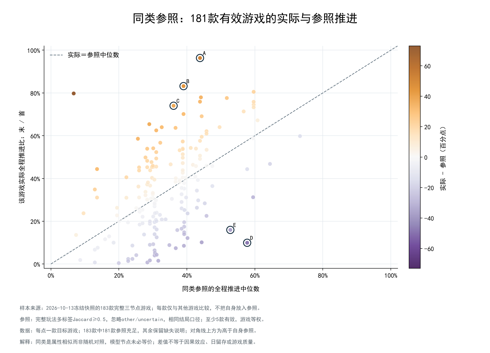
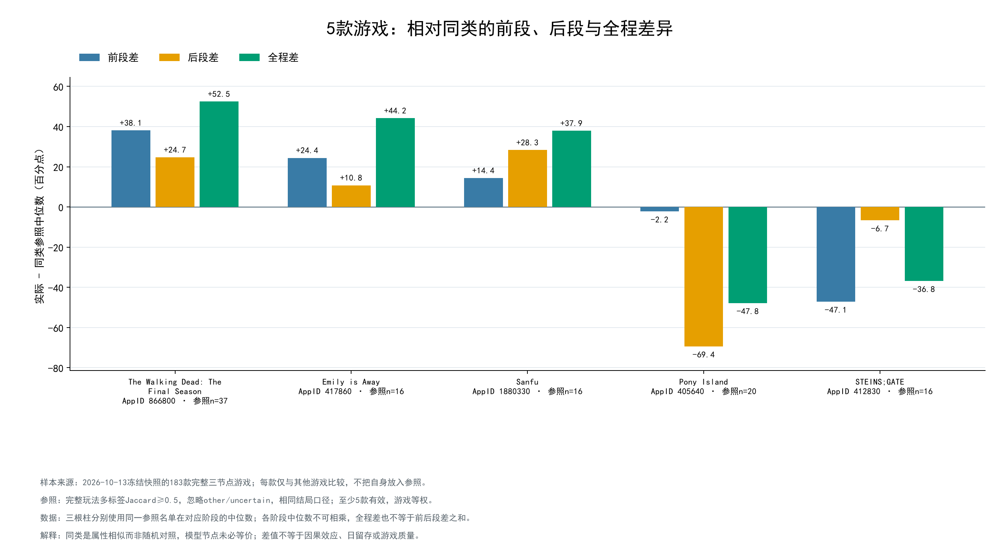
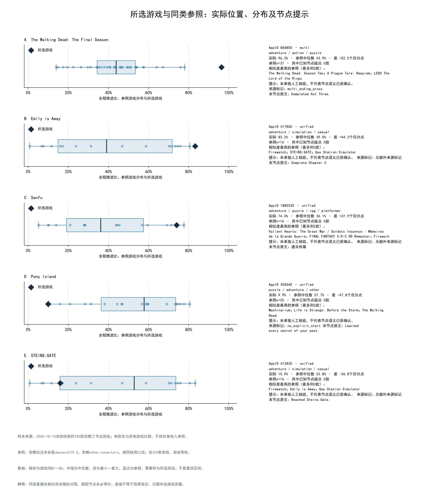

# 专题6：相对同类的主线推进表现

版本：lyx-multilabel-peer-benchmark-v1。运行时间：2026-10-17T03:43:32.795195+00:00。
冻结来源：wwh5-2026-10-13T10:26:09.722887+00:00，不是今天实时数据。

## 范围与方法

沿用198款底表中的183款完整三节点游戏；既有分类、数组位置中位节点和代表结局不变。旧库HLTB仅作68款长度补充，评分沿用任务5SteamSpy正负评价数。
完整gameplay集合用于Jaccard=交集数量/并集数量，忽略other与uncertain但保留原标签；相似度≥0.5、结局口径相同、排除自身，其他参照游戏等权。
不使用推进值挑参照，也不按相似度对结果加权。至少5款参照才报中位数、Q1/Q3、推进差与参照内百分位；不足时原值和参照数量保留、统计留空，不自动放宽条件。
推进差=目标实际值−参照游戏该指标中位数，内部单位0～1，展示差乘100为百分点；参照内百分位=(低于目标款数＋0.5×同值款数)/n。
前/后/全程各自取游戏级中位数，三项参照名单相同；三个中位数不能相乘，三项差值不能相加。箱体是参照游戏间四分位范围，不是置信区间。

这是留一同类描述基准，不是交叉验证预测模型；没有回归、SHAP、用户级留存推断或因果控制。183款不代表全部Steam，多个目标的参照可能重叠，不能当成独立重复实验。

## 实际覆盖

| 条件 | 待分析范围 | 有效参照≥5 | 参照≥10 | 参照不足 | 缺目标时长 | 参照数中位数 |
|---|---:|---:|---:|---:|---:|---:|
| 多标签主参照 | 183 | 181 | 160 | 2 | 0 | 33 |
| 相似度≥0.4 | 183 | 182 | 175 | 1 | 0 | 48 |
| 相似度≥0.6 | 183 | 157 | 120 | 26 | 0 | 14 |
| 主参照＋好评差≤10个百分点 | 183 | 165 | 138 | 18 | 0 | 19 |
| 主参照＋主线时长比≤2 | 68 | 46 | 33 | 22 | 115 | 9 |

主参照有效181款：高于参照91款、低于参照90款、相等0款。每款的参照不同，正负数量不要求对半。

主口径参照不足的游戏：397950 Clustertruck（n=4）；861650 Session: Skate Sim（n=0）。

长度条件使用较宽的两倍时长带来建立一组参照，与任务5找成对案例的1.25倍条件用途不同；不声称完全匹配长度。缺失不补值、不要求所有183款都具备HLTB。

## 条件对照：同一批目标游戏

以下只在主参照与相应条件都有效的目标交集比较；差值变化来自参照名单变化，目标实际推进未改变。方向一致只表示相对位置符号一致，不是统计显著性。

| 条件 | 共同有效目标 | 两差均非零 | 方向一致 | 主差中位数 | 条件差中位数 | 差变动绝对值中位数 |
|---|---:|---:|---:|---:|---:|---:|
| 相似度≥0.4 | 181 | 181 | 170 | +0.18pp | -0.15pp | 1.14pp |
| 相似度≥0.6 | 157 | 157 | 150 | -0.32pp | -0.17pp | 1.49pp |
| 主参照＋好评差≤10个百分点 | 165 | 165 | 161 | -0.32pp | -1.32pp | 1.14pp |
| 主参照＋主线时长比≤2 | 46 | 46 | 42 | -1.43pp | +1.39pp | 4.80pp |

## 自动案例与选择规则

主参照至少10款、全程差绝对值≥10个百分点，Jaccard≥0.4/0.5/0.6下均至少5参照且差值方向一致；按差绝对值降序、参照数降序、AppID升序，最多取3个正向和2个负向。
已在任务5记录具体语义疑点的6款不自动推荐，但仍参与完整计算和参照，已知疑点参照数单列。未列疑点不等于已人工核验；案例是探索性偏离，不是游戏质量或设计排行榜。

| 案例 | AppID | 游戏 | 全部玩法标签 | 参照n | 实际全程 | 参照中位数 | 差值 | 参照内百分位 |
|---|---:|---|---|---:|---:|---:|---:|---:|
| A | 866800 | The Walking Dead: The Final Season | adventure/action/puzzle | 37 | 96.3% | 43.9% | +52.5pp | 100.0% |
| B | 417860 | Emily is Away | adventure/simulation/casual | 16 | 83.2% | 39.0% | +44.2pp | 100.0% |
| C | 1880330 | Sanfu | adventure/puzzle/rpg/platformer | 16 | 74.0% | 36.1% | +37.9pp | 93.8% |
| D | 405640 | Pony Island | puzzle/adventure/other | 20 | 9.9% | 57.7% | -47.8pp | 0.0% |
| E | 412830 | STEINS;GATE | adventure/simulation/casual | 16 | 15.9% | 52.8% | -36.8pp | 25.0% |

案例数量不足时不凑数。同系列、相同标签或重叠参照会使多个案例相关，不能把每款当成独立的设计效果证据。
每个目标的完整参照名单保存在peer_membership.csv，包括相似度、标签、评分、HLTB时长和已知节点提示。

### 自动案例的原始三节点

| AppID | 游戏 | 首节点描述 | 中节点描述 | 末节点描述 | 来源标记 |
|---:|---|---|---|---|---|
| 866800 | The Walking Dead: The Final Season | Completed Act One. | Completed Act Two. | Completed Act Three. | multi_ending_proxy |
| 417860 | Emily is Away | Complete Chapter 1 | Complete Chapter 3 | Complete Chapter 5 |  |
| 1880330 | Sanfu | 通关序章 | 通关点播台章 | 通关终章 |  |
| 405640 | Pony Island | Unlocked Pony Lasers. | Killed Louey. | Learned every secret of your past. | no_explicit_start |
| 412830 | STEINS;GATE | Started Steins;Gate. | 缺失 | Reached Steins Gate. |  |

例如Pony Island末节点含Learned every secret of your past（全部秘密）要求，不能直接当成普通剧情结局；STEINS;GATE中位节点描述缺失；The Walking Dead: The Final Season的末节点只标Completed Act Three，覆盖是否等于整部游戏结局仍待人工核对。
自动案例只是按数据规则挑出的核查对象，并非通过了语义质量审查。保留原文比把高/低差值直接归因于设计更重要。

## 节点可比性限制

同结局口径只区分unified/multi代理，不证明末节点任务要求等价。来源中的“全部任务线”“100%战役”“特定模式”“一局胜利”及教程中位节点、描述缺失等疑点继续保留；没有在本轮改分类、顺序或数据库。

| AppID | 游戏 | 已记录疑点 | 主参照n | 实际−参照 |
|---:|---|---|---:|---:|
| 2379780 | Balatro | 末节点是赢得一局，是对局进程代理，非传统剧情结局。 | 5 | +73.0pp |
| 2054970 | Dragon's Dogma 2 | 末节点原文注明Casual Mode不可用，存在模式限制。 | 60 | -10.3pp |
| 1113000 | Persona 4 Golden | 中、末节点描述缺失，普通剧情必经性待核验。 | 18 | -26.5pp |
| 1874880 | Arma Reforger | 首末为特定战役，中位节点为教程；前后包含关系待核验。 | 13 | -4.2pp |
| 794260 | Outward Definitive Edition | 末节点要求全部3条任务线，不能直接等同完成任一条主线。 | 27 | -27.6pp |
| 238090 | Sniper Elite 3 | 末节点要求100%完成战役，与普通结局是否等价待核验。 | 27 | -21.6pp |

不是所有目标或参照都做过逐项人工语义核验，因此不能把相对差值称为真实留存优势。强结论应先对目标及主要参照的节点含义作人工复核；本轮不把全面人工核验设为运行前置。

## 本次图中所选游戏

| AppID | 游戏 | 可用状态 | 参照数 |
|---:|---|---|---:|
| 866800 | The Walking Dead: The Final Season | available | 37 |
| 417860 | Emily is Away | available | 16 |
| 1880330 | Sanfu | available | 16 |
| 405640 | Pony Island | available | 20 |
| 412830 | STEINS;GATE | available | 16 |

上述选择仅影响描边和20/21展示对象，前面自动案例表与总体条件统计不随选择变化。

## 图表与读法

19：全部有效目标构成固定背景；对角线上方表示实际全程高于其同类参照，不表示该游戏绝对完成率更高，也不是模型预测准确度图。选择只加描边。

20：各阶段的实际值减同阶段参照中位数。可以定位相对差距在前段还是后段，但不是时间轨迹或玩家流失归因。

21：蓝点为其他参照游戏，箱体Q1～Q3、须最小～最大、黑菱形为目标；右侧卡片含最相似参照和语义提示。参照不足或两节点选择保留说明，不补零点。

## 产物、交互与后续

[游戏主参照](peer_benchmark.csv)、[915行条件结果](peer_conditions.csv)、[完整参照名单](peer_membership.csv)、[覆盖](peer_coverage.csv)、
[逐目标条件对照](benchmark_sensitivity.csv)、[共同交集汇总](matched_sensitivity.csv)、[自动案例](benchmark_cases.csv)、[节点提示](semantic_caveats.csv)。
data.json含183款、全部参照条件、案例与名录；manifest保存源版本、代码/产物指纹和数据库及既有1～18图/输出保护。CSV/JSON为本地忽略产物，网页发布需单独交接。
query_benchmark支持1～5款AppID/已有中英文名，从已准备数据取结果，不重新计算参照。183款以外但在原198款内的选择保留两节点提示；主参照不足保留n与缺失原因。
总体19图及所有参照始终固定；20/21展示所选游戏。后端不需要重新抓取、调用模型或将Python依赖装入Go网页。未实现HTTP服务或网页部署。
下一步可人工抽查突出案例及其主要参照的节点语义，再讨论是否需要普通结局子样本；不因差值大就自动改数据。当前未训练回归模型，不声称已经排除所有可观察差异。
