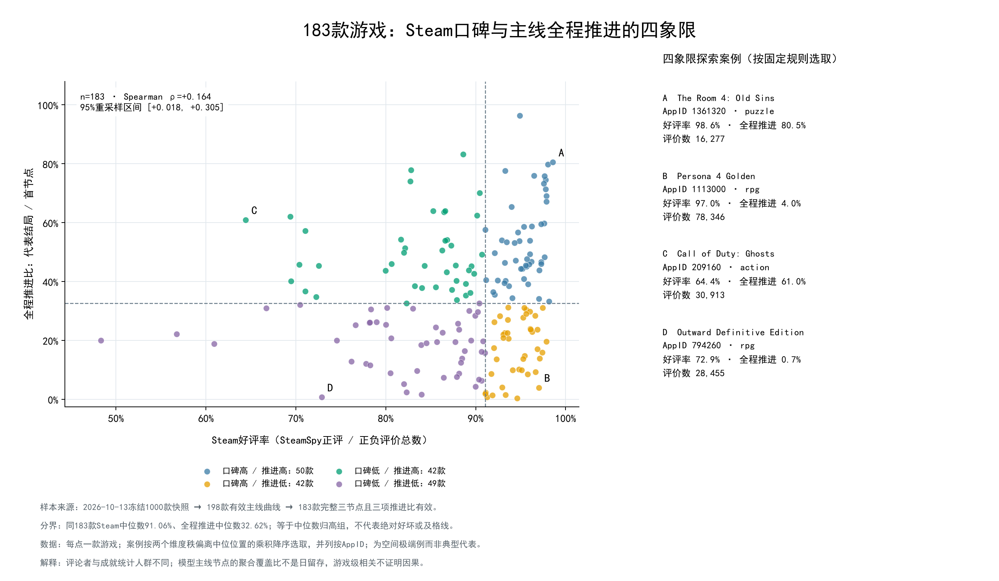
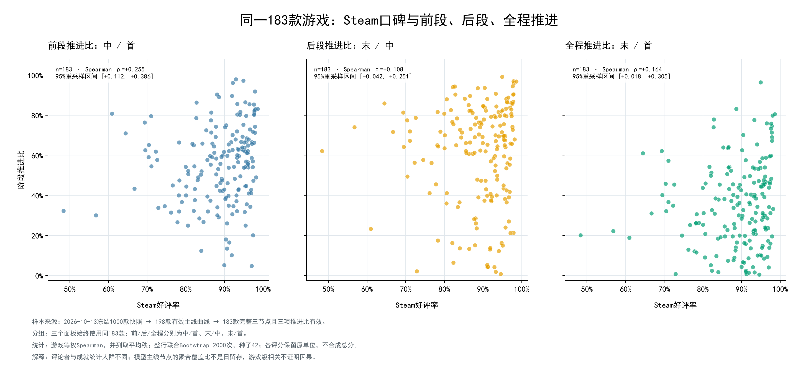
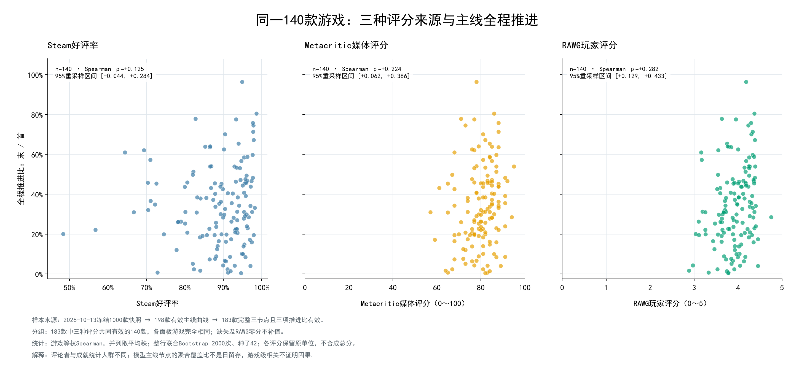

# 专题5：口碑与主线推进

运行时间：2026-10-17T03:19:12.785756+00:00。版本：lyx-reputation-three-point-v1。
数据版本：`wwh5-2026-10-13T10:26:09.722887+00:00`；冻结快照，不是运行当天实时评分。

## 样本与来源

| 项目 | 游戏数 |
|---|---:|
| 固定主线底表 | 198 |
| 完整且不同的首、中、末节点及全部推进比有效 | 183 |
| 排除的两节点游戏 | 15 |
| Steam好评率有效 | 183 |
| Metacritic有效（43款NULL） | 140 |
| RAWG正值评分（5款NULL、5款零） | 173 |
| 三种评分共同有效 | 140 |
| 正值HLTB主线参考耗时补充 | 68 |
| 三种评分与HLTB共同有效 | 61 |

任务5三个方向全部从183款完整三节点出发；图16、17同183款，图18三个面板固定同140款。
数组位置中位节点、代表结局与类型沿用T1，不重排、不重新标注。分母须正，缺失不补零，分子有效零保留。

主评分只读借用库`games.payload`：SteamSpy `positive/(positive+negative)`，逐款核对`review_count=positive+negative`；
媒体评分取`rawg.metacritic`（0～100，正值）；玩家评分取`rawg.rating`（0～5，正值）。RAWG零分保留原值和状态供审计，不解释成低口碑。
未使用旧库`games_rate.review_percent`混合补值。旧库仅以AppID补充`games_time.main_hours`供案例匹配，不改变评分样本。
逐项来源时间、原始零分、评分人数、类型、质量标记与198款排除台账均保存；RAWG媒体评分的源是RAWG中的Metacritic字段，不是另行请求Metacritic。

## 方法与统计结果

每款游戏等权。Spearman并列取平均秩；整行游戏级Bootstrap 2000次、种子42、百分位95%区间，每次重采样后重新排名。
同140款三种评分共享相同抽样下标，系数差用同轮差值形成区间；不以区间是否跨零筛选或隐藏结果，不把三平台评分合成总分。
区间刻画该固定游戏集合的重采样波动，不是评论者/成就玩家的抽样误差，不能代表全部Steam。

| 样本 | 评分 | 推进指标 | n | Spearman ρ | 95%重采样区间 |
|---|---|---|---:|---:|---|
| steam183 | Steam好评率 | 前段推进比：中 / 首 | 183 | +0.255 | [+0.112, +0.386] |
| steam183 | Steam好评率 | 后段推进比：末 / 中 | 183 | +0.108 | [-0.042, +0.251] |
| steam183 | Steam好评率 | 全程推进比：末 / 首 | 183 | +0.164 | [+0.018, +0.305] |
| common140 | Steam好评率 | 前段推进比：中 / 首 | 140 | +0.219 | [+0.048, +0.365] |
| common140 | Steam好评率 | 后段推进比：末 / 中 | 140 | +0.076 | [-0.090, +0.235] |
| common140 | Steam好评率 | 全程推进比：末 / 首 | 140 | +0.125 | [-0.044, +0.284] |
| common140 | Metacritic媒体评分 | 前段推进比：中 / 首 | 140 | +0.224 | [+0.067, +0.375] |
| common140 | Metacritic媒体评分 | 后段推进比：末 / 中 | 140 | +0.176 | [+0.017, +0.338] |
| common140 | Metacritic媒体评分 | 全程推进比：末 / 首 | 140 | +0.224 | [+0.062, +0.386] |
| common140 | RAWG玩家评分 | 前段推进比：中 / 首 | 140 | +0.268 | [+0.097, +0.423] |
| common140 | RAWG玩家评分 | 后段推进比：末 / 中 | 140 | +0.226 | [+0.074, +0.381] |
| common140 | RAWG玩家评分 | 全程推进比：末 / 首 | 140 | +0.282 | [+0.129, +0.433] |

**观测：** 同183款Steam好评率与全程推进ρ=+0.164；三个阶段中绝对相关最大的为前段推进比：中 / 首（ρ=+0.255）。
**解释：** 评分与推进可同时反映不同体验维度；相关强弱不证明哪个阶段导致评价，也不能用它推断个人评论与通关行为的对应关系。
**使用：** 对照图中的分布和案例阅读；原始有效覆盖183/140/173只用于缺失说明，跨评分结论以共同140款为准。

### 同样本评分相关系数差

| 评分A − 评分B | 推进指标 | ρ差 | 95%成对区间 |
|---|---|---:|---|
| Steam好评率 − Metacritic媒体评分 | 前段推进比：中 / 首 | -0.005 | [-0.177, +0.158] |
| Steam好评率 − Metacritic媒体评分 | 后段推进比：末 / 中 | -0.100 | [-0.278, +0.080] |
| Steam好评率 − Metacritic媒体评分 | 全程推进比：末 / 首 | -0.098 | [-0.281, +0.074] |
| Steam好评率 − RAWG玩家评分 | 前段推进比：中 / 首 | -0.049 | [-0.184, +0.074] |
| Steam好评率 − RAWG玩家评分 | 后段推进比：末 / 中 | -0.150 | [-0.288, -0.020] |
| Steam好评率 − RAWG玩家评分 | 全程推进比：末 / 首 | -0.156 | [-0.291, -0.029] |
| Metacritic媒体评分 − RAWG玩家评分 | 前段推进比：中 / 首 | -0.044 | [-0.207, +0.120] |
| Metacritic媒体评分 − RAWG玩家评分 | 后段推进比：末 / 中 | -0.050 | [-0.197, +0.098] |
| Metacritic媒体评分 − RAWG玩家评分 | 全程推进比：末 / 首 | -0.058 | [-0.215, +0.100] |

区间跨零时，这一快照不足以稳定区分两种评分的关联强度；未跨零也不意味着该评分更真实或有因果解释力。

### 起点、结局及评价人数对照

这些子样本仍要求完整三节点，不替换183款主分析；各子集游戏名单及指纹保存在sensitivity_correlations.csv。

| 子集 | n | 前段ρ | 后段ρ | 全程ρ |
|---|---:|---:|---:|---:|
| 单一start标签 | 170 | +0.264 | +0.124 | +0.179 |
| 统一结局 | 107 | +0.351 | +0.184 | +0.249 |
| 多结局代理 | 76 | +0.094 | -0.030 | -0.008 |

分组后关联强度变化说明结局口径与游戏构成值得关注；这些子集也有其他属性差异，不能据此归因。完整区间见CSV。
共同140款RAWG评价人数均≥50，加入这一人数要求后仍为同140款、统计不变；不把所有183款都当成评分人数达标。

## 四象限与案例

两轴分界均用同183款样本中位数；等于中位数归高组。“高/低”是样本内相对位置，不是绝对评价等级。

| 象限 | 游戏数 |
|---|---:|
| 口碑≥样本中位数、推进≥样本中位数 | 50 |
| 口碑≥样本中位数、推进<样本中位数 | 42 |
| 口碑<样本中位数、推进≥样本中位数 | 42 |
| 口碑<样本中位数、推进<样本中位数 | 49 |

Steam分界91.0575%，全程推进分界32.6203%。
每象限按两个维度百分位秩偏离0.5的绝对值乘积最大选一款，并列按AppID；百分位秩=(平均秩−0.5)/183。案例为空间极端示例，不是随机或典型样本，不声称控制类型/长度。

| 案例 | AppID | 游戏 | 好评率 | 全程推进 |
|---|---:|---|---:|---:|
| A | 1361320 | The Room 4: Old Sins | 98.59% | 80.53% |
| B | 1113000 | Persona 4 Golden | 97.02% | 4.01% |
| C | 209160 | Call of Duty®: Ghosts | 64.43% | 60.96% |
| D | 794260 | Outward Definitive Edition | 72.88% | 0.73% |

### 同类同长度补充案例

68款有HLTB的完整三节点游戏中，同主类型、同结局口径且主线参考耗时最大/最小≤1.25形成 **99对候选**，不是99款游戏。
只从评分差和推进差反向的组合中，按两个差值乘积绝对值降序选择最多3对不重复游戏；并列按推进差、AppID。
这是探索性匹配案例，未控制所有混杂因素，不是因果配对研究。无足够组合时不补凑。

| 游戏A | 游戏B | 主类型 | 主线参考耗时A/B | 好评差（百分点） | 推进差（百分点） |
|---|---|---|---|---:|---:|
| Battlefield™ 1 | POSTAL 2 | action | 6.74/7.03小时 | 10.37 | 46.53 |
| Gears 5 | Fable Anniversary | action | 11.18/13.47小时 | 15.33 | 26.23 |
| Metro: Last Light Redux | Tom Clancy’s Splinter Cell Blacklist | action | 9.73/10.76小时 | 10.68 | 37.38 |

## 图表怎么读

16：每点一款，两个虚线是固定183款中位数。看相对位置及分布，再读A～D极端案例；低组不等于游戏质量差。

17：横轴始终Steam好评率，纵轴依次前、后、全程比。三图同183款，比较ρ和区间；这三个指标数学相关，不能当成三次独立重复实验。

18：同140款、相同全程比，各评分使用原单位。点云斜率不可跨单位直接比较，应比较秩相关及成对差值区间；140款结果不能冒充183款全样本。

## 数据交接与边界

CSV：reputation_eligibility.csv（198），reputation_cohort.csv（183），rating_common.csv（140），score_coverage.csv，score_summary.csv，
reputation_correlations.csv，correlation_differences.csv，reputation_quadrants.csv，quadrant_cases.csv，matched_candidates.csv，matched_cases.csv。
data.json含固定背景183款、共同背景140款、可选1～5款的明细及全局统计；选择只高亮，不改变背景、中位线、区间或相关系数。
不在183款或缺共同评分的选择仍保留状态与缺失原因，供网页展示原因卡片，不在相应图中补零。当前提供本地CLI与无写入Python查询，不表示已部署网页。

模型节点及数组顺序继续复用，代表结局不自动证明普通必经性；评论者与成就分母人群不同，不能称为日留存、弃坑率或因果效应。
本轮不调用模型或远端API、不重分类、不写SQLite、不运行任务6建模。RAWG数据的网页展示须保留[RAWG来源回链](https://rawg.io/)。

## 图16～18的进一步探索解读

本节按负责人确认的图号分析：16为四象限，17第二面板为后段推进，18为评分来源。原15号是时长图，本轮不改变原时长专题。
这里的类型使用完整gameplay多标签，每款可属于多个类型，同一游戏在同一标签内只计一次；分母为各区域的游戏数，占比之和可超过100%。
比较区域内占比与全部183款背景占比，提升倍数=区域占比/背景占比。背景包含该区域；CSV另给区域外占比，不把大类数量多误认为特征。
本节为看图后提出的探索性问题，不作显著性筛选或因果检验；多标签重叠、类型共现及节点语义均可能影响观察。

### 1. 四象限里的类型有什么共性？

正文每组列区域占比高于背景且区域至少5款、背景至少10款的前三个最大百分点差标签；全部标签（含不足5款）及零计数保存在CSV。
| 象限 | n | 多标签 | 区域内 | 全183背景 | 差值（百分点） | 提升倍数 |
|---|---:|---|---|---|---:|---:|
| 口碑高 / 全程高 | 50 | 解谜 | 24/50（48.0%） | 38/183（20.8%） | +27.2 | 2.31 |
| 口碑高 / 全程高 | 50 | 冒险 | 45/50（90.0%） | 146/183（79.8%） | +10.2 | 1.13 |
| 口碑高 / 全程高 | 50 | 平台跳跃 | 11/50（22.0%） | 25/183（13.7%） | +8.3 | 1.61 |
| 口碑高 / 全程低 | 42 | 模拟 | 20/42（47.6%） | 56/183（30.6%） | +17.0 | 1.56 |
| 口碑高 / 全程低 | 42 | 平台跳跃 | 11/42（26.2%） | 25/183（13.7%） | +12.5 | 1.92 |
| 口碑高 / 全程低 | 42 | 策略 | 14/42（33.3%） | 42/183（23.0%） | +10.4 | 1.45 |
| 口碑低 / 全程高 | 42 | 动作 | 37/42（88.1%） | 130/183（71.0%） | +17.1 | 1.24 |
| 口碑低 / 全程高 | 42 | 其他 | 13/42（31.0%） | 43/183（23.5%） | +7.5 | 1.32 |
| 口碑低 / 全程高 | 42 | 冒险 | 35/42（83.3%） | 146/183（79.8%） | +3.6 | 1.04 |
| 口碑低 / 全程低 | 49 | 策略 | 18/49（36.7%） | 42/183（23.0%） | +13.8 | 1.60 |
| 口碑低 / 全程低 | 49 | 角色扮演 | 29/49（59.2%） | 88/183（48.1%） | +11.1 | 1.23 |
| 口碑低 / 全程低 | 49 | 生存 | 13/49（26.5%） | 29/183（15.8%） | +10.7 | 1.67 |

**读法与可研究的方向：**

- 高口碑高推进：解谜占48.0%，较总体高27.2个百分点，比冒险单标签的提升更明显；可优先研究“解谜＋冒险”的组合，而不是笼统地说冒险都容易完成。
- 高口碑低推进：模拟47.6%、策略33.3%均高于背景。可提出“评价认可与完成主线不是同一目标”的假设，但标签本身不足以认定游戏没有主线或玩家只玩沙盒。
- 低口碑高推进：动作占88.1%，提示较低的相对口碑并不妨碍部分游戏取得较高推进。是否更线性、更短或面向不同玩家，仍需另外核查，不能从动作标签直接推出。
- 低口碑低推进：策略、角色扮演、生存更常见，可研究长流程、重复尝试、不同结局代理是否影响结果；当前并没有证明这些设计导致低推进。
- 一个反直觉点：平台跳跃在高口碑高推进、高口碑低推进中各有11款，不能仅看它在某个象限的提升倍数，就认定平台跳跃普遍更易完成。
这些标签不能相互排斥解释。例如同一解谜游戏可以同时带冒险、休闲、其他标签，不能把各行当成不同游戏群的独立证据；other也不代表一种具体玩法。

共现的具体组合见下表（各象限按出现款数降序，至少5款，取前2项）；这是标签组合构成，不是相加后的独立样本。

| 象限 | 标签组合 | 区域内 | 背景占比 | 提升倍数 |
|---|---|---|---|---:|
| 口碑高 / 全程高 | 动作＋冒险 | 29/50（58.0%） | 59.0% | 0.98 |
| 口碑高 / 全程高 | 冒险＋解谜 | 24/50（48.0%） | 19.7% | 2.44 |
| 口碑高 / 全程低 | 动作＋冒险 | 23/42（54.8%） | 59.0% | 0.93 |
| 口碑高 / 全程低 | 冒险＋角色扮演 | 16/42（38.1%） | 42.1% | 0.91 |
| 口碑低 / 全程高 | 动作＋冒险 | 30/42（71.4%） | 59.0% | 1.21 |
| 口碑低 / 全程高 | 动作＋角色扮演 | 17/42（40.5%） | 36.1% | 1.12 |
| 口碑低 / 全程低 | 动作＋冒险 | 26/49（53.1%） | 59.0% | 0.90 |
| 口碑低 / 全程低 | 冒险＋角色扮演 | 24/49（49.0%） | 42.1% | 1.16 |

### 2. 后段面板右上角为什么集中？

将视觉区域明确为 **Steam好评率≥90%、后段推进比≥80%**。这是看图后设定的探索边界，不是自动发现的聚类，也不是质量合格线。
| 多标签 | 右上区域 | 全183背景 | 提升倍数 | 同为好评≥90%背景中的占比 |
|---|---|---|---:|---|
| 解谜 | 19/28（67.9%） | 38/183（20.8%） | 3.27 | 32/102（31.4%） |
| 休闲 | 9/28（32.1%） | 30/183（16.4%） | 1.96 | 23/102（22.5%） |
| 冒险 | 25/28（89.3%） | 146/183（79.8%） | 1.12 | 86/102（84.3%） |
| 其他 | 9/28（32.1%） | 43/183（23.5%） | 1.37 | 26/102（25.5%） |
| 动作 | 13/28（46.4%） | 130/183（71.0%） | 0.65 | 65/102（63.7%） |
| 角色扮演 | 6/28（21.4%） | 88/183（48.1%） | 0.45 | 41/102（40.2%） |

借用库的题材/表现/人数标签可补充解释，但它们是模型根据标签整理的自由文本，不是人工统一词典；原样按字符串计数、不合并近义词，不能因未标某词就断言没有该特征。

| 维度 | 标签 | 区域内 | 全183背景 | 提升倍数 |
|---|---|---|---|---:|
| theme | Story Rich | 22/28（78.6%） | 79/183（43.2%） | 1.82 |
| theme | Mystery | 15/28（53.6%） | 23/183（12.6%） | 4.26 |
| theme | Horror | 15/28（53.6%） | 37/183（20.2%） | 2.65 |
| presentation | Atmospheric | 22/28（78.6%） | 102/183（55.7%） | 1.41 |
| presentation | Great Soundtrack | 15/28（53.6%） | 84/183（45.9%） | 1.17 |
| presentation | First-Person | 8/28（28.6%） | 49/183（26.8%） | 1.07 |
| player_mode | Singleplayer | 28/28（100.0%） | 182/183（99.5%） | 1.01 |
| player_mode | Multiplayer | 5/28（17.9%） | 85/183（46.4%） | 0.38 |

**可以支持的解释：** 该区域呈现解谜、叙事/悬疑等标签的聚集，值得把“具有明确阶段目标的叙事/解谜游戏”作为后续研究假设；不能据此断言这些设计导致高推进。单人标签即使非常普遍，也须对照总体是否同样普遍。

**需要分开的两个问题：** 后段高只表示末/中高，不自动代表从开头就高。以下比较各组游戏级中位数，不能把这些中位数相乘重算全程。

| 范围 | n | 首覆盖 | 中覆盖 | 末覆盖 | 前段 | 后段 | 全程 | 多结局代理 | HLTB有效n/主线时长中位数 |
|---|---:|---:|---:|---:|---:|---:|---:|---|---|
| 右上区域 | 28 | 82.6% | 58.0% | 49.5% | 71.5% | 86.6% | 61.0% | 9/28 | 12/8.85小时 |
| 同为高口碑、后段<80% | 74 | 81.7% | 42.8% | 20.2% | 57.7% | 55.7% | 27.4% | 34/74 | 29/12.65小时 |
| 全部三节点 | 183 | 81.6% | 41.8% | 22.7% | 57.0% | 67.1% | 32.6% | 76/183 | 68/12.02小时 |

HLTB只覆盖部分游戏，因此区域内12款的时长中位数不能当成全部28款长度；本节不据此断言该区域整体更短。

**边界敏感性：** 保存好评85%/90%/95%×后段70%/80%/90%全部9个区域，避免只挑最醒目的边界。

| 好评下限 | 后段下限 | n | 解谜n | 解谜占比 | 对183款背景提升倍数 |
|---:|---:|---:|---:|---:|---:|
| 85% | 70% | 59 | 24 | 40.7% | 1.96 |
| 85% | 80% | 36 | 20 | 55.6% | 2.68 |
| 85% | 90% | 10 | 7 | 70.0% | 3.37 |
| 90% | 70% | 43 | 23 | 53.5% | 2.58 |
| 90% | 80% | 28 | 19 | 67.9% | 3.27 |
| 90% | 90% | 9 | 7 | 77.8% | 3.75 |
| 95% | 70% | 24 | 17 | 70.8% | 3.41 |
| 95% | 80% | 18 | 14 | 77.8% | 3.75 |
| 95% | 90% | 6 | 5 | 83.3% | 4.01 |

看图后再分组的相关仅作描述，不是控制混杂的回归或因果证据：

| 组别 | n | 好评率与后段Spearman |
|---|---:|---:|
| all183 | 183 | +0.108 |
| puzzle | 38 | +0.479 |
| non_puzzle | 145 | -0.097 |

总体后段相关较弱，解谜与非解谜组内的描述关联也不同，提示不能用一个总体系数概括所有类型；分组仍有重叠类型、系列与节点差异，不是已经控制其他因素的结论。

### 3. 双指标共同表现前五与后五

“综合”仅指图16两轴，不是游戏质量或分类准确率。为避免量纲与分布差异，分别计算183款中的Steam好评率百分位秩u及全程推进百分位秩v；均采用(平均秩−0.5)/183。
**共同表现分=100×(u+v)/2**，各50%权重；保留分数并列，展示顺序同分按AppID。前/后/全程不一起求和，因为全程=前段×后段，三项并入会重复计量。

#### 领先五款

| AppID | 游戏 | 完整玩法多标签 | Steam好评率 | 前段 | 后段 | 全程 | 共同表现分 |
|---:|---|---|---:|---:|---:|---:|---:|
| 1361320 | The Room 4: Old Sins | 解谜、冒险、休闲、其他 | 98.59% | 83.16% | 96.83% | 80.53% | 99.18 |
| 2379780 | Balatro | 策略、休闲、其他 | 98.02% | 82.98% | 96.11% | 79.76% | 98.36 |
| 288160 | The Room | 解谜、冒险、休闲、其他 | 97.79% | 82.55% | 90.26% | 74.51% | 95.90 |
| 425580 | The Room Two | 解谜、冒险、休闲 | 97.65% | 80.24% | 94.53% | 75.85% | 95.63 |
| 1288310 | Firework | 解谜、冒险、角色扮演、其他 | 97.87% | 71.29% | 96.91% | 69.09% | 95.36 |
#### 靠后五款

| AppID | 游戏 | 完整玩法多标签 | Steam好评率 | 前段 | 后段 | 全程 | 共同表现分 |
|---:|---|---|---:|---:|---:|---:|---:|
| 794260 | Outward Definitive Edition | 角色扮演、冒险、生存 | 72.88% | 33.71% | 2.16% | 0.73% | 4.37 |
| 238090 | Sniper Elite 3 | 动作、冒险、模拟、策略 | 82.32% | 37.57% | 6.33% | 2.38% | 11.75 |
| 668580 | Atomic Heart | 动作、冒险、角色扮演、解谜、生存 | 82.03% | 32.25% | 16.16% | 5.21% | 12.02 |
| 640820 | Pathfinder: Kingmaker — Enhanced Plus Edition | 角色扮演、策略、冒险 | 77.80% | 26.61% | 45.58% | 12.13% | 12.30 |
| 1874880 | Arma Reforger | 动作、模拟、策略、其他 | 76.17% | 31.46% | 41.07% | 12.92% | 12.30 |

展示边界存在3款并列：Pathfinder: Kingmaker — Enhanced Plus Edition（640820）、Arma Reforger（1874880）、Dragon's Dogma 2（2054970）；按AppID决定五行展示名额，不据此判断同分游戏优劣。

#### 原始成就语义核对

以下从本地只读源成就直接取末节点展示名和描述，保留现有选点，不作数据库修正。节点要求不同是解释排名的实质限制，尤其不能将靠后榜当成最差游戏榜。

| AppID | 游戏 | 末节点 | 末节点描述原文 | 节点/结局标记 | 评价数 | 媒体/RAWG |
|---:|---|---|---|---|---:|---|
| 1361320 | The Room 4: Old Sins | The Room: Old Sins Complete | Completed The Room: Old Sins | unified | 16,277 | 86/4.37 |
| 2379780 | Balatro | Heads Up | Win a Run | unified; no_explicit_start | 153,566 | 缺失/4.29 |
| 288160 | The Room | Protégé | Complete The Room | unified | 28,997 | 73/4.23 |
| 425580 | The Room Two | Master of The Room | Complete The Room Two | unified | 19,928 | 88/4.29 |
| 1288310 | Firework | 春风化雨 | 完成终章 | unified | 41,558 | 缺失/缺失 |
| 794260 | Outward Definitive Edition | Master of Aurai | Finish all 3 quest lines. | unified | 28,455 | 65/3.33 |
| 238090 | Sniper Elite 3 | Dedicated soldier | Complete 100% of the campaign on any difficulty | unified | 27,117 | 67/3.53 |
| 668580 | Atomic Heart | For Chief's a Jolly Good Fellow | Save Sechenov | unified | 37,995 | 73/3.85 |
| 640820 | Pathfinder: Kingmaker — Enhanced Plus Edition | The Story's End | Win the game! | multi; multi_ending_proxy | 33,421 | 73/3.92 |
| 1874880 | Arma Reforger | The Second Invasion | Finished the last mission of Operation Omega campaign. | unified | 30,623 | 缺失/3.29 |
| 2054970 | Dragon's Dogma 2 | Closure | Experienced the end of the cycle. (Not available in Casual Mode) | unified | 106,939 | 缺失/3.81 |

**关键解释限制：** Outward的末节点要求Finish all 3 quest lines，和完成任一条剧情线不是同一要求；Sniper Elite 3写Complete 100% of the campaign，与普通结局是否等价需人工核验；Dragon's Dogma 2末节点还注明Not available in Casual Mode。
Balatro的末节点Win a Run是赢得一局的进程代理，不是传统剧情通关；Arma Reforger的选中首末与Operation Omega campaign有关，中间却是教程任务，不能未经核验就认为三节点必然前后包含。
这些差异可能影响排名，但本轮不反向更改已接受的模型节点，也不另做修正后的新榜；原始描述和三节点均留档供后续人工判断。

领先组中的The Room系列占3/5，这提示系列聚集会影响“解谜表现好”的直觉，五款不能当成五个独立设计范式；模型分类、系列与类型效应尚未分离。

#### 权重敏感性

| 好评权重 | 推进权重 | 与50/50前五重合 | 与50/50后五重合 |
|---:|---:|---:|---:|
| 25% | 75% | 4/5 | 3/5 |
| 50% | 50% | 5/5 | 5/5 |
| 75% | 25% | 4/5 | 2/5 |

权重是解释性选择，不从数据中优化；名单变化说明不存在无需定义的“综合最好/最差”。完整183款排序、百分位秩、3组权重名单与所有原值均保存。

### 4. 反直觉案例与下一步

- Persona 4 Golden（1113000）：好评97.02%、后段83.78%，但前段仅4.78%、全程4.01%。高后段不能消除此前差距。
  本地节点为The Other Self（77.4%） → The Power of Truth（3.7%） → One Who Has Proven Their Power（3.1%）；中/末描述缺失时，不能仅按名称确认普通剧情必经性。

18号同140款的RAWG全程ρ高于Steam，但已有报告保留成对差值与区间，不能因为散点看起来更陡就下结论；评分单位、人群和游戏构成均不同。
下一步最有价值的是人工核对上述严格末节点/缺描述节点，讨论是否应另标为“多任务线/完整战役/一局胜利/特定模式”的推进代理；是否改变数据或主口径须另行确认。
然后可在保留现有模型口径的同时，补充“普通单次主线结局”子样本；目前只记录发现，不自动清洗、不改变183/140范围，不把类型富集写成因果。

复核明细：[标签构成](exploration_multilabel.csv)、[标签组合](exploration_tag_pairs.csv)、[区域成员](exploration_memberships.csv)、
[自由文本标签](exploration_text_labels.csv)、[区域统计](exploration_group_summary.csv)、[9组边界](exploration_region_boundaries.csv)、
[183款共同表现排序](exploration_joint_rankings.csv)、[权重对照](exploration_rank_weights.csv)、[原始三节点](exploration_case_checkpoints.csv)、
[分组描述相关](exploration_descriptive_correlations.csv)。本节依据冻结本地数据，未作外部信息补全或游戏质量断言。
