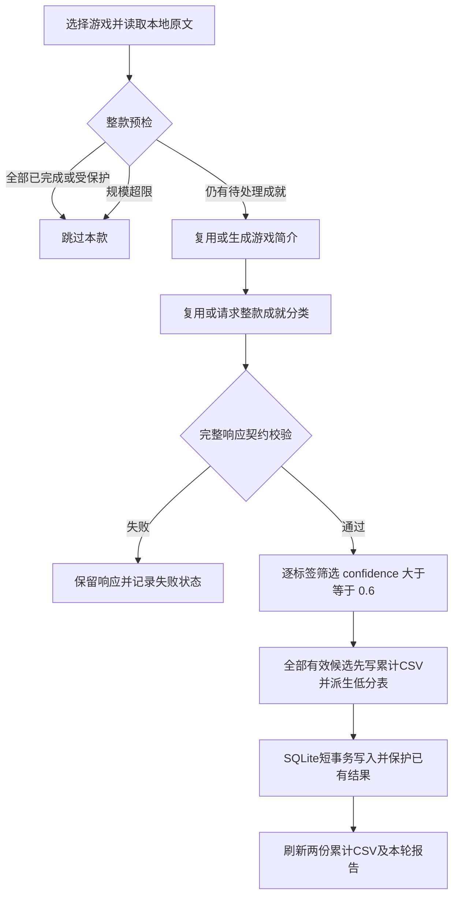

# DeepSeek作为LLM as Judge的成就分类：实现与契约

更新：2026-10-16。按游戏名定位本地数据，背景摘要缓存后复用，每款默认一次完整分类。所有写入限LYX，远端永远只读。

当前阶段是**工程链路已跑通，正在积累分类结果**：已实现结构化提示词、整款分类、逐标签筛选、缓存恢复、SQLite写入、请求超时隔离和累计CSV。冻结1000款游戏的数据准备已完成，1000款的成就分类尚未全部完成。

本项目中的LLM as Judge指让DeepSeek按固定类别与边界，对成就文本作语义判别，输出标签、置信度、引用和解释。它不是另设一个模型评审器；游戏简介也由同一DeepSeek客户端独立生成，不能视为独立证据或第二位评审。格式校验由程序负责，语义是否正确仍需要人工核验。

| 层次 | 当前职责 | 通过后意味着什么 |
|---|---|---|
| 模型语义判别 | 根据游戏背景及整款成就原文，选择八类多标签 | 得到可追溯的分类候选 |
| 程序契约校验 | 检查完整ID、JSON、类别、互斥、有限分数和原文引用 | 输出结构及引用满足约定 |
| 本地门槛筛选 | 每个标签按`confidence >= 0.6`判断 | 达到本地自动入库门槛 |
| 人工核验 | 核对语义、主线节点、必经性和排序 | 形成可用于分析的确认结果 |

模型自报confidence不是准确率；用户已人工抽查部分0.6结果并授权采用该门槛，但目前没有人工金标集、整体语义准确率或分类质量提升的量化结论。

## 1. 提示词与调用链

分类常量[CLASSIFICATION_PROMPT](../process/DataAgent.py)位于DataAgent.py导入区之后，版本lyx-deepseek-whole-game-v7；简介常量[GAME_INTRO_PROMPT](../process/game_intro.py)位于game_intro.py导入区之后，版本lyx-game-intro-v2。用户可直接读改常量，并同步升级版本。

调用链：selected_appids/resolve_game_name → load_games完整读取 → game_plan只读预检 → game_intro.get_intro → classification_messages → DeepSeekClient.call → validate_classification → classification_rows → update_datacache（全量表及低分派生表）→ store_classifications → update_datacache刷新结果。原始完整/部分响应先由客户端留在receipt，最后再导出本轮report与CSV。

图中的失败隔离适用于单款响应错误和请求超时；认证、429、文件或数据库等整体错误，以及同类连续超时达到上限时，按第5节规则停止本轮。

选择方式为--game-name、--appids、--appids-file、--all-games四选一；未指定时使用冻结前1000款。无子命令默认plan，不会自动调用API；classify默认预算2次，而非默认一次跑完全部。完整参数及终端例子统一见[PROCESS.md的游戏选择参数](PROCESS.md#游戏选择参数)。

摘要模块接收客户端，不反向导入DataAgent。凭据、脱敏、缓存和请求预算仅由同一个客户端负责，HTTP传输交给[deepseek_transport.py](../process/deepseek_transport.py)进行可取消的等待、总时限与接收进度处理。业务仍逐款串行，API保持stream=False。请求指纹含任务、各自版本、接口、模型、消息与生成参数，不含密钥；总时限及心跳配置不改变提示词、生成参数或缓存指纹。

## 2. 背景摘要契约

输入只有title、localized_title、valve_genres，不发送成就或结果变量。摘要是模型知识的显式背景，不增加外部事实来源，不声称网页检索或官方核验。

~~~json
{"recognized":true,"summary":"40～80字符的中文游戏背景摘要","uncertainty":""}
~~~

新请求以55～65字符为写作目标，并提供56字符格式示例；输出前检查长度，不编造事实补字。硬性契约不变，严格校验3个字段、布尔值、文本及长度；summary在recognized=true时40～80字符，uncertainty最多80字符。不能识别时recognized=false、summary为空且说明原因，仍可继续基于原始成就分类。HTTP 200但简介内容不合规时记该款response_error及简介失败阶段；简介总时限或读超时记request_timeout，两者均跳过本款且不请求分类。其他网络等整体错误仍停止本轮，成功缓存保留供恢复；同类连续超时另按下述暂停规则处理。

简介响应存既有runtime/cache，分类报告增加source=model_generated和摘要内容。不给SQLite增加简介列、JSON列或版本表。分类规则升级不使简介缓存自动失效。

## 3. 分类输入与输出

固定system包含任务、八类定义、边界/对照、背景依据和输出契约。user先`<game_context>`，后`<achievement_batch>`；分段各自使用canonical，避免全对象排序把achievements放在固定背景之前。

game_context含名称、官方类型、model_intro、intro_recognized、intro_source、intro_uncertainty；成就只含短引用id、display_name、description（NULL转空文本）。appid/api_name在本地映射。原始成就条件优先，摘要不能证明成就具体条件；依赖摘要或模型知识时声明knowledge_used及疑点。

~~~json
{
  "achievements": [{
    "id": "a0001",
    "types": [{"type": "other", "confidence": 0.9}],
    "evidence": ["本项输入中的逐字片段"],
    "reason": "普通成长目标",
    "uncertainty": "",
    "knowledge_used": false
  }]
}
~~~

| 类型 | 判别范围 |
|---|---|
| mainline | 主线推进或结局，仍需核验是否必经及其顺序 |
| side | 可选支线任务或剧情 |
| collection | 收集、探索或集合完成 |
| challenge | 明确的特殊难度、技术、成绩或限制条件 |
| multiplayer | 完成条件必须多人、在线或合作 |
| dlc | 完成条件依赖扩展内容 |
| other | 含义明确但不属于上述类别的普通操作、成长或全成就汇总 |
| unknown | 证据不足，无法可靠判断；必须独占 |

允许多标签。普通等级目标不单凭数值归challenge，特殊难度/技巧/成绩/限制条件才适用；游戏支持多人不等于每项成就都是multiplayer。mainline不意味着顺序或必经性，unknown是有效的“不足以判定”结果，不能拿网络失败或坏响应代替它。

evidence是从本项display_name/description逐字抽取的原文，reason是模型解释为何选择类型；两者均由DeepSeek返回，职责不同。evidence不是思考过程、外部攻略或语义正确性的证明。完整ID不增不漏不重复；字段严格匹配；置信度有限0～1；reason非空且≤40字符，uncertainty≤40字符；knowledge_used=true时疑点非空；evidence为1～2段非空的对应成就原文，每段严格len<500，即最多499字符（Python len计数，含空格标点；500不通过）。DataAgent.EVIDENCE_MAX_CHARS是排他上界，报告明确写evidence_max_chars=500及evidence_length_comparison="<"。原文比对先逐字匹配，失败后仅将U+00A0与普通空格等同比较；不做大小写、标点、其他空白或模糊匹配，不改写输入和响应。report标明evidence_match_policy=exact_or_nbsp_space。长度/空引用/非原文仍分别报错并指出成就ID和名称。重复JSON键、NaN、截断或契约错误仍拒绝整款，该游戏不进入门槛筛选或写库；记录response_error后继续后续游戏。格式校验不证明语义正确。

## 4. 整款与已有结果保护

一款有待处理项时，模型收到全部原始成就，包括已有机器或人工结果对应的原文，但不接收旧标签。完整响应先校验，默认只写待处理项。已有DeepSeek且状态suggested/uncertain记already_classified；--reclassify可更新机器标签，人工approved/manual和非空排序号始终保护。

整款已无待处理项则整个跳过，简介也不请求。写入前检查完整原始集合/文本和游戏背景；调用期间新增/删除成就也会拒绝。整个游戏用一个短事务更新标签和状态，HTTP在事务外。

已完成判据是非保护项status为suggested/uncertain且全部已有标签method=deepseek；rule/jev旧结果不能据此跳过。更改门槛或提示词不会自动重判既有DeepSeek项，显式--reclassify才允许替换；该开关仍优先复用缓存，不强制新请求。

method=deepseek；标签每类一行。默认门槛0.6，逐类筛选confidence >= 0.6，等于门槛也通过；低于门槛保存在runtime JSON及process/datacache.csv，不写achievement_types。classification_rows保留完整types及accepted_types/rejected_types；store_classifications使用相同门槛再次筛选，防止绕过入口写入低分标签。全部未通过时保留旧标签和状态，记below_threshold；部分通过时只用通过的标签替换可更新的自动结果。明确类别为suggested；unknown也按相同门槛筛选，通过后仍为uncertain，不自动approved或填写mainline_index。confidence是模型自报信心，不是校准概率或准确率。标签表增加display_name，入库从原始成就填写，来源改名时触发器同步；当前六表、user_version=4，原始成就不改。

门槛仅为本地处理参数，比较符改为>=不改分类prompt v6或API请求指纹。更改门槛可复用同一完整响应缓存；已完成机器结果默认保留，普通分类需要重筛时显式--reclassify。原始响应和未通过标签均留在JSON，CSV同时标记confidence_passed/label_sqlite_outcome；report的confidence_comparison为">="。筛选后的accepted_label_count不等于入库数（包含保护项），written_label_count统计实际写入标签；全部未通过的待处理项纳入remaining_pending_count及unprocessed_achievement_count。

每款通过完整契约校验后，全部有效候选标签先累计到process/datacache.csv，再提交SQLite，提交后刷新写入结果；低分、已有、受保护及已写标签均保留。每标签一行，按(appid,api_name,type,request_hash)去重，source_csv/first_seen_at/last_seen_at保留追溯。不同请求记录独立，原runtime CSV/JSON和报告不删不覆盖。坏格式、过期输入或无法验证证据的记录不作为有效分类导入。--datacache可指定LYX内累计CSV路径。

每次累计更新同时在同目录重建process/failure_data.csv，作为datacache的低分子集；使用相同22列及去重键，按每行`confidence < min_confidence`筛选，当前默认即低于0.6。等于门槛通过，多标签仅低分标签进入该表；达到门槛但因已有结果、人工保护或conflict未写库的候选不属于低分。HTTP/结构/证据失败没有有效分类候选，仍留在report/receipt，不纳入该表。

低分表保留不同request_hash的历史记录，每行采用该键最近一次累计更新的门槛；同键重新筛选通过后会移出低分表，其他历史请求不随之删除。因此它是人工复核入口，不是当前数据库未分类或未入库成就清单。更改--datacache会在新源同目录生成固定名failure_data.csv，建议一个目录只放一个累计源。可用datacache.rebuild_failure_data从已有全量表独立恢复，源CSV保持原样，不调用API、不读写数据库；plan及导入预检不创建这些输出，新逻辑自下次启动生效。

历史迁移入口为process/import_classification_cache.py，默认只plan，--apply才写本地，先备份SQLite。默认source-root为process/runtime/deepseek/runs，支持--database/--datacache/--min-confidence；重新核验原始身份、当前上下文及完整响应证据，按>=0.6筛选，只补缺失标签，保留已有机器标签、人工标签和主线排序。旧上下文、坏CSV与证据不合规项拒绝导入并报告；不调用模型、不连接远端。命令及路径说明见[PROCESS.md](PROCESS.md#累计分类csv与历史结果导入)。

普通分类和历史补录的已有结果策略不同：普通分类默认整项保留已有DeepSeek结果；补录只有在已有标签的类型、分数与名称都与候选一致时，才补上同一成就缺失的其他合格标签。不同请求的分类不相容时标记conflict，不自动合并。早期v3试跑只能在与现有库原文及标签一致时按legacy_existing归档，不按旧契约重新入库。

累计CSV用于留档和追溯，不负责判定游戏是否完成；低分仍为待处理项。部分游戏因此会在下轮再次复用整款缓存，高分已有项跳过、低分再次留档，相同请求不新增重复CSV行。这不会自动提高低分，也不强制重新请求模型。两份累计CSV在同一文件锁内各自原子替换，但与SQLite之间、两份文件之间都不是跨文件事务；低分表更新失败时可从datacache重建。先留候选，SQLite提交后再刷新；中断时pending表示尚未确认提交，需核对数据库或安全重放，不能只凭该行断言数据库未写入。

## 5. 输出预检、恢复与统计

game_plan显示完整成就数、输入字符/字节、1024+160*N输出估计、待处理/保护数及缓存。简介缺失时仅在本地测量中使用长度预留，不向API发送占位摘要。默认max-output-tokens=65536、max-input-chars=300000；超限为oversized_game，无模型请求，不自动拆分。字符不是token，估计不是保证。

首次普通游戏通常简介1次+分类1次，不含重试；max-requests限制本轮新HTTP尝试数，包括两阶段、失败尝试及重试，缓存/SQLite查询不计，每次启动重新计数，0禁止新请求。简介成功而预算耗尽后可续跑；完整响应先落盘，写库前中断可复用完整缓存。每次真实响应新增带时间戳的receipt JSON，同请求指纹下的旧文件保留，不被后续生成覆盖；每轮报告另存独立时间目录。每轮备份before_classify.sqlite。

HTTP读超时仍由--timeout-seconds控制，默认300秒，连接上限15秒。新增--intro-total-timeout-seconds（默认90秒）和--classification-total-timeout-seconds（默认300秒）：从该次逻辑调用首次网络尝试到接收完整正文共用总时限，覆盖有限重试及退避，保活空行不延长。HTTP传输可取消，总时限或ReadTimeout发生后关闭响应、记录request_timeout，不自动重发同一超时请求，并继续下一款；分类超时不删除已成功的简介缓存。总时限仅限制本地等待，不能保证服务端终止处理，因此已尝试请求仍计预算，无usage时用量为未知。

每15秒打印等待进度，并更新本轮progress.json，包括游戏/AppID、task、attempt、request_count/max_requests、phase、elapsed/remaining、received_bytes、has_non_whitespace_body和last_data_at；无数据也更新。阶段区分等待响应头、接收正文和退避。完整正文记response_text；未收完正文记partial_response_text及response_complete=false，不进入可复用缓存或SQLite。历史receipt缺少response_complete字段时仍按旧完整响应规则判断，显式false禁止复用。

简介、分类各自统计连续超时。同类真实请求收到完整HTTP 200响应后清零，缓存命中不清零；同类连续3次超时停止本轮，state=service_paused、退出码1，记录paused_reason及consecutive_timeouts。HTTP 200中的无效JSON、截断及简介/分类契约错误仍按游戏记response_error，本款不写库并继续。failed_game_count/failed_appids包含响应失败、超时及终止本轮的传输失败；timeout_game_count/timeout_appids单列超时，errors及游戏项的failure_stage/failure_task/failure_receipt/failed_request_hash、calls用于定位留档。遍历结束有零星失败则completed_with_errors、退出码1，预算先耗尽仍budget_reached，之前失败计数不清空。429、TLS/认证/余额、非读超时网络故障、SQLite和文件错误仍停止整轮；连接错误/5xx只有限退避，共享总时限且重试消耗预算。失败都不生成unknown，原有数据及此前已提交其他游戏不回滚。Ctrl+C仍按interrupted收尾，本次不增加独立停止命令。

传输异常仅新增安全诊断与失败计数：receipt与游戏项记录error_type异常类名、appid/名称、任务、阶段、请求指纹和receipt路径，calls同步记录；不保存原始网络异常正文或认证头。RequestTransportError仍由外层处理并停止整轮，不计入timeout_game_count，也不扩大可继续执行的异常范围。

local_response_cache_hits区别于API输入前缀缓存；api_cache_hit_tokens、api_cache_miss_tokens和ratio只汇总本轮真实响应。usage_by_task分开简介与分类，缺失字段为null，本地复用不重复记历史用量。分类旧v1/v2/v3文件保留但不套用新契约；简介v1按下述精确兼容规则复用。

| 数据位置 | 用途与恢复边界 |
|---|---|
| runtime/deepseek/cache/请求指纹/receipt-时间.json | 每次真实尝试的请求与完整/部分响应；只有完整且重校验通过的响应可复用 |
| runtime/deepseek/runs/时间/report.json、classifications.csv、progress.json | 本轮选择、进度、错误、所有有效候选和写入结果；每轮独立，不覆盖上轮 |
| process/datacache.csv | 跨轮累计全部有效标签及处理结果；按(appid,api_name,type,request_hash)去重，历史导入另保留legacy_existing与冲突 |
| process/failure_data.csv | 累计表派生的逐标签低分子集，保留同样22列；不包含网络/契约失败，也不代表当前全部未入库成就 |
| database/achievements.sqlite | 当前原始成就、分类标签和人工状态；实际分析及进度核对以数据库与来源记录为依据 |

原始evidence、reason、uncertainty、knowledge_used等解释保留在JSON/CSV；SQLite的achievement_types保存appid/api_name/display_name/type/method/confidence，status和mainline_index在achievements。不新增JSON字段或把解释复制成数据库业务列。累计CSV字段与结果状态字典见[PROCESS.md](PROCESS.md#累计分类csv与历史结果导入)。

分类v7只追加格式检查：引用保持大小写、不补说明、描述为空时引用展示名、知识声明与疑点一致。类别、字段、长度和置信度契约不变。当前缓存优先，再按精确保留的v6/v5/v4旧提示词定位历史完整响应；简介v2同样可回退查找v1。除已列明的提示词与版本差异外，游戏上下文、成就、摘要、模型、接口及生成参数必须相同。响应一律按当前规则重校验，调用元数据保留源prompt_version、requested_prompt_version与compatible_cache=true；旧receipt不改写，不把新模板当作旧提示词。

原先因U+00A0空格或历史引用上限记error的完整HTTP 200响应可在重校验通过后用--max-requests 0恢复；不合格简介、空引用、大小写改写、补造说明、截断或部分响应仍不能复用。分类失败不清除已合格简介。本次没有新增纠错调用、自动重试或缓存清理流程。

## 6. 当前验收状态

工程链路已有真实整款分类、有限预算批量、零请求缓存恢复和历史补录证据；分类仍在推进。当前覆盖统一引用[DATABASE的带时间快照](DATABASE.md#当前实际数据)，不在多份契约文档重复维护行数。

- 《重生》完整响应零请求恢复、HELLDIVERS™ 2多标签写入及后续星露谷批次，验证了请求、缓存、写入和预算暂停。候选统计可包含缓存与已有结果，不能当作新增完成数。
- 2026-10-15门槛改为>=0.6后，离线补录74条边界标签；相容缺失标签可补齐，冲突保留旧结果，重复导入新增0，原始字段及18项排序保留。
- 隔离验收覆盖引用长度、置信度边界、多标签、去重、NULL描述、人工/排序保护、输入变化回滚、总时限、心跳、部分响应隔离和中断收尾；没有新增pytest用例。

参数、用量、来源报告与验收路径统一见[按日实验记录](experiments.md)。这些证据证明工程行为；目前没有人工金标集、分类准确率或稳定API缓存成本收益结论，离线传输验收也不证明真实服务持续可用。

## 7. 后续工作及完成边界

1. 在预算内继续分批分类，依据本轮错误、低分与超规模清单核对覆盖情况；当前不自动拆分超规模游戏。
2. 人工抽查各类标签，优先复核mainline、0.6边界、unknown和conflict。已有抽查只是采用门槛的依据，后续若要报告质量，需要另行建立人工核验集并统计结果。
3. 由人工确认主线节点、必经性和叙事顺序，再填写mainline_index；当前模型不输出顺序，不按完成率猜排序。
4. 分类与人工核验充分后，再开展游戏类型与主线完成率、各类成就参与方式的聚合比较；观察性结果不能直接解释为用户留存或因果影响。

后续分析范围与实施前提见[data_plan.md](data_plan.md)，由负责人在分类完成后决定是否开展。不能把链路验收、提示词规则或缓存命中率写成已完成的分析结论。运行命令以[PROCESS.md](PROCESS.md)为准。
