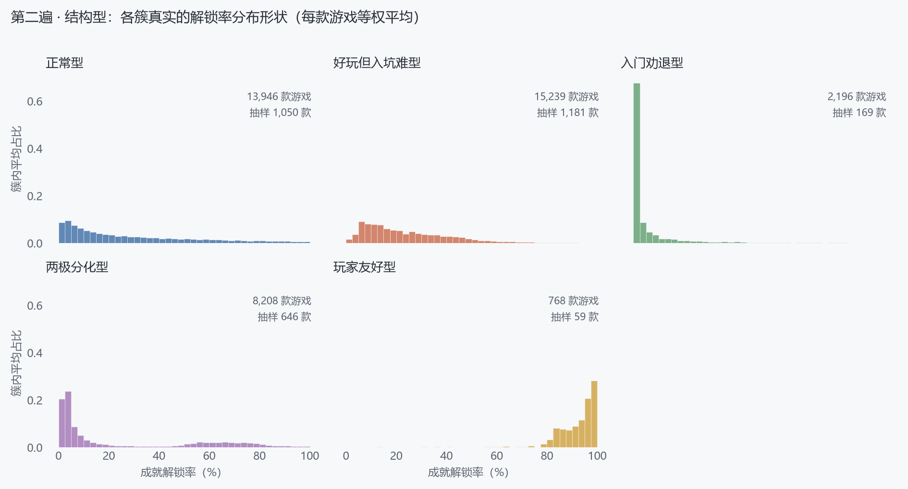
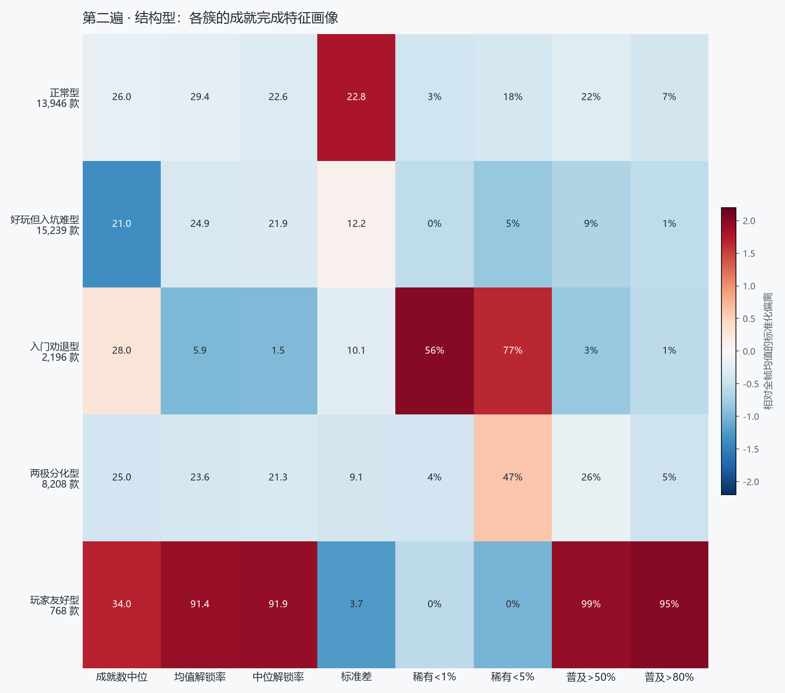
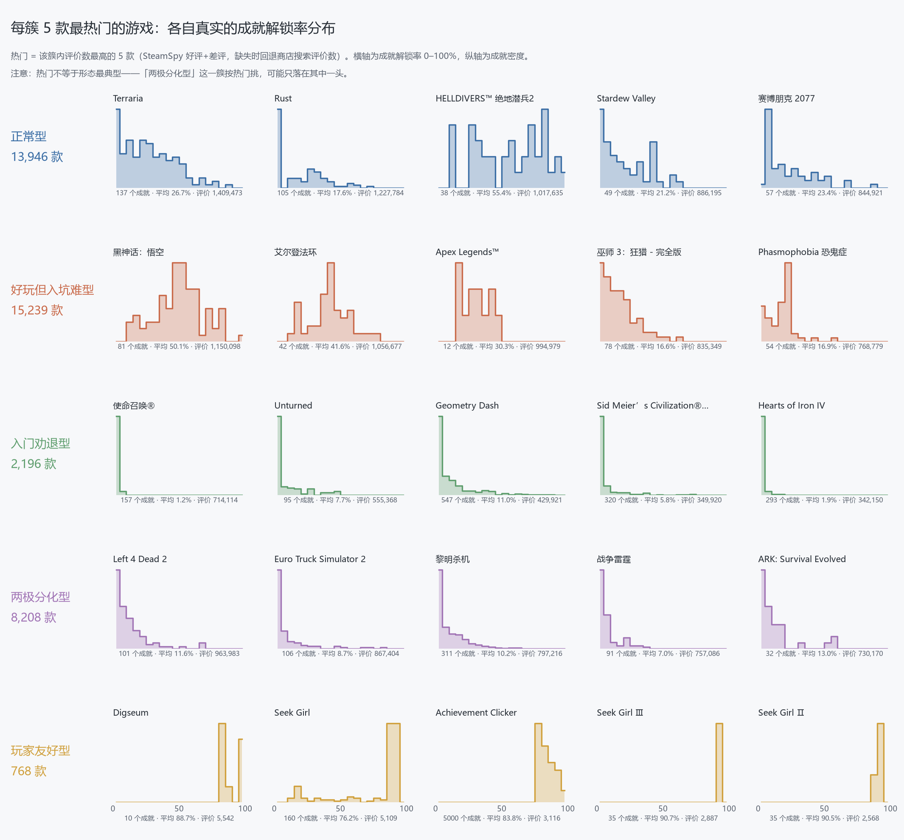
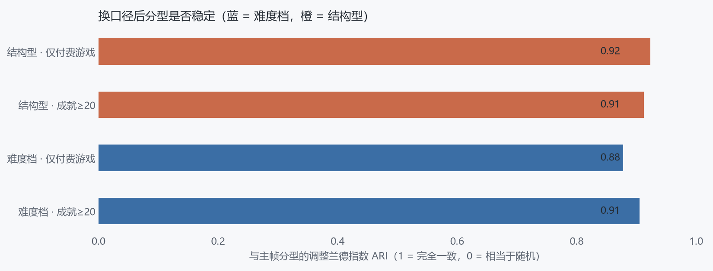

# 游戏画像聚类与自动分型

> YMT · 方向 2（`docs/plan.md` 新⑥）
> 数据：Steam 成就数据库当前快照，主建模帧 **40,357 款游戏 / 约 190 万条成就**
> 输入指纹 `6fd8e8990c2a` · 实验口径与全部数字见 [`experiments.md`](./experiments.md)

## 一、问题

`docs/plan.md` 给这个方向的原话是一个问句：

> 同样属于 RPG 的游戏，它们的成就完成结构是否存在不同类型？

这个问题有两层。表层是「游戏能不能按成就数据分组」，深层是「分出来的组，说清的是难度高低，
还是完成方式的不同」。本报告的回答是：**两者都有，但必须先分开**——不分的话，聚类只会
交出难度排名。

## 二、数据与口径

从共享库按游戏聚合出 10 个成就侧特征：成就条数、解锁率的均值/中位数/25 分位/75 分位/标准差、
稀有成就（<1%、<5%）占比、普及成就（>50%、>80%）占比。建模帧取成就数 ≥ 10 的 40,357 款
（全库 50,738 款有成就的游戏，单款成就数中位数 19）。

两个刻意的取舍：

- **标签不进聚类输入。** 库里有 447 个 SteamSpy 标签。把它们多热编码成 447 维再喂给 K-Means，
  结果会基本由标签决定——那等于把「按类型分组」包装成「按完成结构分组」，正是 `plan.md`
  要避免的。标签只在聚类完成后用来回答「这一簇都是些什么游戏」。
- **游玩时长不进主模型。** SteamSpy 的 `average_forever` 全库 0 条有效（字段已失效），
  唯一可用来源是 RAWG 的 `playtime`，但只有约 1.4 万款有值。用它会砍掉 65% 样本，所以只在
  RAWG 子集上做事后描述。

## 三、第一遍：聚出来的其实是难度档

用全部 10 维特征扫 k = 3…12，轮廓系数在 k=3 最高（0.2938）。三簇的画像非常干净：

| 类名 | 游戏数 | 占比 | 均值解锁率 | 稀有<5% | 普及>50% |
|---|---|---|---|---|---|
| 大多好拿 | 4,294 | 10.6% | 67.7% | 0.4% | 81.4% |
| 中等 | 21,922 | 54.3% | 29.2% | 7.7% | 16.2% |
| 大多难拿 | 14,141 | 35.0% | 9.4% | 50.9% | 2.5% |

三簇沿解锁率水平整齐排开，PCA 第一主成分解释了 **57.0%** 的方差——**第一主方向就是难度**。
换句话说，直接聚类得到的是「这游戏好不好拿成就」，不是「它的成就怎么分布」。

这本身有用：Steam 游戏按成就难度可以粗分三档，而且三档的游戏类型明显不同——大多好拿富集
Hidden Object（3.3×）、Clicker（2.9×），大多难拿富集 VR（1.7×）、PvP（1.7×）、
Multiplayer（1.6×）。但它回答不了本方向的原问题，所以需要第二遍。

## 四、第二遍：剥掉难度水平之后

对 `p_mean` 做一元线性回归，把每个形状特征（离散度、四分位距、偏斜、四个占比）的残差留下来，
再加成就数。这样问的是：**平均解锁率相同的两款游戏，成就是均匀铺开还是一头沉？**

k=5 时轮廓系数最高（0.2170）。五类的画像与分配如下（类名用「玩家感受到什么」来取，
技术叫法见本节末尾的名词对照）：

| 类名 | 游戏数 | 占比 | 均值解锁率 | 四分位距 | 稀有<1% | 普及>80% | 主要类型（富集） |
|---|---|---|---|---|---|---|---|
| 正常型 | 13,946 | 34.6% | 29.4% | 30.2 | 3.1% | 6.6% | 肉鸽/经营（Rogue-like 1.4×） |
| 好玩但入坑难型 | 15,239 | 37.8% | 24.9% | 11.9 | 0.4% | 1.2% | 视觉小说（Visual Novel 1.5×） |
| 入门劝退型 | 2,196 | 5.4% | 5.9% | 6.1 | 55.9% | 0.6% | 联机/VR（VR 2.8×、PvP 2.4×） |
| 两极分化型 | 8,208 | 20.3% | 23.6% | 7.4 | 3.6% | 4.8% | 本地多人（Local Co-Op 1.3×） |
| 玩家友好型 | 768 | 1.9% | 91.4% | 3.2 | 0.0% | 94.7% | 找猫类休闲小品（Creature Collector 10.9×） |



这张图是判读类名的直接依据——**每款游戏先算自己的直方图，再在簇内等权平均**。类名按
「这一簇的游戏对玩家是什么体验」来取，括号里是对照的技术叫法：

- **入门劝退型**（原「极稀有型」）：0–2% 一根尖峰。过半数成就的解锁率不足 1%，中位数只有 1.5%。
  典型是联机对战和 VR 项目，成就为长期玩家设计，绝大多数人拿不到。这一类的名字有硬指标支撑。
- **两极分化型**（原「双峰分化型」）：0–10% 一峰（占 58% 的成就）、50–80% 第二峰（占 23%）、
  10%–50% 这段只有 14%，形成明显的双包。本地多人游戏最典型——「开一局」类成就人人都有，
  「全角色通关」类极难，中间地带明显偏少。
- **玩家友好型**（原「近乎全普及型」）：90–100% 一根尖峰，99.3% 的成就解锁率过半、94.7% 超过 80%。
  代表游戏是 Hidden Cats in Berlin、Hidden Cats in Rome 这类「找猫」休闲小品，成就顺手就全了。
  它也是唯一付费占比明显偏低的簇（74.1%，其余 88%–96%），发售年最晚（中位 2024）。
- **正常型**（原「宽幅铺开型」）：从 5% 到 100% 平缓递减，四分位距 30.2 个百分点。肉鸽和经营模拟
  是主力，成就难度随着流程逐步加码，形成连续梯度。它是点最多的「标准形状」，故称正常型。
- **好玩但入坑难型**（原「中段收敛型」）：单峰落在 5–15%，两端都没有尾巴
  （稀有 <1% 仅 0.4%，普及 >80% 仅 1.2%）。视觉小说是典型——按路线给成就，解锁率天然落在中段。

⚠️ **「好玩但入坑难型」这个名字要留一句说明**：它在数据上**不是最难的一簇**——
`稀有<1%` 只有 0.4%，是五类里最低的，也没有极端稀有的成就。叫「入坑难」的理由是
**解锁率普遍卡在 20% 上下、多数买家只拿到一小部分**（中位解锁率 21.9%），属于「整体偏慢」，
而不是「有一批几乎拿不到的成就」。真要按硬指标判断难度，应该看「入门劝退型」。





这张图的每一格是**一款游戏自己**的成就分布（不是簇内平均）。挑的是**每簇评价数最高的 5 款**
（SteamSpy 好评 + 差评优先，缺失时回退商店搜索的评价数），所以名字基本都认得：Terraria、
黑神话·悟空、使命召唤、Left 4 Dead 2、赛博朋克 2077……每格下方标了成就数、平均解锁率和评价数。

代价要讲清楚：**热门不等于形态最典型。**「两极分化型」这一簇按热门挑，5 款全落在
「极难」那一头（平均解锁率 7%–13%），因为高评价游戏天然偏向低解锁。要看清这一簇「两头堆」的
样子，得看上一张 `shape-density.png`；想看形态最典型的单款游戏，可以用
`cluster.py` 里 `representatives(..., mode="typical")` 的口径。

**名词对照**（左为本文用法；中列是 2026-10-17 中途用过的「描述形状」讲法，已弃用；
右列是最早的形态学叫法）：

| 本文类名 | 中途叫法（已弃用） | 最早的技术叫法 |
|---|---|---|
| 正常型 | 越玩越难 | 宽幅铺开型 |
| 好玩但入坑难型 | 难度都差不多 | 中段收敛型 |
| 入门劝退型 | 几乎没人拿到 | 极稀有型 |
| 两极分化型 | 要么很容易，要么极难 | 双峰分化型 |
| 玩家友好型 | 几乎人人都有 | 近乎全普及型 |

`figures/` 里的图、`cluster-report.json` 与 `visual.html` 也一律使用左列的说法。

## 五、一个必须交代的修正

第一版的最小簇门槛我写的是「≥ 2%」，k=5 的最小簇是 1.9%，差 0.1 个百分点被挡掉，于是
按轮廓系数选了 k=4。但 k=4 的轮廓系数（0.2009）本来就**低于** k=5（0.2170）——2% 是我自己
加的门槛，却盖过了数据本身的判断。

检查 k=4 的结果时发现，其中一簇内部严重两极：簇内「普及>80%」的均值是 28.4%，
但 90 分位游戏的该指标达到 100%，而另一半游戏是 0%。这是把「几乎全稀有」和「几乎全普及」
两类游戏硬并成了一簇，K-Means 的球心落在了两个峰之间。

门槛放宽到 1% 后由轮廓系数自己选，得到 k=5，那一簇正确拆成「入门劝退型」与「玩家友好型」。
这件事的教训写在 `experiments.md` 里：**类名必须来自对结果的检查，不能来自对 k 的第一印象。**

## 六、稳健性

| 复跑口径 | 游戏数 | 与主帧 ARI（难度档） | 与主帧 ARI（结构型） |
|---|---|---|---|
| 成就数 ≥ 20 | 25,212 | 0.905 | 0.912 |
| 仅付费游戏 | 36,725 | 0.878 | 0.924 |



两遍分型在两套更严口径下都基本保持（ARI 0.88–0.92）。分型不是靠少量边界游戏撑起来的。

## 七、局限

1. **聚的是游戏，不是玩家。** 一款游戏落在「入门劝退型」，说的是它的成就大多数人拿不到，
   不是它的玩家更硬核。库中没有个人解锁记录，无法据此推断玩家分群。
2. **`percent` 是当前时点的快照**，不是历史值。库里没有当年数据，所以看到的「难度」是
   今天回看的结果。
3. **类名是归纳出来的，不是假设。** 换数据、换 k 都可能不成立；k=4→5 那次修正就是活证据。
4. **第二遍的残差是线性的**，压不住边界效应（解锁率接近 0 或 100 时形状被压缩），
   所以「入门劝退型」和「玩家友好型」这两个簇实际上仍带着水平信息——它们是形状，也是极端难度。
5. **结构不锐利。** 轮廓系数 0.217 属于中等偏弱，「正常型」与「好玩但入坑难型」在 PCA 平面上
   重叠明显。这两类的边界应视为弱结论，本报告不做精确断言。
6. **标签覆盖率随年份下滑**（2024 年仅约 82% 的游戏有 SteamSpy 标签），各簇年份构成已随表
   报告，但跨簇的类型差异不宜直接读成「某类型更爱这样设计」。
7. **RAWG 时长不可当定量结论。** `playtime` 全库中位数只有 2–3 小时，独立游戏大量为 0 或缺失。
   「玩家友好型时长中位 0 小时」只能当方向性提示。

## 八、结论

- Steam 游戏的成就完成结构，**第一层差异是难度水平**（PCA 第一主成分 57% 方差），可粗分
  高 / 中 / 低三档。
- **剥掉难度后仍有结构**，五类中三类含义清晰：「入门劝退型」对应联机/VR 项目、「两极分化型」
  对应本地多人、「玩家友好型」对应低价休闲小品。三种结构恰好对应三种不同的成就设计取向。
- 「同样属于 RPG 的游戏是否存在不同完成结构」——**是**，但前提是先把难度差异去掉；
  不去掉的话，聚类只会还给你一张难度排行榜。

## 九、复现与产物

```bash
uv run python result/YMT/features.py --refresh   # 重查云库并落缓存
uv run python result/YMT/cluster.py              # 两遍聚类 + 全部图
uv run python result/YMT/visual.py               # 生成可视化单页 visual.html
```

- `features.py` 特征抽取（只读查库）· `cluster.py` 两遍聚类与出图
- **`visual.html` 可视化单页**（自包含、双击即开，适合投屏）：五类的真实分布曲线、
  三区占比条、代表游戏与类型标签，可切换「难度三档 / 结构五类」；
  另含两张热图——**五类特征指纹**（列内 min–max 伸缩）与
  **标签 × 结构型的富集交叉热图**（每类各取 4 个最具代表性的标签，对数色阶）。
  交叉热图上可读出一条额外结论：「两极分化型」几乎没有专属标签（只有 Local Co-Op 1.3×），
  更像一种跨品类的成就设计，而不是某个品类自带的属性。
- `figures/` 11 张图 · `cluster-report.json` 全部数字 · `experiments.md` 实验记录

数据来源：Steam 商店与 Steam Web API（成就、标签）、SteamSpy（用户标签）、
[RAWG](https://rawg.io/)（时长与评分，用于事后描述）。
RAWG 数据按免费档**非商业用途**使用，本项目为课程作业符合该条款。

> 本报告所有统计均为**描述性**结果。聚类得到的类名与边界由当前数据与当前参数决定，
> 不代表关于游戏设计意图或玩家群体的因果结论。
