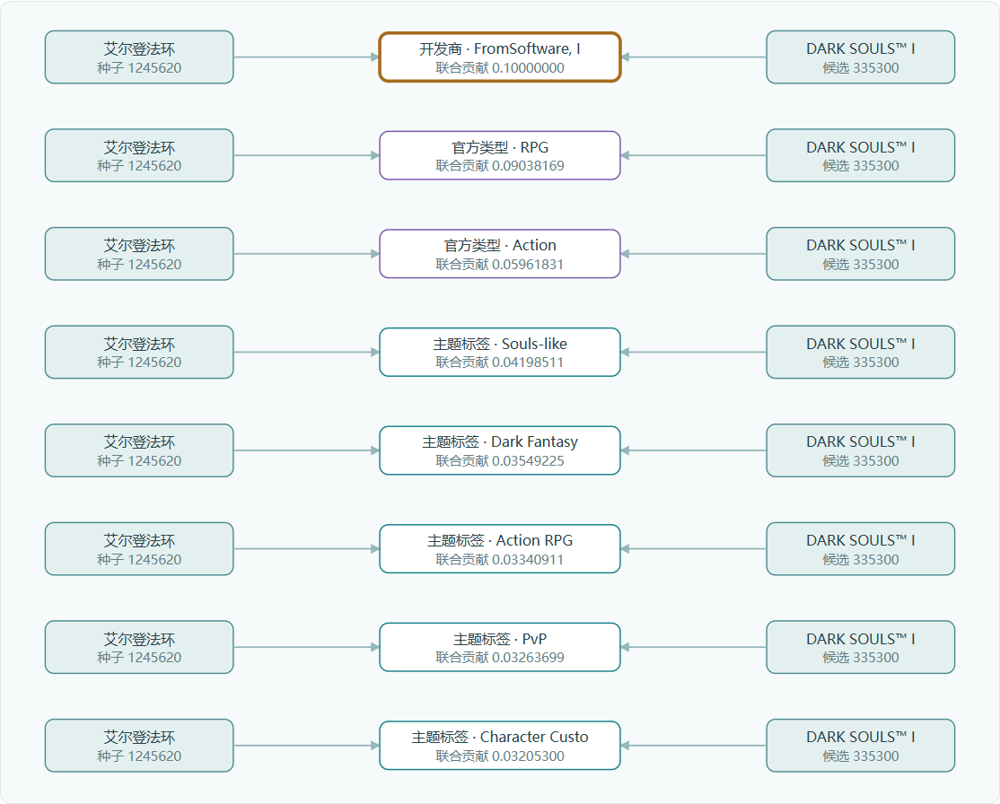
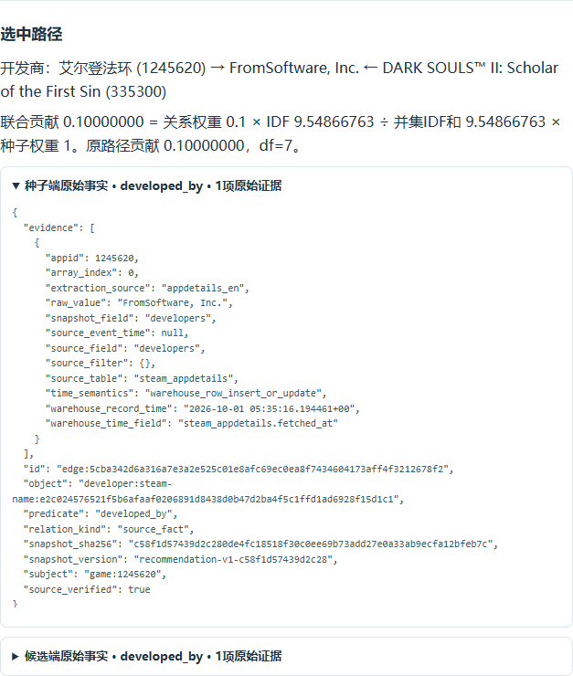

# 同端口导航、知识图谱与解释验收

日期：2026-10-14，main基准e32d34bbcd4d65cf57761cb92d301e7bc2f46074。用户报告三个旧端口入口拒绝连接，实际复现新子入口均404。

修复为同一serve同端口四页面，共用一次只读数据库抽取的快照、图谱检查器和评分器。辅助资源/API使用同源相对路径，旧独立端口不再是导航依赖。保留可选独立baseline命令；它不是主页面运行的前置条件。

## 实际检查

- 正式serve命令真实只读连接小组数据库成功；四页面的数据来源记录和读取时刻完全相同，50,925游戏、41,279候选。
- 1440×1000桌面和390×844手机，17项实际浏览器检查通过。点击标签基线、图谱核查、单游戏解释及返回；基线推荐和关系图、图谱规模/共同路径/双端事实、质量JSON弹窗、单游戏和主页面分数路径、原始证据展开、手机布局全部通过；无pageerror和失败资源/API响应。
- 12项真实HTTP检查通过：尾斜杠跳转、404、POST/PUT/PATCH/DELETE的405；主页面与单游戏解释排名/分数一致；路径贡献合计重建分数，图谱双端source_verified为true。
- 25份Python源码AST与31项来源摘要通过；24份原源码/资源字节保持原样，评分计算模块未改。原HTML/JS变动仅导航、相对资源/API路径和说明。
- 独立复核指出质量JSON链接和过时关系排序文案，已修正；复核确认无遗留阻断。

## 成果在哪里

图谱来源核查页/graph/显示114,301实体与895,023事实关系。节点包括游戏、主题标签、官方类型、开发商名称、发行商名称；事实边是游戏指向对应实体。页面呈现具体查询的局部路径与质量覆盖，不一次绘制全量关系。

主页面/及单游戏解释/explain/将实际推荐分数分解到关系和共同路径。点击路径可看到种子端与候选端原始字段及来源；图中裁剪不改变排名或总分。当前实际图谱与解释示例：

轻量摘要见[site-verification.json](../reports/site-verification.json)，详细日志位于本机runtime/site-acceptance/，不上传。数据库加载的原始证据见[数据库验证](DATABASE-VERIFICATION.md)。四入口属于个人服务；小组Go网站尚未集成，AI评价仍为原冻结数据的辅助证据。本次无commit/push。
