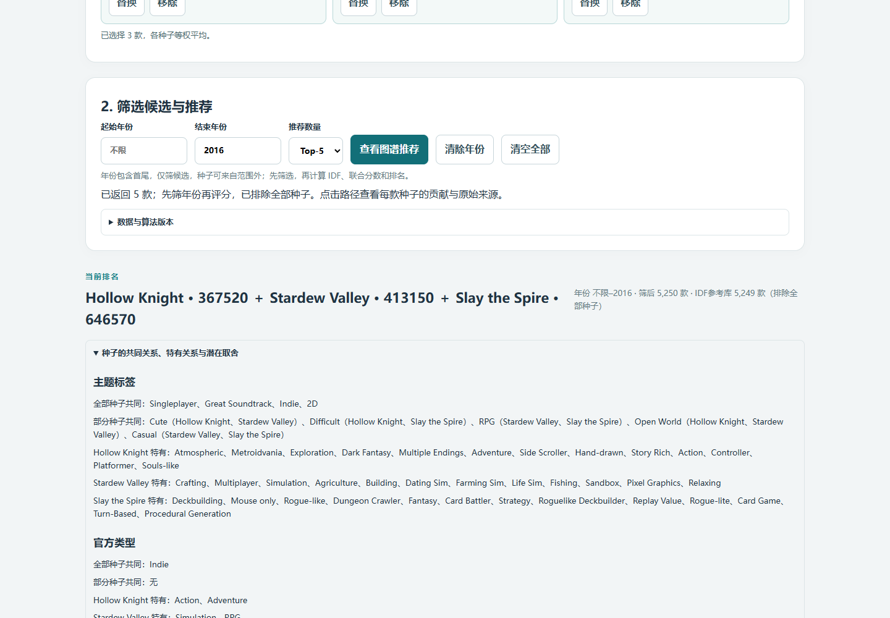
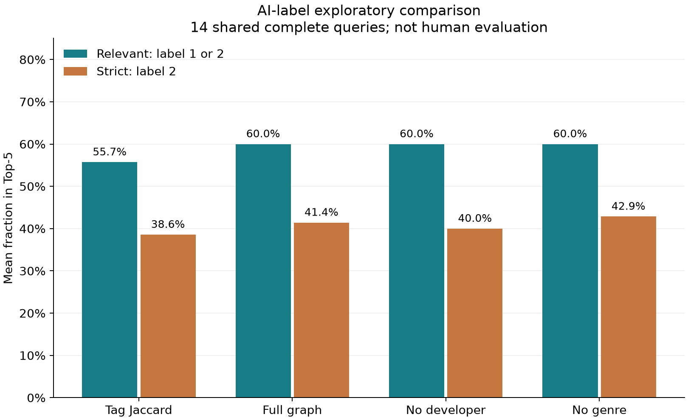
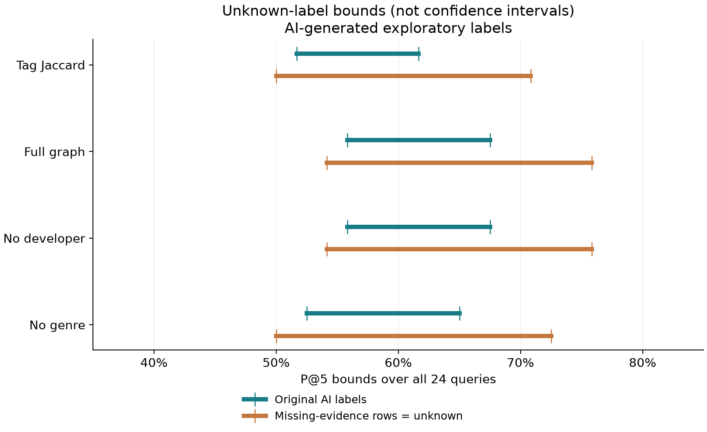

# 游戏知识图谱与可解释推荐

负责人：朱政宇。阶段交付：2026-10-14。

本项目把游戏与主题标签、官方类型、开发商、发行商组织为知识图谱，通过明确的关系评分给出推荐，并让使用者看到“为什么推荐、各关系贡献多少、证据从哪里来”。可在本地页面搜索完整冻结快照、选择1–3款游戏、限制候选发售年份和查看推荐路径。

## 数据与图谱

原实验冻结输入含50,925款游戏，41,279款满足推荐资格。图谱有114,301个实体、895,023条事实边，保留原始来源证据。标签来自SteamSpy主题标签；类型为Steam官方类型；Steam功能标志不当作主题标签参与评分。

默认服务在启动时从小组数据库只读提取，自动构建/核验本地图谱缓存；重启后更新，运行期间数据保持一致。以下规模与AI实验数字属于原冻结数据，新启动的数据规模以页面版本信息为准。缺失字段和不合格游戏在搜索中说明，不能加入种子的游戏会被阻止。图谱规模本身不证明推荐效果。

## 推荐方法

原始标签Jaccard作为基线。图谱方法对各关系使用IDF-Jaccard，再按标签0.75、类型0.15、开发商0.10、发行商0加权；权重是启发式初值。缺失关系贡献记零，权重不按单个候选重新分配。排序同分时按appid，便于复核。

多游戏推荐对2–3个种子等权平均，共同IDF参考库排除全部种子。年份先筛候选，再计算IDF与排名。解释页显示各种子贡献、共同/特有关系、完整路径和两端证据；图的裁剪不改变分数。

## 可运行功能

| 功能 | 当前行为 |
|---|---|
| 搜索 | 本次启动加载的完整游戏范围，分页和资格原因 |
| 推荐 | 单游戏或最多3款联合偏好，候选年份包含首尾 |
| 解释 | 实际排名与各关系/种子贡献，来源回查 |
| 基线 | 单独标签页，便于比较 |
| 辅助评价 | 原始AI评分、消融、unknown上下界与敏感性分析 |

入口统一为run.py，所有个人代码和报告位于result/ZZY；数据库只读启动时生成的本地缓存、旧离线数据和运行输出被Git忽略。正常运行不需要手动分发数据包。个人服务现已同端口连接联合推荐、标签基线、图谱来源核查、单游戏解释四入口；尚未整合进小组Go面板。

## 知识图谱与可解释推荐的对应位置

图谱包含游戏、主题标签、官方类型、开发商名称和发行商名称五类实体，以及游戏指向四类属性实体的事实关系。图谱来源核查页展示全量规模、覆盖与缺失，并可用两款游戏回查共同实体及双端原始字段。主页关系图展示本次种子和候选的局部图谱。

可解释推荐位于主页结果区和单游戏解释台：关系贡献合计为推荐分数，共同路径显示精确贡献，每条路径可展开两端原始字段和来源信息。标签基线页用于比较单关系方法；四入口同端口运行，共享本次数据。

## AI辅助相关性评价

24个固定单游戏查询，四方法各取Top-5并集，共177对游戏。外部AI给出0/1/2/unknown标签：61/39/57/20。0为不相关，1为部分相关，2为较强玩法相关；unknown保留资料不足，不强行记0。

P@5把1或2视为相关，每query分母固定5；严格P@5只把2视为相关。只要共同候选池有unknown，该query的四方法都不进入点估计；所有24query另保留下–上界。pool-nDCG使用四方法候选并集的共同理想排序，不能当作全库理想排序。

原始AI标签下，共同完整query为14/24：

| 方法 | P@5 | 严格P@5 | pool-nDCG@5 |
|---|---:|---:|---:|
| 标签Jaccard | 55.7% | 38.6% | 0.6043 |
| 完整图谱 | 60.0% | 41.4% | 0.6784 |
| 去开发商 | 60.0% | 40.0% | 0.6722 |
| 去类型 | 60.0% | 42.9% | 0.7103 |

图谱P@5比标签基线高4.29个百分点，2000次query bootstrap的描述区间为[0,8.57]个百分点。差异较小且区间触及零，不据此作稳定效果提升结论。去开发商P@5相同，去类型pool-nDCG更高；本次不足以证明全部关系都带来增益，不因此调整默认权重。

原表还含20个“资料不足却给数值分”的行。单独将其视为unknown做敏感性分析，保留原始评分不改：共同完整query变为13/24，图谱/标签P@5为64.6%/60.0%。两次点估计的query集合不同，不能读作同样本效果改善。

## 限制与交付状态

标签由AI生成，网页来源和统一时间没有逐条独立核实；部分评分理由过于宽泛。以上属于辅助分析，不是独立真人评价、用户满意度、真实游玩或总体准确率。样本只覆盖单种子及标签稀疏/稠密两端，不能推广到全部游戏、联合查询或年份条件。

原正式人工研究包存在已记录的说明/换行摘要差异，本轮保留历史现场，不创建真人锁或宣称正式流程验收通过。迁移验证关注个人目录的真实运行及既有指标复现，详见[验证记录](docs/VERIFICATION.md)。

目前代码、页面、报告和只读数据库启动入口已整理；组员独立运行和正式真人效果仍待验收。当前交付能够展示知识图谱如何参与推荐，以及推荐理由与来源；结论保持在已有证据范围内。
